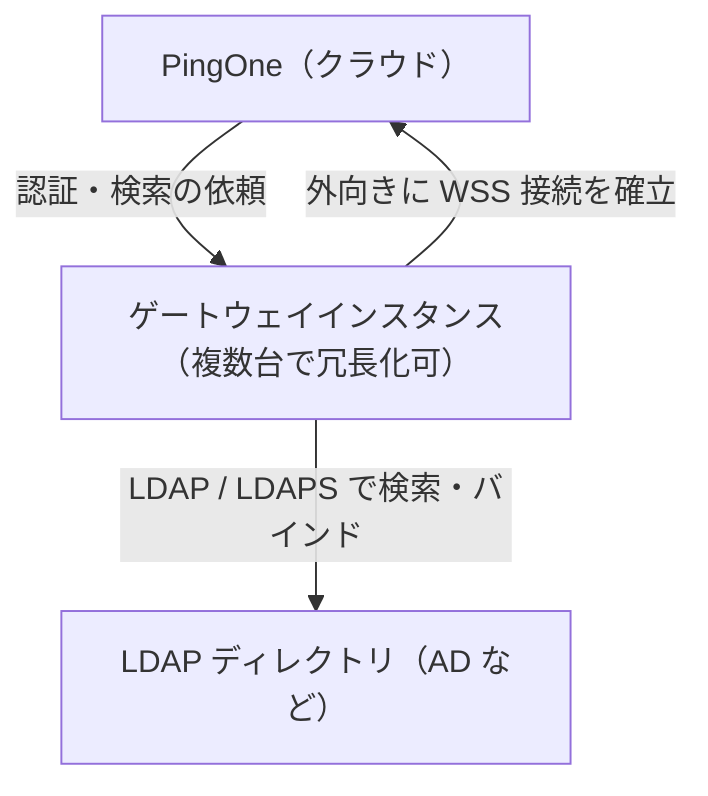
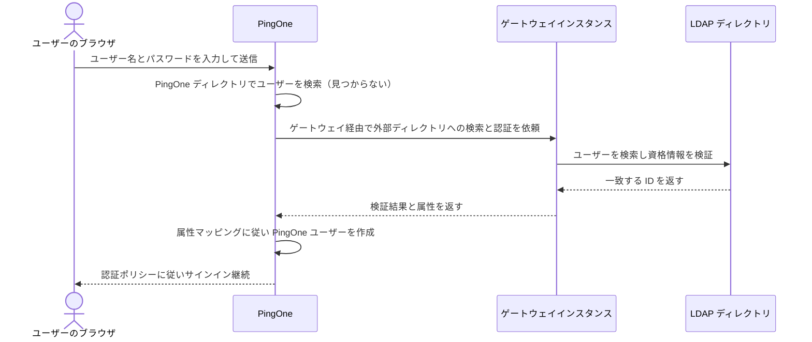

# 【勉強】Ping Identity — Active Directory／LDAP 連携（LDAP ゲートウェイ・ユーザータイプ・初回認証での移行）（2026-10-09）

## 今日のテーマ

オンプレミスの Active Directory（AD）などの LDAP ディレクトリと PingOne をつなぐ「LDAP ゲートウェイ」を学びます。Entra ID 編のハイブリッドID（Connect Sync・Cloud Sync）、Okta 編の AD 連携（Okta AD エージェント）と同じ立ち位置のテーマです。「ID の原本が社内ディレクトリにあるとき、PingOne にどう取り込み、パスワードをどこで検証するか」を整理します。

## 概要

PingOne の LDAP ゲートウェイは、PingOne が外部ディレクトリに保存されたユーザーを認証・認可するための仕組みです。公式ドキュメントでは、次の用途が挙げられています。

- 資格情報が外部ディレクトリにあるユーザーを PingOne で認証する。
- ゲートウェイ経由でサインオンしたユーザーを PingOne ディレクトリへ移行（マイグレーション）する（PingOne に存在しないユーザーのときだけ外部ディレクトリを確認します）。
- AD または PingDirectory との片方向・双方向の同期を、PingOne のプロビジョニング機能で行う（ゲートウェイ経由のプロビジョニングが対応するのは AD と PingDirectory のみ）。
- 外部ディレクトリの ID データを使って認可判断を行う。

なお、PingOne からの要求が、ゲートウェイの張った WSS 接続の上を通ると考えられますが、これは構成からの解釈で、公式に明記は確認できていません（要確認）。ファイアウォールのインバウンド開放が不要かどうかも、同様に断定しません。

ゲートウェイの実体は、ディレクトリの近くに置く小さなソフトウェア（ゲートウェイインスタンス）です。ネットワークの言葉で言えば「社内側から PingOne へ外向きに張る WebSocket Secure（WSS）接続の中継役」です。公式の前提条件ページには、ゲートウェイは LDAP サーバーへのネットワーク接続と、PingOne へ WSS 接続を確立するためのインターネット向けアウトバウンド通信が必要と書かれています。

下の図は全体像です。インスタンスが外向きに PingOne へ接続し、LDAP ディレクトリには社内ネットワークで接続します。

## 押さえる要点

- **対応ディレクトリ**: PingDirectory、Microsoft AD（Kerberos あり・なし）、Oracle Directory Server Enterprise Edition、Oracle Unified Directory、CA Directory、IBM（Tivoli）Security Directory Server、そして LDAP v3 準拠のディレクトリサーバーです。AD 専用ではありません。
- **動作環境**: Docker コンテナ、スタンドアロン Java アプリ、Windows アプリのいずれかで動きます。専有リソースは 2 CPU、RAM 1 GB、ストレージ 1 GB。Java で動かす場合は Java 21 LTS または Java 25 LTS が必要です。OS は問いません。
- **管理者権限**: セットアップする管理者には Environment Admin ロールが必要です。
- **ゲートウェイ資格情報**: ゲートウェイを保存すると PingOne が資格情報を生成します。パスワードのようなものとして扱い、PingOne 側では保存しないため、その場で控えます。紛失したら再発行できます。
- **ユーザータイプ（User Type）**: 外部ディレクトリ側のユーザーのカテゴリを定義する設定です。外部認証を認証ポリシーで使うには定義が必要で、ポリシーには「ゲートウェイとユーザータイプの組」を追加します。
- **パスワード権限（Password Authority）**: ユーザータイプごとに「PingOne」か「LDAP」を選びます。PingOne を選ぶと、初回だけ外部ディレクトリで認証し、以降は PingOne で認証します。LDAP を選ぶと、パスワード確認は常にゲートウェイ経由で外部ディレクトリが行います。
- **ユーザーの紐付け（User Link Attributes）**: `dn` や `sAMAccountName` などの LDAP 属性で PingOne ユーザーと LDAP ユーザーを結び付けます。複数指定すると、上から順に OR 検索されます。

## 手順や設定のイメージ

公式の手順の流れは次のとおりです（Setting up an LDAP gateway より）。

1. LDAP ゲートウェイを追加する。
2. ユーザータイプを追加する。
3. ゲートウェイインスタンスを起動する。
4. インスタンスを検証する。
5. （任意）ゲートウェイを使う認証ポリシーを作成する。
6. （任意）その認証ポリシーをアプリケーションに追加する。

ゲートウェイ追加時の主な設定項目です（PingOne 管理コンソールの Integrations → Gateways から追加）。

- **LDAP Host Name / Port**: 標準の LDAP は 389、TLS 接続は 636 が既定です。**Add LDAP Host** で複数台を登録すると、記載順に接続を試し、先頭が使えなければ次へフェイルオーバーします。
- **Connection Security**: TLS、StartTLS、None から選びます。既定の TLS が推奨です。
- **Bind DN / Bind Password**: ゲートウェイが使うサービスアカウントです。ユーザー名でユーザーを検索できる権限が必要です。
- AD を選ぶと、Kerberos 認証を有効にする項目（サービスアカウントの UPN とパスワードなど）が表示されます。

認証ポリシー側では、Login ステップの **Migrate Gateway Users Upon First Authentication** で「Add gateway user type」を押し、ゲートウェイとユーザータイプを選びます。

次の図は、PingOne ディレクトリにまだいないユーザーが初めてサインインする流れです。公式の記述（PingOne ディレクトリで見つからず、ゲートウェイが設定されていれば外部ディレクトリを確認し、一致すれば認証して ID を作成できる）に沿っています。

## つまずきやすいところ・注意点

- **LDAP ホストにロードバランサーを指定しない**: 公式は接続問題を避けるため、ロードバランサーのホスト名や IP を使わないよう注意しています。冗長化は「ホストを複数登録」で行います。
- **ゲートウェイインスタンスの冗長化**: 複数インスタンスは高可用性と拡張性のためです。PingOne は有効な接続を追跡し、負荷とレイテンシが低い接続を優先して振り分け、利用不可になったインスタンスは一覧から外されます。
- **資格情報の共有**: 1 つの資格情報を複数インスタンスで共有できますが、削除するとゲートウェイの通信が全て止まります。公式はインスタンスごとに別の資格情報を推奨しています。
- **パスワード権限を切り替えるときの影響**: LDAP から PingOne に変えると、次回サインイン時にパスワードが移行されます。PingOne から LDAP に変えると、PingOne 側のパスワードは削除されます。
- **属性更新は「全か無か」**: 「Update PingOne user attributes as users sign on」は、1 つでも更新に失敗すると全属性が更新されず、認証自体が失敗します。このオプションはパスワード権限が LDAP のときだけ使え、Kerberos 認証では更新されません。
- **認証ポリシーの編集不能**: ポリシー保存後に、選択したユーザータイプの「Enable migration of new users upon first authentication」を外すと、そのポリシー設定が編集できなくなります。再び有効にすれば戻ります。
- **ファイアウォール設計**: 公式は地域ごとの WSS アドレス（例: 米国は `wss://gateways.pingone.com/` など）と API エンドポイントを公開しています。具体的なポート番号は、確認したページに記載がなく**要確認**です。
- **プロキシ経由**: フォワードプロキシを使えますが、プロキシ自体が WebSocket に対応している必要があります。プロキシに資格情報を設定する場合は、ゲートウェイクライアント 3.3.0 以降が必要です。

## 今日のまとめ

**ミニ辞書**

- **LDAP ゲートウェイ**: PingOne と社内 LDAP ディレクトリをつなぐ中継の仕組み。
- **ゲートウェイインスタンス**: 社内に置く実行体。外向きに WSS で PingOne へ接続する。
- **ユーザータイプ**: 外部ディレクトリのユーザーの種類と、検索・紐付け・移行のルールをまとめた設定。
- **Password Authority**: パスワードの正をどちらに置くか（PingOne か LDAP）の選択。
- **JIT 的な移行**: 初回サインイン時に外部ディレクトリで認証し、PingOne ユーザーを作成する動き。

**理解度チェック**

1. ゲートウェイがアウトバウンド接続を張る設計は、社内ファイアウォールの設定にどう効きますか。
2. Password Authority を「PingOne」にした場合と「LDAP」にした場合で、初回後のサインインの検証先はどう違いますか。
3. LDAP ホストにロードバランサーを使わず、複数のホストを登録するのはなぜですか。

## 参考リンク

- [LDAP gateways](https://docs.pingidentity.com/pingone/integrations/p1_ldap_gateways.html)
- [Setting up an LDAP gateway](https://docs.pingidentity.com/pingone/integrations/p1_gateways_overview.html)
- [Before configuring an LDAP gateway](https://docs.pingidentity.com/pingone/integrations/p1_gateway_prereqs.html)
- [Adding an LDAP gateway](https://docs.pingidentity.com/pingone/integrations/p1_add_ldap_gateway.html)
- [Adding a user type](https://docs.pingidentity.com/pingone/integrations/p1_add_a_user_type.html)
- [Creating an authentication policy that uses the gateway](https://docs.pingidentity.com/pingone/integrations/p1_create_auth_policy_using_the_gateway.html)
- [Configuring multiple gateway instances (LDAP)](https://docs.pingidentity.com/pingone/integrations/p1_configure_multiple_gateways_ldap.html)
