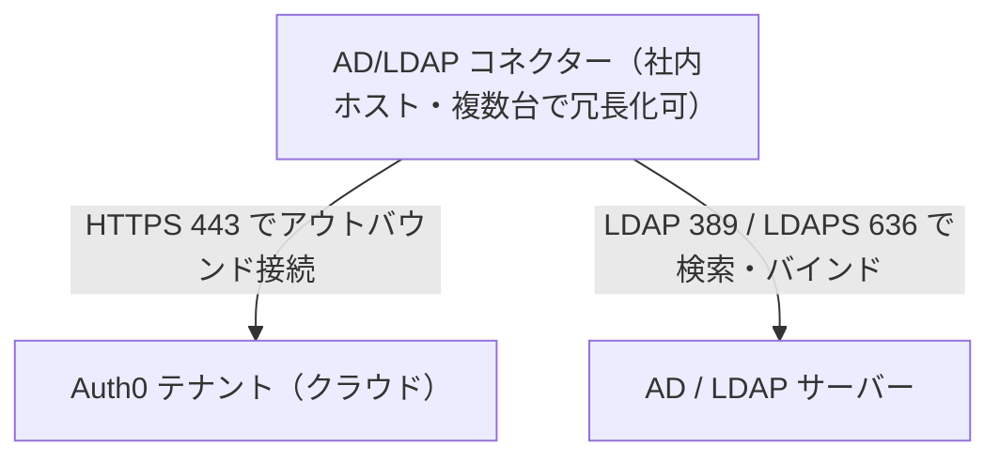
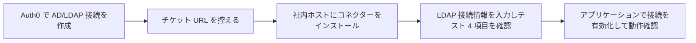

# 【勉強】Okta Customer Identity Cloud (Auth0) — Active Directory／LDAP 連携（AD/LDAP コネクター・キャッシュ・高可用性）（2026-10-12）

## 今日のテーマ

オンプレミスの Active Directory（AD）や LDAP ディレクトリを Auth0 につなぐ「AD/LDAP コネクター」を学びます。Entra ID 編のハイブリッドID、Okta Workforce 編の Okta AD エージェント、Ping Identity 編の LDAP ゲートウェイと同じ立ち位置のテーマです。「社内ディレクトリにあるユーザーに、Auth0 経由でどうサインインさせるか」を整理します。

## 概要

AD/LDAP コネクターは、社内ネットワークに置くソフトウェアで、オンプレミスの AD／LDAP サーバーと Auth0 のクラウドサービスをつなぐ橋渡し役です。AD／LDAP は通常、社内ネットワークに閉じているため、クラウドの Auth0 から直接は届きません。そこで社内側にコネクターを置き、コネクターのほうから Auth0 へ接続します。

公式ドキュメントによると、Auth0 でユーザーが認証するとコネクターへ誘導され、コネクターが AD サービスに対して検証し、結果を Auth0 に返します。対応する認証方式は LDAP、Kerberos、クライアント証明書の 3 つです。

ネットワークの観点では、コネクターからの接続はすべて Auth0 に向けたアウトバウンドです。そのため、ファイアウォールの変更は通常不要とされています。ただし Kerberos またはクライアント証明書を使う場合は、ユーザーのブラウザがコネクターのホストへ直接つなぎに来るため、インバウンドの 443 番ポートが必要になります（後述）。

次の図は基本構成です。

## 押さえる要点

- **用途の範囲**: 自社が管理する AD／LDAP のためのものです。取引先（顧客）のサーバーにコネクターを入れ、自社の Auth0 ドメインへ直接つなぐ構成は、Auth0 が推奨せずサポート外としています（顧客のパスワードを自社が直接扱うことになるため）。B2B で顧客の企業認証を使うときは、顧客側のフェデレーション（SAML IdP など）へのエンタープライズ接続が推奨です。
- **ディレクトリの種類**: 既定は Active Directory 向けに最適化されています。OpenLDAP など他の LDAP では、`config.json` の `LDAP_USER_BY_NAME`、`LDAP_SEARCH_QUERY`、`LDAP_SEARCH_ALL_QUERY` を書き換えます（例: `(cn={0})`。環境によっては `cn` より `uid` が合う場合があります）。
- **キャッシュ**: コネクターはユーザープロファイルと資格情報をキャッシュし、Auth0 側にはパスワードのハッシュが保存されます。キャッシュはログインのたびに更新され、使われるのはコネクターが停止・到達不能なときだけです。ダッシュボードで資格情報のキャッシュを無効にしない限り、常に有効です。キャッシュ値は大文字小文字を区別するため、キャッシュと同じ表記のユーザー名でないとログインできません。
- **接続の作成時オプション**: 接続名（作成後は変更不可）、表示名、ロゴ URL、IdP ドメイン（Lock ウィジェットで使う場合のみ必要）、Disable cache、クライアント SSL 証明書認証、Kerberos（IP 範囲を指定。範囲内のユーザーが Kerberos、範囲外は AD／LDAP のユーザー名とパスワード入力になる）、「Sync user profile attributes at each login」があります。
- **プロビジョニングチケット URL**: 接続の作成後に表示され、このコネクターを Auth0 上で一意に識別します。README は共有しないよう注意しています。
- **コネクターと接続の対応**: コネクターはチケット URL によって Auth0 上の特定の接続に結び付きます。要件ページには、テナントごと・AD／LDAP 接続ごとに専用のコネクターが必要で、複数のコネクターが同じディレクトリを指すことは可能だが、各コネクターが担当するのは 1 テナント内の 1 接続だけ、という趣旨の記載があります（接続を増やすときはコネクターも別に用意する、と理解してよさそうですが、細部は要確認です）。

## 手順や設定のイメージ

全体の流れです。

**システム要件（公式）**: x86／x86-64、CPU は最小 1 コア（推奨 2）、RAM 2 GB 以上、空きディスク 500 MB。OS は Windows または Linux で、Kerberos を使うなら Windows が必須です（Windows Server 2016 や 2019 が例示され、2012 R2 も対応）。ホストの時計は NTP で自動同期させる必要があり、ずれていると起動せずクロックスキューのエラーになります。サービスアカウントには、ディレクトリへの読み取り権限を持つドメインユーザーを用意します。

**Windows の場合**

1. Auth0 Dashboard の Authentication > Enterprise > Active Directory / LDAP で接続を選び、Setup タブの Install For Windows から MSI を取得して、Windows サービスとしてインストールします。
2. インストール後にブラウザでローカルホストのページが開くので、チケット URL を入力します。
3. LDAP 接続文字列（例: `ldap://ldap.internal.contoso.com`。`ldaps` なら証明書が有効であること）、Base DN（例: `dc=contoso,dc=com`）、検索を実行できるユーザーの完全な DN とパスワードを入力して送信します。
4. Configuration Log に出る 4 つのテストが通ることを確認します。順に、LDAP サーバーへの TCP 接続、ユーザー名とパスワードでの LDAP バインド、そのユーザーでの検索権限、Auth0 サーバーへの接続です。

**Linux などの場合**は、公式手順では最新のコネクターパッケージを `/tmp` にダウンロードして `node server.js` を実行し、チケット URL を入力します。`config.json` に `LDAP_URL`、`LDAP_BASE`、`LDAP_BIND_USER`、`LDAP_BIND_PASSWORD` を書き、再度 `node server.js` を実行すると、`LDAP_BIND_PASSWORD` が暗号化された `LDAP_BIND_CREDENTIALS` に置き換わります。常駐化には systemd のユニットファイルが例示されています。管理 UI は `node admin/server.js` で起動し、`http://localhost:8357` で開きます。

**高可用性（複数台構成）**: まず 1 台目で設定し、`http://localhost:8357/#troubleshoot` の 4 テストが通ることを確認します。その設定ファイルをエクスポートし、2 台目以降はインストールだけして設定せず、エクスポートした設定をインポートします。Windows では「Auth0 AD/LDAP」と「Auth0 AD/LDAP Admin」の 2 つのサービスを再起動します。Auth0 は稼働中のコネクターのどれかにログイン処理を振り分け、1 台が障害でも他へ切り替えます。台数について、要件ページは多くの組織が 2 台構成にしていると述べています。

## つまずきやすいところ・注意点

- **プロキシ配下**: 公式は非推奨としています。初回セットアップの「Invalid Ticket」は、プロキシなどのネットワーク問題が最も疑われます。どうしても使うなら `HTTP_PROXY` を設定します。
- **Kerberos／クライアント証明書のときだけインバウンドが必要**: この場合、ユーザーのブラウザがコネクターのホストの 443 番ポートへ直接接続します。複数台なら、前段にネットワークロードバランサーを置き、`SERVER_URL` に公開アドレスを設定します。公式は、スティッキーセッションなしのラウンドロビンで足りるとしています。通常の LDAP 認証のみなら、ロードバランサーは不要です。
- **`config.json` の平文パスワード**: 初期は `LDAP_BIND_PASSWORD` が平文で書かれるため、ファイルの保護に注意が必要です（初回起動後は暗号化された値に置き換わります）。
- **キャッシュの落とし穴**: キャッシュはコネクター停止時のフォールバックです。AD 側でパスワードを変更・無効化した直後の挙動など、キャッシュと実データのずれについては、今回確認した公式ページに記載がないため**要確認**です。
- **時刻同期**: NTP がずれるとコネクターが起動しません。インフラ出身の方には馴染み深い、Kerberos と同じ類の落とし穴です。
- **ユーザープロファイルの保存**: コネクターで認証したユーザーが Auth0 のユーザーストアにどう保存されるか（本日確認した公式ページには明記なし）は**要確認**です。確認できているのは「Sync user profile attributes at each login」で変更が Auth0 に反映されることまでです。

## 今日のまとめ

**ミニ辞書**

- **AD/LDAP コネクター**: 社内の AD／LDAP と Auth0 をつなぐ、社内設置のソフトウェア。
- **プロビジョニングチケット URL**: コネクターを Auth0 上の接続に結び付ける識別子。共有しない。
- **Base DN**: コネクターが検索を始めるディレクトリ上の起点。
- **LDAP_USER_BY_NAME**: ログイン時にユーザーを探す LDAP フィルター。既定は `(sAMAccountName={0})`。
- **Disable cache**: 資格情報キャッシュを無効にする設定。

**理解度チェック**

1. コネクターの通信が基本アウトバウンドだけだと、社内ファイアウォールの設定にどう効きますか。また、例外はどのときですか。
2. キャッシュが使われるのはどんなときで、なぜ大文字小文字に注意が必要ですか。
3. 高可用性のために 2 台目のコネクターを追加するとき、なぜ「設定せずにインポート」するのですか。

## 参考リンク

- [AD/LDAP Connector](https://auth0.com/docs/authenticate/identity-providers/enterprise-identity-providers/active-directory-ldap/ad-ldap-connector)
- [Connect Your App to Active Directory using LDAP](https://auth0.com/docs/authenticate/identity-providers/enterprise-identity-providers/active-directory-ldap)
- [Install and Configure AD/LDAP Connector](https://auth0.com/docs/authenticate/identity-providers/enterprise-identity-providers/active-directory-ldap/ad-ldap-connector/install-configure-ad-ldap-connector)
- [AD/LDAP Connector System Requirements](https://auth0.com/docs/authenticate/identity-providers/enterprise-identity-providers/active-directory-ldap/ad-ldap-connector/ad-ldap-connector-requirements)
- [High Availability and Multiple Connectors](https://auth0.com/docs/authenticate/identity-providers/enterprise-identity-providers/active-directory-ldap/ad-ldap-connector/ad-ldap-high-availability)
- [AD/LDAP Connector config.json schema](https://auth0.com/docs/authenticate/identity-providers/enterprise-identity-providers/active-directory-ldap/ad-ldap-connector/ad-ldap-connector-config-file-schema)
- [auth0/ad-ldap-connector (GitHub)](https://github.com/auth0/ad-ldap-connector)
