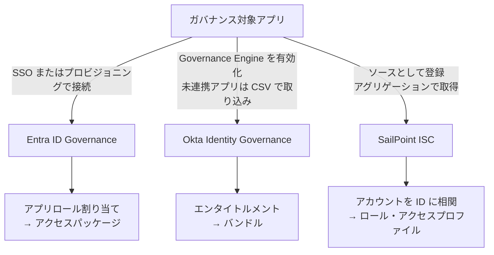
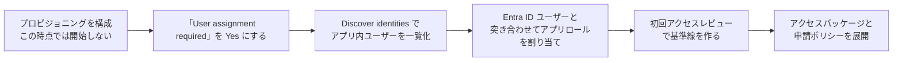

# 【勉強】IGA（アイデンティティガバナンス＆管理）— アプリ連携（ガバナンス対象アプリのオンボーディング）（2026-10-13）

## 今日のテーマ

「ガバナンス対象アプリのオンボーディング（アプリ連携）」を学びます。IGA は、アプリの中にある「誰が何を持っているか」を知らなければ、レビューも申請も SoD も何もできません。今日は、その情報を IGA に取り込む入口を見ます。

## 概要

これまでの IGA の回は、アクセスレビュー、申請、SoD、JML、ロール設計と、「ルールと運用」の話でした。今日は、その前提になる**データの入口**です。IGA 製品は、対象アプリのユーザーと権限（エンタイトルメント）の一覧を自分の側に持って初めて、レビューや申請の対象にできます。

インフラの感覚に置き換えると、CMDB に資産が登録されていなければ棚卸しも変更管理もできないのと同じです。**アプリを IGA に登録し、中のアカウントと権限を取り込み、人（ID）と結びつける**。この作業が、ガバナンスの土台になります。

押さえたい点は、取り込みの方法が製品ごとに違うことです。Entra ID Governance は「Entra ID に統合したアプリ（SSO やプロビジョニングなど）」を基本の対象にし（統合しないアプリも制限付きで使えます）、Okta Identity Governance は「Governance Engine を有効にしたアプリ」を対象にし、SailPoint Identity Security Cloud（ISC）は「ソース」から定期的にデータを集める（アグリゲーション）方式です。

下の図は、3製品の取り込みの考え方を並べたものです（概念の整理用で、公式の図ではありません）。

## 押さえる要点

### Microsoft Entra ID Governance: 先に Entra ID につなぐ

Microsoft の公式ドキュメントでは、Entra ID Governance を使うには、アプリが次のどちらかを満たして Entra ID に統合されている必要があると説明されています。

- アプリのフェデレーション SSO を Entra ID が担い、トークン発行を制御している。
- アプリが、Entra ID から渡されるユーザー／グループの一覧に依存している（SCIM によるプロビジョニング、Microsoft Graph への問い合わせ、AD の Kerberos によるグループ取得など）。

どちらも満たさないアプリにも IGA は使えますが、制限があります。例えば、Entra ID にいないユーザーや、アプリロールに割り当てられていないユーザーは、アクセスレビューに含まれません。

オンプレミスのアプリには、**プロビジョニングエージェント**を使う方法があります。公式が挙げる接続先は、SCIM ベースのアプリ、SQL データベース、LDAP ディレクトリ、SOAP／REST の Web サービス、MIM のカスタムコネクター、SAP ECC です。

### Okta Identity Governance: Governance Engine を有効にする

Okta では、アプリのインスタンスで **Governance Engine** を有効にします。Okta の公式ドキュメントによると、Governance Engine がアプリのエンタイトルメントの情報源になります（以前はアプリのユーザープロファイルが情報源でした）。

Okta のライフサイクル管理（LCM）と完全には連携していない「切り離されたアプリ（disconnected app）」は、ユーザーとエンタイトルメントを **CSV でインポート**して、ガバナンスの対象にできます。

### SailPoint ISC: ソースをアグリゲーションして ID に相関させる

SailPoint ISC では、アプリを**ソース**として登録し、アカウントを定期的に取り込みます。これが**アカウントアグリゲーション**です。取り込んだアカウントは、**アカウント相関（Account Correlation）**で ID に結びつけます。ソースのアカウント属性と、ID の属性を比べて（演算は Equals）、一致すれば同じ人として扱います。

## 手順や設定のイメージ

### Entra ID: 既存ユーザーを取り込んで、最初のレビューをかける

すでに運用しているアプリでは、過去に手作業で付いた権限が残っています。Microsoft は、新しい申請ルールを有効にする前に、**既存ユーザーを一度レビューして基準線を作る**ことを推奨しています。

上の図は、公式の手順を簡略化した流れです。突き合わせの手順は次のとおりです。

1. プロビジョニングを構成する（まだ開始しない）。
2. 属性マッピングで「Match objects using this attribute」を設定し、突き合わせのキーを決める。
3. プロビジョニングの概要ページで **Discover identities** を実行する。アプリ内のユーザーのうち、Entra ID のユーザーに一致するもの、すでに割り当て済みのもの、一致しないものが分かる。
4. 一致したユーザーに、アプリロールの割り当てを作る。公式が配布している PowerShell スクリプトに、`-DryRun` で先に結果を確認できるものがある。
5. もう一度 Discover identities を実行し、一致したユーザーがすべて割り当て済みか確認する。
6. 確認できたら、プロビジョニングを On にして開始する。

なお Discover identities は、プロビジョニングが構成済み（接続情報とテスト接続が成功している状態）のアプリが前提です。SSO だけを構成したアプリでは使えません。

### Okta: 切り離されたアプリを CSV で取り込む

1. アプリの General タブで、Identity Governance の Governance Engine を Enabled にする。
2. Import タブから **Import from CSV** を選び、テンプレートをダウンロードする。
3. エンタイトルメントの列名は `ent_<名前>` にする（名前に空白は使えない）。複数の値を持つ権限は、引用符で囲んで値をカンマで区切る。
4. アップロードして検証し、問題がなければインポートを実行して、対象ユーザーを選び、割り当てを確認（Confirm）する。

## つまずきやすいところ・注意点

- **Entra の「User assignment required?」が No のまま**: No だと、ディレクトリ内の全ユーザーがアプリを使えるため、アクセスレビューができません。Yes にします。
- **Entra はアプリ内のユーザーを自動ではロール割り当てにしない**: Discover identities で突き合わせ結果を出し、スクリプトなどで割り当てを作る必要があります。アプリにしかいないユーザーは、割り当てるまでレビューされません。プロビジョニングに対応しないアプリは、公式の別手順（Govern the existing users of an application that does not support provisioning）になります。
- **Entra の `isSoftDeleted` のマッピング**: これがないと、割り当てを外されたユーザーがアプリ側に残り続けます。
- **Okta ではプロビジョニング設定済みの既存インスタンスに Entitlement Management を有効にできない**: 例外は、公式が別ページ（Enable Entitlement management）で挙げているアプリです。また、既存インスタンスで Governance Engine とプロビジョニングを併用すると、従来のプロビジョニングで作ったデータや関係を失うおそれがあり、特に Governance Engine が有効な状態でのインポート後に起きやすい、と公式は注意しています。新しいインスタンスを作るのが基本です。
- **Okta の CSV インポートは完全インポートのみ**: 差分（増分）のインポートはサポートされていません。
- **SailPoint の相関が合っていないと、アカウントが宙に浮く**: 相関できないアカウントは「未相関」になり、ID に結びつきません。公式は、ID にアクセスを付与する前に、未相関アカウントを解消するよう案内しています。相関設定を変えたら、最適化を無効にしたアグリゲーションを実行して、変更のないアカウントも再評価します。
- **SailPoint のアグリゲーションの種類**: 既定は最適化アグリゲーションで、変更のないアカウントはスキップされ、相関が再計算されません。差分アグリゲーションは対応するソースだけで使えます。
- **SailPoint のアカウント削除**: 取り込み時にソースから消えたアカウントを削除する設定では、削除の割合がしきい値を超えると、アグリゲーションが中止されます。

## 今日のまとめ

### ミニ辞書

- **オンボーディング（アプリ連携）**: アプリを IGA の管理対象にし、アカウントと権限を取り込むこと。
- **アプリロール割り当て（Entra）**: ユーザーとアプリのロールを結ぶ設定。レビューの対象になる。
- **Governance Engine（Okta）**: Okta Identity Governance でアプリのエンタイトルメントを管理する仕組み。
- **ソース（SailPoint）**: ISC がアカウントを取り込む接続先のアプリやシステム。
- **アグリゲーション**: ソースからアカウントなどを集める処理。
- **アカウント相関**: ソースのアカウントと ID を結びつける処理。
- **未相関アカウント**: どの ID にも結びつかなかったアカウント。

### 理解度チェック

1. Entra ID に直接つながっていない既存アプリで、アクセスレビューの対象にしたいとき、事前に何をしますか。
2. Okta で、LCM と完全には連携していないアプリの権限を、ガバナンスの対象にする方法は何ですか。
3. SailPoint ISC で、アカウントを ID に結びつける処理は何と呼びますか。結びつかないアカウントがあると、何が困りますか。

## 参考リンク

- [Govern access for applications in your environment（Microsoft Learn）](https://learn.microsoft.com/entra/id-governance/identity-governance-applications-prepare)
- [Integrating applications with Microsoft Entra ID and establishing a baseline of reviewed access（Microsoft Learn）](https://learn.microsoft.com/entra/id-governance/identity-governance-applications-integrate)
- [Govern an application's existing users（Microsoft Learn）](https://learn.microsoft.com/entra/id-governance/identity-governance-applications-existing-users)
- [Preparing for an access review of users' access to an application（Microsoft Learn）](https://learn.microsoft.com/entra/id-governance/access-reviews-application-preparation)
- [Discover identities（Microsoft Learn）](https://learn.microsoft.com/entra/identity/app-provisioning/how-to-account-discovery)
- [Configure a provisioning-enabled app（Okta Help Center）](https://help.okta.com/en-us/Content/Topics/identity-governance/em/config-provisioning-enabled-app.htm)
- [Import user entitlements from CSV（Okta Help Center）](https://help.okta.com/en-us/Content/Topics/identity-governance/em/import-user-entitlements.htm)
- [Entitlement Bundles（Okta Help Center）](https://help.okta.com/en-us/content/topics/identity-governance/em/entitlement-bundles.htm)
- [Roles（SailPoint Identity Security Cloud）](https://documentation.sailpoint.com/saas/help/access/roles.html)
- [Loading data（SailPoint Identity Security Cloud）](https://documentation.sailpoint.com/saas/help/accounts/loading_data.html)
- [Correlation（SailPoint Identity Security Cloud）](https://documentation.sailpoint.com/saas/help/accounts/correlation.html)
