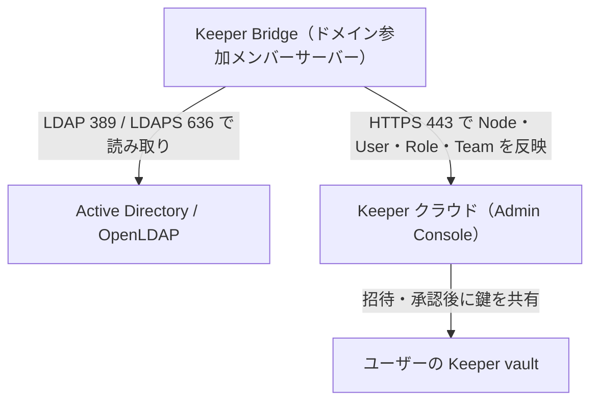
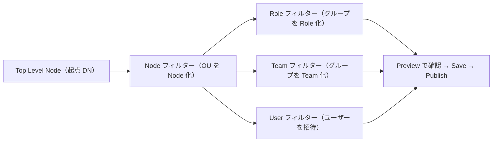

# 【勉強】Keeper — Active Directory／LDAP 連携（Keeper AD Bridge・ドメインフィルター・承認キュー）（2026-10-16）

## 今日のテーマ

オンプレミスの Active Directory（AD）や LDAP ディレクトリと Keeper をつなぐ「Keeper AD Bridge（以下 Bridge）」を学びます。Entra ID 編のハイブリッドID、Okta 編の AD エージェント、Ping 編の LDAP ゲートウェイ、Auth0 編の AD/LDAP コネクターと同じ立ち位置のテーマです。「ID の原本が社内ディレクトリにあるとき、Keeper にユーザーとチームをどう流し込むか」を整理します。

## 概要

公式ドキュメントでは、Bridge は Microsoft Active Directory または OpenLDAP をクラウドの Keeper（KeeperPAM と Keeper Enterprise）につなぎ、ユーザーのライフサイクルを自動化する仕組みと説明されています。Node（組織単位）、User、Role、Team を AD から Keeper に同期します。ディレクトリとは LDAP または LDAPS で通信します。単一ドメイン、マルチドメイン、マルチフォレストと、高可用性（HA）モードにも対応するとされています（HA の具体的な構成方法は今回確認できていないため、要確認です）。

インフラ出身の方向けにたとえると、Bridge は「社内のドメイン参加サーバー上で動くエージェント型の同期サービス」です。Keeper クラウドへは 443 で接続します（公式の要件）。通信の開始方向は公式に明記がなく、構成からの推測ですが、社内の Bridge がディレクトリを読み取って Keeper に反映する形で、Keeper 側がディレクトリへ直接問い合わせる構成ではないと考えられます（要確認）。

重要な注意が一つあります。**Bridge はプロビジョニング（アカウントやチームの用意）の仕組みで、AD のパスワードで Keeper の vault にログインさせる仕組みではありません。** ログインまで AD に寄せたいときは、別のアドオンである Keeper SSO Connect（AD FS 経由）を組み合わせます。

下の図は全体像です（矢印は「処理の主体から対象への働きかけ」を表します）。Bridge が社内でディレクトリを読み、Keeper クラウドへ反映します。



## 押さえる要点

- **動作環境**: Windows Server 2022 または 2025 のドメイン参加メンバーサーバーに入れます。ドメインコントローラー（DC）上への導入は非対応です。ドメイン機能レベルは Windows 2008 R2 以上が必要です。Tray アプリケーションと Windows サービスで構成されます。
- **ネットワーク**: ディレクトリへは 389 または 636、Keeper クラウドへは 443（データセンターにより keepersecurity.com または keepersecurity.eu）です。
- **アカウント**: ディレクトリの bind アカウントには、ドメインへの読み取り専用以上の権限があれば足り、特別な権限は不要です。
- **Keeper Admins グループ**: セキュリティグループ「Keeper Admins」のメンバーだけが Tray アプリにログインして設定できます。マルチドメインのフォレストではユニバーサルグループにし、グローバルカタログにメンバーがキャッシュされるようにします。
- **メール属性**: ディレクトリサービスの設定で Email Property を、通常は `mail` か `userPrincipalName` に合わせます。
- **ドメインフィルター**: AD のどのオブジェクトを Keeper に出すかを LDAP フィルターで決めます。Bridge の設定の中心です。次の節で詳しく見ます。

### 4 つのフィルターの役割

- **Top Level Node**: すべてのフィルターの起点となる DN のパスです。未設定ならドメインツリー全体が対象になります。
- **Node フィルター**: Admin Console 上のツリー構造を決めます。既定では Domain Controllers OU を除くすべての OU が Node になります。
- **Role フィルター**: 既定は空です（グループ名が組織ごとに異なるためです）。特定のセキュリティグループを Role にしたいときに定義します。Node フィルターで Node になった範囲のオブジェクトだけが返ります。なお全ユーザーには、AD ではなく Admin Console 側にある既定の Role が付きます。
- **Team フィルター**: 既定では、Node 内のすべてのセキュリティグループ（ローカル、グローバル、ユニバーサル）が Team になります。Team は Bridge を作った Node の配下に置かれます。
- **User フィルター**: 既定では、Node 内のユーザーオブジェクト（objectClass が user、objectCategory が Person）が対象です。Bridge は、ユーザーを所属グループに応じた Role と Team に割り当てます。

OU が Node として出力されていなければ、その中のオブジェクトは Role・Team・User のフィルターで指定しても出力されません。この「Node が先、他はその中から」の順序が最初のつまずきどころです。

下の図は、フィルターの適用順を示したものです。



## 手順や設定のイメージ

公式の手順の流れです（Setup Bridge on the Admin Console ほか）。

1. Bridge 用の Keeper 管理者アカウントを作ります。Bridge が Keeper クラウドに認証するためのもので、Bridge Node と、Node・User・Role・Team の管理権限が必要です。
2. Root Node の Administrative Permissions で「Cascade Node Permissions」を有効にします。
3. Bridge のホストからそのアカウントで Admin Console にログインし、2 要素の「Don't ask again on this device」を選びます。Settings → Security で「Stay Logged In」を有効にし、パスワードや 2 要素なしでログインできることを確認します。
4. Root Node の下に Node を作ります。Bridge は Root Node には登録できません。
5. その Node の Provisioning タブで「+ Add Method」から「Active Directory or LDAP Sync」を選びます。LAN／WAN IP の欄は空欄のまま保存します（登録時に自動で結び付くため）。
6. Provisioning タブに表示される Bridge の実行ファイルをダウンロードし、メンバーサーバーに置いてインストールします。
7. Bridge クライアントを起動し、Keeper Admins グループのメンバーでログインします。ドメイン参加済みの Windows では AD 認証、そうでなければ汎用 LDAP 認証が既定です。LDAPS（636）を使うなら SSL にチェックを入れます。マルチドメインのフォレストでは「Use Global Catalog」のチェックを外します。
8. ドメインフィルターを設定し、Preview でノードツリー、出力されるオブジェクト、総数を確認してから Save → Publish します。公開中は Bridge Log を見ます（.csv へのエクスポートや Windows イベントビューアーでの確認も可能）。

フィルターの例（公式ページの考え方に沿った書き方です。実環境の OU 名に合わせて調整してください）。

```text
# User フィルター: 特定グループのメンバーだけをKeeperに出す（ネストしたグループも含める）
(&(objectClass=user)(objectCategory=Person)(memberOf:1.2.840.113556.1.4.1941:=CN=Keeper-Users,OU=Groups,DC=example,DC=com))
```

`1.2.840.113556.1.4.1941` は AD の「入れ子グループを再帰的にたどる」ための照合ルール OID です。

## つまずきやすいところ・注意点

- **承認キュー（Approval Queue）**: Bridge や SCIM で作られた Team／User は、承認されるまで承認キューで待ちます。鍵を共有する処理が要るため承認が必要で、Bridge の場合は Team Key を各ユーザーの公開鍵で暗号化して配ります。Admin Console に管理者がログインする、Team メンバーが vault にログインする、Keeper Automator（バージョン 3.3 以降）を使う、Commander の `team-approve` を使う、のいずれかで完了します。
- **パスワードは別物**: 前述のとおり、Bridge は vault のログインを AD のパスワードに置き換えません。
- **同期後は手作業を控える**: 公式は、同期開始後は Admin Console で User や Team を手で変更せず、AD 側に任せることを勧めています。Role の強制ポリシーの変更だけは Admin Console で行います。
- **無効化と除外の動き**: AD で無効化されたユーザーは Bridge によってロックされます。ユーザーが Role フィルターの対象から外れた場合も、アカウントはロックされ、削除は Keeper 管理者に委ねられます。つまり「自動で消える」のではなく「ロックして人の判断を待つ」設計です。
- **Domain Users の落とし穴**: 主グループが Domain Users のユーザーは、その所属が `memberOf` ではなく `primaryGroupID`（RID 513）に入っているため、`memberOf` の検索に出ないことがあります。`primaryGroupID=513` の条件で拾えます（公式の例は、この条件だけの User フィルターです）。
- **Role と Team は同じグループを使う**: 両方ともセキュリティグループを対象にするため、フィルターを変えるときは互いへの影響に注意します（公式も両者が同じ対象を扱う点に触れています）。
- **Users コンテナ**: 既定の Users コンテナ（OU ではない）にユーザーがいる場合、Node フィルターで cn を指定して含めます。公式は、可能なら OU への変換を検討するよう促しています。

## 今日のまとめ

### ミニ辞書

- **Keeper Bridge（AD Bridge）**: AD／OpenLDAP の Node・User・Role・Team を Keeper に同期する、社内設置の Windows サービス。
- **Node**: Keeper の組織階層の単位。AD の OU に対応づけられる。
- **ドメインフィルター**: AD のどのオブジェクトを Keeper に出すかを決める LDAP フィルター群。
- **承認キュー**: 鍵の共有を待つ Team／User が並ぶ場所。
- **Keeper Admins グループ**: Bridge の Tray アプリにログインできる AD のセキュリティグループ。
- **Keeper SSO Connect**: AD FS などを使って vault ログインまで IdP に寄せるアドオン。Bridge とは役割が別。

### 理解度チェック

1. Bridge を DC 上ではなく、どこに入れる必要がありますか。また、Keeper クラウド側とディレクトリ側でそれぞれ使うポートは何ですか。
2. Role フィルターが既定で空なのはなぜですか。また、OU が Node として出力されていないと何が起きますか。
3. AD で無効化されたユーザーは、Keeper 側でどう扱われますか。AD のパスワードで vault にログインさせたい場合は、何を追加で使いますか。

## 参考リンク

- [Active Directory Provisioning（Keeper Docs）](https://docs.keeper.io/enterprise-guide/user-and-team-provisioning/syncing-active-directory-or-ldap)
- [LDAP Provisioning（Keeper Docs）](https://docs.keeper.io/enterprise-guide/user-and-team-provisioning/ldap-provisioning)
- [Keeper AD Bridge 概要（Keeper Docs）](https://docs.keeper.io/keeper-bridge)
- [Prerequisites（Keeper Docs）](https://docs.keeper.io/en/keeper-bridge/prerequisites)
- [Setup Bridge on the Admin Console（Keeper Docs）](https://docs.keeper.io/keeper-bridge/ad-bridge-on-the-admin-console)
- [Authenticate to the Bridge Client（Keeper Docs）](https://docs.keeper.io/en/keeper-bridge/configure-the-bridge-client)
- [Domain Filters（Keeper Docs）](https://docs.keeper.io/keeper-bridge/domain-filters)
- [Logging（Keeper Docs）](https://docs.keeper.io/keeper-bridge/logging)
- [Custom LDAP Filters（Keeper Docs）](https://docs.keeper.io/keeper-bridge/custom-role-filters)
- [Team and User Approvals（Keeper Docs）](https://docs.keeper.io/enterprise-guide/user-and-team-provisioning/approval-queue)
