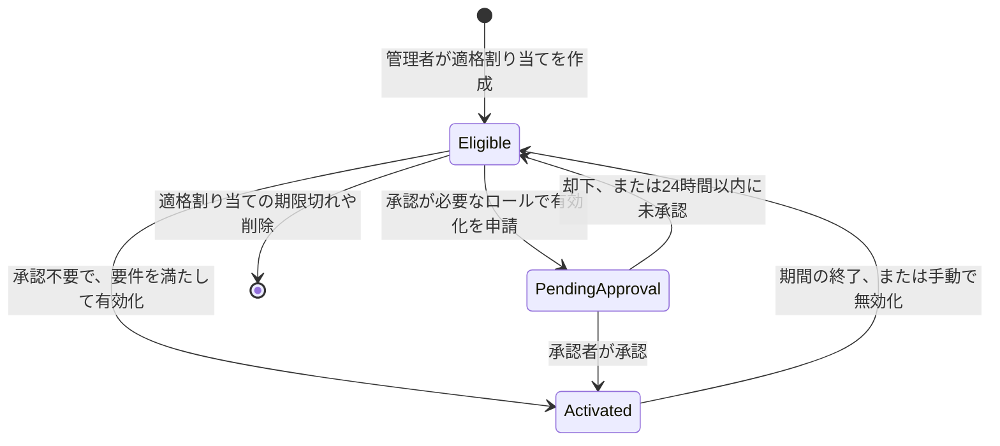
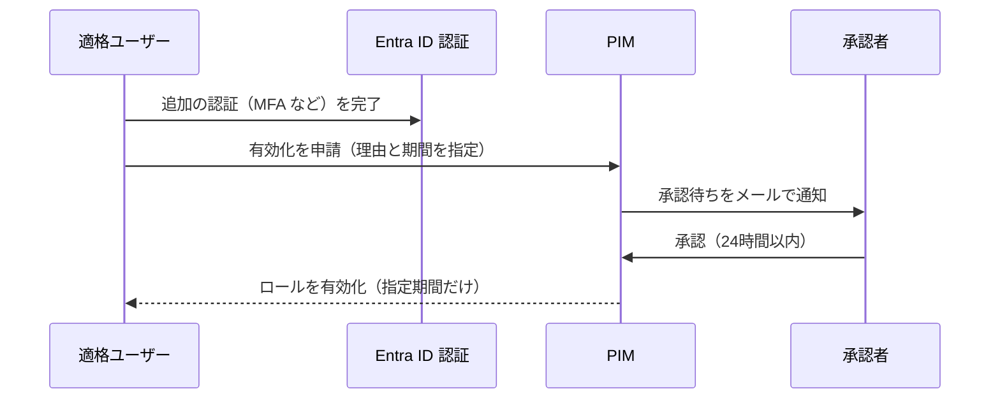

# 【勉強】Microsoft Entra ID — 管理者ロールと PIM（Privileged Identity Management）による Just-in-Time 権限（2026-10-18）

## 今日のテーマ

Microsoft Entra ID の管理者ロールと、それを「必要なときだけ」使えるようにする Privileged Identity Management（PIM）を学びます。ユーザー／グループ管理や条件付きアクセスの回で触れた「誰に何をさせるか」のうち、テナントの設定そのものを触れる「特権」側の話です。

## 概要

Entra ID の管理者ロール（Global Administrator、User Administrator など）は、Microsoft Entra RBAC（ロールベースのアクセス制御）で割り当てます。公式のベストプラクティスは、最小権限の原則（必要な権限を、必要な範囲で、必要な期間だけ与える）を勧めています。

PIM は、この「期間」を守るためのサービスです。公式の説明では、Entra ID、Azure、Microsoft 365 などの重要なリソースへのアクセスを管理・制御・監視する機能で、Just-in-Time（JIT）の特権アクセス、開始・終了日つきの割り当て、有効化時の承認・MFA・理由入力、通知、アクセスレビュー、監査履歴のダウンロードなどを提供します。

インフラ出身の方向けにたとえると、sudo の常用をやめて、作業のたびに申請して一時的に昇格する運用を、Entra ID の管理者ロールで仕組みにしたものです。

ライセンスは Microsoft Entra ID P2 または Microsoft Entra ID Governance が必要です。公式によれば、適格割り当てや期限つき割り当てを持つユーザー、承認者、アクセスレビューの担当者などに必要です。また P2 や Governance のライセンスが切れると、適格割り当ては削除され、期限つきの active 割り当ては期限なしの active に変わります（恒久的な active 割り当ては影響を受けません）。実行中のアクセスレビューは終了し、PIM の設定も削除されます。

## 押さえる要点

- **適格（eligible）と有効（active）**: 適格は「有効化の操作をすれば使える権利」、active は「操作なしで常に使える権利」です。公式は、恒久的な割り当てと適格な割り当てで、得られる権限に差はないと説明しています。違いは、常時必要か、必要なときだけかという点です。
- **有効化（activate）**: 適格ユーザーが、MFA、理由の入力、承認の取得といった操作をして、ロールを使える状態にすることです。有効化後は、設定された期間だけ使えます。
- **期間（duration）**: 恒久（permanent）と期限つき（time-bound）があります。適格・active のどちらにも指定できます。
- **ロール設定（PIM ポリシー）**: ロールごとに独立して持ちます。同じロールの割り当ては、すべて同じ設定に従います。
- **PIM for Groups**: ロール割り当て可能なグループに適格なメンバー／オーナーを持たせる仕組みです。公式は、複数ロールを 1 回の有効化でまとめて使いたいときに使うとしています。

下の図は、割り当てが「適格」から「有効化」を経て元に戻る状態の流れです。



## 手順や設定のイメージ

**1. ロール設定を決める**（Privileged Role Administrator 以上で、Entra 管理センターの ID Governance → Privileged Identity Management → Microsoft Entra roles → Roles → 対象ロール → Role settings）。主な項目は次のとおりです。

- 有効化の最大期間: 1〜24 時間のスライダーで設定します（Role settings ページの記述）。なお Graph の PIM API 概要には「最大 8 時間」という記述も残っており、公式内で食い違っています。実際の上限は自分のテナントのロール設定で確認してください（要確認）。
- 有効化時に MFA を要求する、または条件付きアクセスの認証コンテキストを要求する。後者は認証強度（Authentication Strengths）や準拠デバイスなどと組み合わせられます。
- 理由（justification）やチケット情報を要求する。チケット番号は情報として記録するだけで、チケットシステムとの照合はされません。
- 承認を要求する。承認者は 2 人以上を推奨します。未指定なら、active な Privileged Role Administrator／Global Administrator が既定の承認者になります。
- 割り当て期間の上限（恒久を許すか、期限を強制するか）。

**2. 適格割り当てを作る**（Roles → Add assignments → ロールとメンバーを選び、Assignment type で Eligible を選択）。Microsoft Graph なら次のように作ります。

```http
POST https://graph.microsoft.com/v1.0/roleManagement/directory/roleEligibilityScheduleRequests
{
  "action": "adminAssign",
  "justification": "監査担当に Global Reader を付与",
  "roleDefinitionId": "f2ef992c-3afb-46b9-b7cf-a126ee74c451",
  "directoryScopeId": "/",
  "principalId": "<ユーザーのオブジェクトID>",
  "scheduleInfo": {
    "startDateTime": "2026-10-19T00:00:00Z",
    "expiration": { "type": "noExpiration" }
  }
}
```

**3. 利用者が有効化する**（My roles → Microsoft Entra roles → Activate）。API では、有効化は eligibility ではなく `roleAssignmentScheduleRequests` に `SelfActivate` を送ります。公式によれば、自分自身の有効化を API で行うには、MFA を通過したセッションで実行する必要があります。

```http
POST https://graph.microsoft.com/v1.0/roleManagement/directory/roleAssignmentScheduleRequests
{
  "action": "SelfActivate",
  "principalId": "<自分のオブジェクトID>",
  "roleDefinitionId": "<ロール定義ID>",
  "directoryScopeId": "/",
  "justification": "障害対応のため",
  "scheduleInfo": {
    "startDateTime": "2026-10-19T01:00:00Z",
    "expiration": { "type": "AfterDuration", "duration": "PT5H" }
  }
}
```

承認が必要な場合の流れは、次の図のとおりです（メール通知や承認の画面操作は PIM が担います）。



## つまずきやすいところ・注意点

- **承認ありで自分を締め出す**: 全員が適格で active な Global／Privileged Role Administrator がおらず、承認が必須で、承認者も未設定だと、テナントからロックアウトされます。緊急用アクセスアカウントと、具体的な承認者の設定で避けます。
- **承認の期限**: 承認者には 24 時間の猶予があり、設定は変えられません。過ぎると、申請者が出し直します。承認者は自分の申請を承認できません。
- **認証コンテキストの罠**: 認証コンテキスト用の条件付きアクセスポリシーは、先に作って有効にしておきます。「認証コンテキスト」と「ディレクトリロール」を同時に対象にした 1 つのポリシーを作ると、有効化の時点ではまだロールを持たないため効きません。また、有効化後に別の端末から同じロールを使われることを防ぎたいなら、ディレクトリロールを対象にした条件付きアクセスも別に作ります。
- **active 割り当てでは「使うときの MFA」を強制できない**: 適格ロールの有効化時には MFA を強制できます。一方 active 割り当ては、割り当てた時点からロールが有効なので、使う場面での MFA は PIM では強制できません。代わりに「active 割り当てを作る管理者に MFA を求める」設定があります。
- **直前の認証は使い回される**: 強い認証や直前の MFA があれば、有効化時に再認証を求められないことがあります。毎回求めたいなら、認証コンテキストの条件付きアクセスで、サインインの頻度を「Every time」にします。利用者が再認証すると 10 分の窓が開き、その間は Entra ロール・Azure リソースロール・PIM for Groups をまたいで、別ロールの有効化でも再認証されません。
- **最後の Global Administrator**: PIM は、最後の active な Global Administrator の割り当ての削除や、有効期限による削除を防ぎます。
- **割り当ての 5 分ルール**: 割り当ては、5 分未満の期間では作れず、作成から 5 分以内には削除できません。

運用の目安として、Global Administrator は 5 人未満、特権ロールの割り当ては 10 件未満、緊急用アクセス用のクラウド専用アカウントを 2 つ、というのが公式の推奨です。また、管理者ロールには、オンプレミスから同期したアカウントではなくクラウド専用のアカウントを使うよう勧めています。

## 今日のまとめ

### ミニ辞書

- **PIM**: 管理者ロールなどを JIT・期限つき・承認つきで使わせる Entra のサービス。
- **eligible／active**: 使うために操作が要る権利／常に使える権利。
- **activate**: eligible な人が操作をして、ロールを使える状態にすること。
- **ロール設定（PIM ポリシー）**: ロールごとの、MFA・承認・期間などの規則。
- **認証コンテキスト**: 有効化の瞬間に特定の条件付きアクセスを課すための仕組み。
- **緊急用アクセスアカウント**: 他の管理者が使えないときのための、クラウド専用の Global Administrator。

### 理解度チェック

1. eligible と active の割り当てで、得られる権限に差はありますか。違いは何ですか。
2. 承認を必須にした設定が、ロックアウトにつながるのはどんな条件のときですか。避けるには何を用意しますか。
3. 有効化時に必ず別の認証方法を求めたい場合、PIM のどの設定と、条件付きアクセスのどの機能を組み合わせますか。

## 参考リンク

- [What is Microsoft Entra Privileged Identity Management?](https://learn.microsoft.com/en-us/entra/id-governance/privileged-identity-management/pim-configure)
- [Configure Microsoft Entra role settings in Privileged Identity Management](https://learn.microsoft.com/en-us/entra/id-governance/privileged-identity-management/pim-how-to-change-default-settings)
- [Assign Microsoft Entra roles in Privileged Identity Management](https://learn.microsoft.com/en-us/entra/id-governance/privileged-identity-management/pim-how-to-add-role-to-user)
- [Approve or deny requests for Microsoft Entra roles in Privileged Identity Management](https://learn.microsoft.com/en-us/entra/id-governance/privileged-identity-management/pim-approval-workflow)
- [Best practices for Microsoft Entra roles](https://learn.microsoft.com/en-us/entra/identity/role-based-access-control/best-practices)
- [Microsoft Entra ID Governance licensing fundamentals](https://learn.microsoft.com/en-us/entra/id-governance/licensing-fundamentals)
- [Assign Microsoft Entra roles using PIM APIs](https://learn.microsoft.com/en-us/graph/tutorial-assign-azureadroles)
