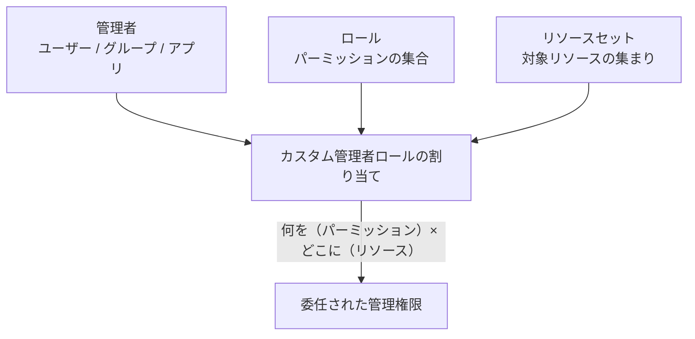
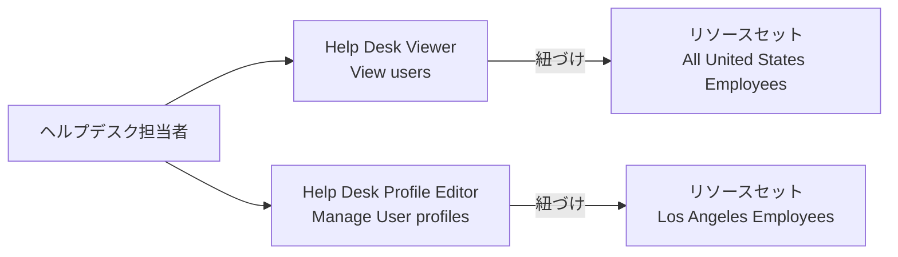

# 【勉強】Okta Workforce Identity Cloud — 管理者ロール（標準ロール・カスタムロール・リソースセット）（2026-10-19）

## 今日のテーマ

Okta Workforce Identity Cloud の「管理者ロール」を学びます。標準ロール（Super Admin など）と、権限と対象を自分で組み立てるカスタム管理者ロール、そして「誰に・どのロールを・どのリソースに」与えるかを表す割り当てモデルが中心です。Entra ID 編の「管理者ロール」の回に対応するテーマです。ただし PIM のような時間限定の昇格は今回の範囲外です。

## 概要

Okta の管理者ロールは、Admin Console（管理画面）や管理 API で何ができるかを決める仕組みです。インフラ出身の方には、OS の root と sudoers の関係に近いものと捉えると入りやすいです。全員に root を渡す代わりに、「このコマンドだけ」「このサーバーだけ」と範囲を切って委任します。

公式ドキュメントは、管理者ロールの割り当てを次の3つの部品で説明しています。

- **管理者（Admin）**: 権限を受け取る主体。ユーザー、ユーザーグループ、アプリ。
- **ロール（Role）**: 管理者の行動を制約する権限（パーミッション）の集合。標準ロールとカスタムロールがあります。
- **リソースセット（Resource set）**: ロールの権限が適用される対象リソースの集まり。

次の図は、カスタム管理者ロールの割り当てが3つの部品の組み合わせでできていることを表しています。

## 押さえる要点

- **標準ロール**: Okta があらかじめ用意したロールです。権限と対象が最初から決まっています。公式の比較表には Super Admin、Org Admin、Group Admin、App Admin、Read-only Admin、Mobile Admin、Help Desk Admin、Report Admin、API Access Management Admin、Group Membership Admin などが載っています。Okta Identity Governance が必要な Access Requests Admin と Access Certifications Admin、Admin Console に権限を持たない Workflows Administrator もあります。
- **スコープを絞れる標準ロール**: Group Admin、Help Desk Admin、Group Membership Admin は「全員」または「一部のグループ」に絞れます。App Admin は「すべてのアプリ」「特定のアプリタイプ」「特定のアプリインスタンス」に絞れます。
- **カスタムロール**: 権限を自分で選んで作るロールです。公式は、Super Admin や Org Admin への依存を減らし、必要な権限だけを渡せる点と、粒度の細かい権限が見えることで監査がしやすくなる点を利点に挙げています。
- **リソースセットはカスタムロール専用**: 標準ロールはリソースセットを使いません。
- **権限は加算される**: 標準ロールとカスタムロールは、ユーザー、グループ、アプリのいずれにも割り当てられます。複数ロールの権限は足し合わさります。
- **グループへの割り当て**: ロールをグループに割り当てると、そのグループのメンバー全員に適用されます。
- **アプリにも割り当てられる**: Okta API を呼ぶ独自のサービスアプリには、管理者ロールが自動では付かないため、明示的な割り当てが必要です。
- **上限**（公式表記）: ロールは最大100、リソースセットは最大10,000、1つのリソースセットのリソースは最大1,000、同じ「ロール × リソースセット」の組み合わせを共有できる管理者は最大1,000です。ロールの100に標準ロールを含むかは、ページの表記だけでは断定できないため「要確認」とします。

## 手順や設定のイメージ

### Admin Console でカスタムロールを作る

公式の手順（クラシックエンジン）は次のとおりです。Super Admin でサインインして進めます。

1. **Security > Administrators** を開く。
2. **Roles** タブを開き、**Create new role** をクリックする。
3. ロール名と説明（任意）を入れる。
4. 必要なユーザー権限とグループ権限を選ぶ。
5. 必要なら **Add conditions** で条件を付ける（公式では Early Access で、有効化には Okta サポートへの連絡が必要）。
6. **Save role** で保存する。

### リソースセットに管理者を割り当てる

1. **Security > Administrators** の **Resources** タブを開く。
2. 対象のリソースセットで **Edit** をクリックし、**View or edit assignments** を選ぶ。
3. 管理者（ユーザー、グループ、またはその両方）と、使うカスタムロールを選ぶ。
4. **Save changes** で保存する。

### ベストプラクティスの例（ヘルプデスク）

公式は「リソース起点で考える」ことを勧めています。まず管理者がアクセスするリソースを決め、そのあとでロールを決めます。公式のヘルプデスクの例では、全米の従業員を含むリソースセットと、ロサンゼルスの従業員だけのリソースセットを作ります。閲覧用ロール（View users）は前者に、編集用ロール（Manage User profiles）は後者に紐づけます。

この図は、1人の担当者に「全員を見られる閲覧ロール」と「一部だけ編集できる編集ロール」を別々に持たせ、それぞれ別のリソースセットに紐づけている構造を表しています。

### API で割り当てる場合

公式の API ガイドによると、標準ロールはユーザー、グループ、クライアント（アプリ）ごとの割り当て API で付与します。カスタムロールは次の3段階です。

1. カスタムロールを作成する。
2. リソースセットを作成する。
3. ロールとメンバーを結ぶリソースセットバインディング（resource set binding）を作成する。

リソースは Okta Resource Name（ORN）か Okta API の REST URL で識別します。たとえば、すべてのユーザーは `orn:{partition}:directory:{yourOrgId}:users`、特定のグループは `orn:{partition}:directory:{yourOrgId}:groups:{groupId}` です。`{partition}` は本番が `okta`、プレビューが `oktapreview` です。具体的な API のパスとリクエスト例は、今回の調査では一次情報で確認できていないため、公式の各操作ページで確認してください（要確認）。

## つまずきやすいところ・注意点

- **Super Admin 限定の操作がある**: 管理者の追加・削除・閲覧、Okta サポートへのアクセス許可、機密属性・ログストリーミング・フック・ラベルの管理、Admin Dashboard の MFA 有効化、ポリシー内の MFA オーセンティケーターの編集は Super Admin だけです。
- **グループへの管理者権限付与も Super Admin だけ**: 管理者権限を持つグループへのユーザー追加と、そのグループの管理も Super Admin に限られます。
- **カスタムロールで Super Admin は触れない**: カスタム管理者ロールを持つ主体は、どんな権限があっても、他の主体の `SUPER_ADMIN` を追加・削除できません。
- **Group Admin の癖**: 管理者ロールが割り当てられたグループは、Group Admin では変更できなくなります。
- **ビューと編集は別ロールで**: 「全ユーザーを閲覧」したいなら、全ユーザーを含むリソースセットを明示的に作る必要があります。
- **AD／LDAP グループの見分け**: AD や LDAP のグループ・ユーザーのリソースにはグループの出所が含まれず、同名のグループは UI で区別できません。
- **レポートは UI のみ**: 管理者ロールの割り当てレポートは Admin Console の専用ページでしか使えません。API でのレポートは非対応です。
- **Workflows は別枠**: カスタム管理者ロールでは Okta Workflows を管理できません。

## 今日のまとめ

### ミニ辞書

- **標準ロール**: 権限と対象が固定された、Okta 標準の管理者ロール。
- **カスタム管理者ロール**: 権限を選んで作る管理者ロール。
- **リソースセット**: カスタムロールの権限が及ぶ対象の集まり。
- **ORN（Okta Resource Name）**: リソースを一意に指す識別子。
- **最小権限**: 必要な権限だけを、必要な範囲に与える原則。

### 理解度チェック

1. 管理者ロールの割り当てを構成する3つの部品は何ですか。
2. リソースセットを使えるのは標準ロールとカスタムロールのどちらですか。
3. 「全ユーザーは閲覧のみ、ロサンゼルスの従業員だけプロフィール編集」を実現するには、ロールとリソースセットをそれぞれ何個作りますか。

## 参考リンク

- [Custom admin roles](https://help.okta.com/en-us/Content/Topics/Security/custom-admin-role/custom-admin-roles.htm)
- [Use standard roles](https://help.okta.com/en-us/Content/Topics/Security/custom-admin-role/use-standard-roles.htm)
- [Use custom admin roles](https://help.okta.com/en-us/Content/Topics/Security/custom-admin-role/about-creating-custom-admin-roles.htm)
- [Standard administrator roles and permissions](https://help.okta.com/oie/en-us/content/Topics/security/administrators-admin-comparison.htm)
- [Best practices for creating a custom role assignment](https://help.okta.com/en-us/Content/topics/security/custom-admin-role/best-practices-custom-admin-roles.htm)
- [Create a role](https://help.okta.com/en-us/Content/Topics/Security/custom-admin-role/create-role.htm)
- [Create an admin assignment using a resource set](https://help.okta.com/en-us/content/topics/security/custom-admin-role/create-admin-role-assignment-by-resource-set.htm)
- [Roles in Okta（API ガイド）](https://developer.okta.com/docs/api/openapi/okta-management/guides/roles)
