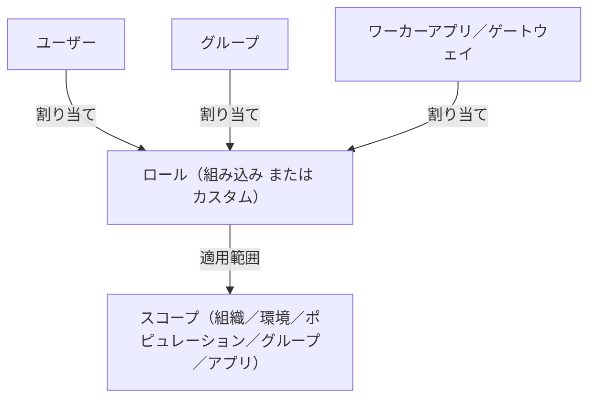
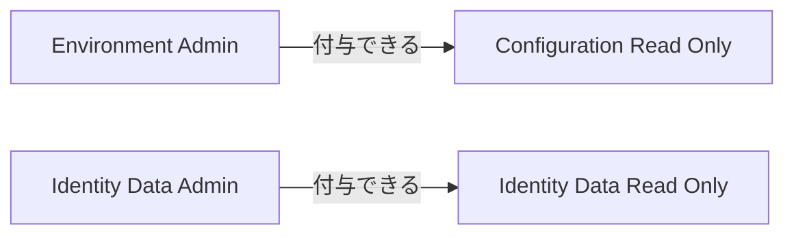

# 【勉強】Ping Identity — 管理者ロール（組み込みロール・カスタムロール・グループ割り当て）（2026-10-20）

## 今日のテーマ

PingOne の「管理者ロール」を学びます。誰に（ユーザー・グループ・アプリ）、どの権限セット（ロール）を、どの範囲（スコープ）で与えるか、という管理者権限の設計の話です。Entra ID 編の管理者ロールと PIM、Okta 編の管理者ロール（標準ロール・カスタムロール・リソースセット）と同じテーマの Ping 版です。

## 概要

PingOne では、管理コンソールや管理 API を操作できる人を「ロールの割り当て」で決めます。公式ドキュメントでは、ロールは組み込み（built-in）とカスタムの2種類で、ユーザー、グループ、ワーカーアプリケーション、PingFederate ゲートウェイに割り当てられます。割り当ては組織、環境（Environment）、ポピュレーション（Population）、グループ、アプリケーションのいずれかのレベルで行いますが、ロールによって選べるレベルは異なります。

インフラ視点で言えば、「ロール＝権限セット」「スコープ＝適用範囲」「割り当て＝誰にそれを付けるか」の3点セットです。オンプレの sudoers で「誰が・どのコマンドを・どのホスト群に」を決める感覚に近いです。

下の図は、割り当ての構造です（ロールと、割り当て先、スコープの関係）。



## 押さえる要点

- **組み込みロールは変更できません。** 公式に「組み込みロールは変更できない」とあり、調整したいときは複製してカスタムロールにします。
- **主な組み込みロール**（公式の説明を要約）:
  - Organization Admin: 組織全体を管理し、組織と環境の作成・編集・削除ができます。
  - Environment Admin: 環境を管理するロールです。
  - Identity Data Admin: ユーザー ID の管理（ユーザー作成やパスワードリセットなど）。
  - Help Desk Admin: MFA 方式・デバイスの管理と、パスワードリセットなどのロックアウト解消。
  - Client Application Developer: API クライアントアプリの作成・削除やシークレットのリセット。
  - Application Owner: 割り当てられたアプリだけを管理します。他の管理権限は持ちません。
  - Configuration Read Only / Identity Data Read Only: それぞれ Environment Admin / Identity Data Admin の読み取り専用版です。
- **委任のルール**: 自分が持っているロール、または割り当て権限を含むロールしか付与できません。たとえば Configuration Read Only は Environment Admin または Configuration Read Only の保持者が、Identity Data Read Only は Identity Data Admin または Identity Data Read Only の保持者が割り当てられます。
- **グループ単位の割り当て**: 管理者ロールをグループのレベルでも割り当てられます。ユーザーを管理できる条件は、そのユーザーが属するポピュレーションかグループのどちらか一方に割り当てがあれば十分です。
- **カスタムロール**: 環境レベルのリソースで、権限（permissions）の集合です。`applicableTo`（適用できるスコープ種別）、`canBeAssignedBy`（誰が割り当てられるか）、`permissions` が主な項目です。作成・更新・削除には Custom Role Admin 権限が必要で、Organization Admin と Custom Role Admin ロールに含まれます。

次の図は委任の例です。上位ロールの保持者が読み取り専用ロールを付与できます（読み取り専用ロールの保持者自身も同じロールを付与できます）。なお、ロールごとに選べるスコープは異なります。



## 手順や設定のイメージ

管理コンソールでユーザーにロールを付ける流れです（公式手順の要約）。

1. Administrators 環境に移動する（公式は管理者をここで管理することを推奨しています）。
2. Directory → Users でユーザーを探し、詳細パネルを開く。
3. Roles → Administrator Roles タブで Grant Roles をクリックする。
4. Available Responsibilities でロールを選び、適用する環境にチェックを入れる。
5. 範囲を絞るときは Reduce Access アイコンから、アプリケーションまたはポピュレーションを指定する。
6. Save を押す。結果は Granted Responsibilities タブに出ます。

Terraform（pingone プロバイダー）では、公式チュートリアルがグループへの割り当てを例にしています。

```hcl
module "admin_utils" {
  source         = "pingidentity/utils/pingone"
  version        = "0.1.0"
  region_code    = "EU" # NA / EU / CA / AU / AP
  environment_id = var.pingone_admin_environment_id
}

resource "pingone_group_role_assignment" "env_admin" {
  environment_id       = var.pingone_admin_environment_id # グループがある環境（Administrators）
  group_id             = pingone_group.admins.id
  role_id              = module.admin_utils.pingone_role_id_environment_admin
  scope_environment_id = pingone_environment.target.id
}
```

`scope_*` 系の属性は、application / organization / environment / population のうちちょうど1つを指定します。ロール ID は、ユーティリティモジュールのほか `data "pingone_role"` で名前から引く方法もあります。

## つまずきやすいところ・注意点

- **Terraform ではロール ID をハードコードしません。** ユーティリティモジュールか `data "pingone_role"` で名前から引きます。
- **付与できるロールは自分の権限に依存します。** 自分が持たない、または割り当て権限のないロールは付与できません。
- **個人よりグループへの割り当てを推奨。** 公式は、ロールを個別ユーザーではなくグループに割り当て、メンバーシップを入社・異動・退職の運用で管理することを推奨しています。
- **管理者は Administrators 環境で管理。** エンドユーザーとの分離のためです。
- **カスタムロールの制約**: DaVinci ではカスタム管理者ロールがサポートされません。組織レベルで割り当てられるのは Administrators 環境の ID に限られます。

## 今日のまとめ

**ミニ辞書**

- **ロール**: 権限のセット。組み込みとカスタムがある。
- **スコープ（ジュリスディクション）**: ロールの適用範囲。組織・環境・ポピュレーション・グループ・アプリ。
- **Administrators 環境**: 管理者の ID をまとめて置く推奨の環境。
- **canBeAssignedBy**: カスタムロールを誰が割り当てられるかを決める項目。

**理解度チェック**

1. 組み込みロールの権限を少しだけ変えたいとき、どうしますか。
2. ヘルプデスクを特定ブランドのユーザーだけに限定したいとき、どのレベルの割り当てが使えますか。
3. Terraform で管理者権限をコード化するとき、ユーザー個別よりグループ割り当てが推奨されるのはなぜですか。

## 参考リンク

- [Administrator roles](https://docs.pingidentity.com/pingone/directory/p1_roles.html)
- [Adding roles to an administrator user](https://docs.pingidentity.com/pingone/getting_started_with_pingone/p1_add_roles_to_a_user_admin.html)
- [Custom roles API](https://developer.pingidentity.com/pingone-api/platform/roles/custom-roles.html)
- [Introducing PingOne administrator group role assignments](https://developer.pingidentity.com/blog/introducing-pingone-administrator-group-role-assignments/)
- [Terraform: role assignment tutorial](https://developer.pingidentity.com/terraform/products/pingone/tutorials/role_assignment.html)
