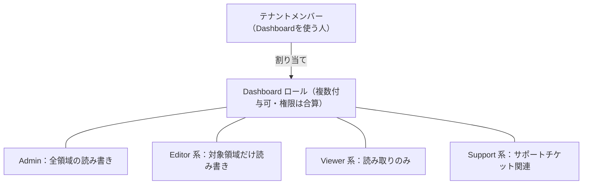
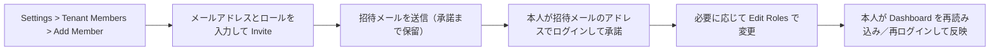

# 【勉強】Okta Customer Identity Cloud (Auth0) — 管理者ロール（Dashboard のテナントメンバーとロール）（2026-10-21）

## 今日のテーマ

Auth0（Okta Customer Identity Cloud）の「管理者ロール」を学びます。Auth0 では、Dashboard（管理コンソール）を操作できる人を「テナントメンバー」と呼び、メンバーごとに Dashboard 用のロールを割り当てます。Entra ID 編・Okta 編・Ping 編と同じ「管理者ロール」テーマの Auth0 版です。

## 概要

テナントメンバーとは、Auth0 Dashboard にアクセスする人（ダッシュボードユーザー）のことです。アプリのエンドユーザー（顧客）とは別の存在で、こちらは「Auth0 を運用する側」の人たちです。公式ドキュメントでは、メンバーの追加・変更・削除は、Auth0 Dashboard または Auth0 Teams Dashboard で行うとされています。

注意点は、ここで扱うロールが **Dashboard 用のロール**であることです。Auth0 のエンドユーザー側にも別途「ロール」の概念があるため（今日は扱いません）、本記事の Dashboard ロールとは区別して読んでください。

下の図は、テナントメンバーとロール、操作できる範囲の関係です。

## 押さえる要点

公式の「Dashboard Access by Role」に載っているロールは次の10種類です（概要の要約）。

- **Admin**: 拡張機能（extensions）を含め、Dashboard への読み書きを全面的に持ちます。
- **Editor - Connections**: すべての接続タイプ（Database・Social・Enterprise・Passwordless）の読み取り・書き込み・作成。
- **Editor - Key Management**: 暗号鍵の管理。General 設定は読み取りのみ。
- **Editor - Organizations**: Organization 設定を全面的に管理。Users・Roles・Connections は読み取りのみ。
- **Editor - Specific Apps**: 特定のアプリケーションと SSO Integrations だけを更新できます（アプリの新規作成は不可）。
- **Editor - Users**: ユーザーの作成・削除・ブロック・ブロック解除・MFA やパスワードのリセット・メタデータ編集・ロール割り当て。ログはユーザー関連の一部のみ読み取り可。
- **Viewer - Users**: ユーザー、ロール、Organization、ユーザー関連ログの読み取り専用。
- **Viewer - Config Settings**: ほぼすべての設定の読み取り専用。シークレットは除外されます。
- **Support Access - Deprecated**: サポートチケットの作成・閲覧・更新と集計メトリクス（非推奨表記）。
- **Elevated Support Access**: テナント上の全ユーザーのサポートチケットの読み書き・作成と集計メトリクス。

補足として、どのロールでも Support Center にはアクセスできます。「Editor」は変更できる、「Viewer」は見るだけ、と読み分けると覚えやすいです。インフラで言えば、root（Admin）、特定サービスの運用担当（Editor 系）、監査・参照用アカウント（Viewer 系）の分け方に近い感覚です。

## 手順や設定のイメージ

メンバーの追加から権限変更までの流れです。

追加は Dashboard の Settings > Tenant Members から行います。Add Member をクリックし、メールアドレスを入力して1つ以上のロールを選び、Invite を押すと、招待リンク付きのメールが送られます。承諾されるまでは招待一覧に保留として表示され、「...」メニューから招待の取り消しや招待リンクのコピーができます。

ロールの変更は、メンバーの「...」メニューから Edit Roles を選びます（招待が未承諾だとこの項目は出ません）。削除は同じく Settings > Tenant Members から、メンバーのメニューで Remove を選び、Save で確定します。変更・削除ができるのはテナント管理者です。

## つまずきやすいところ・注意点

- **ロールは複数付与でき、権限は合算されます。** 「Admin 以外を付ければ安全」とは限らず、付けた組み合わせ全体で評価します。
- **ロール変更は再読み込みまで反映されません。** メンバーが Dashboard を更新しないとアクセス拒否エラーになることがあり、その場合はログアウト・再ログインが必要です。
- **招待の承諾は招待メールのアドレスで行います。** 別のアカウント（ソーシャルとメール／パスワードなど）を持っていると、テナントが見えないことがあります。
- **Editor - Specific Apps は、招待時に指定できるアプリが1つずつです。** 追加のアプリは承諾後に付けます。
- **一部の機能に制限があります。** New Activity ページは Admin と Elevated Support Access のみ。Users 系ロール（Editor - Users / Viewer - Users）は Devices と Authorized Apps に入れません。また、Users 系の2ロールは User Search v3 と Logs Search v3 が必要で、満たさない Private Cloud 環境では使えません。
- **公式は、Dashboard 管理者を複数置くこと、定期的なメンバー棚卸し（会社アカウントの利用、退職者の除外）を推奨しています。**
- **Dashboard の SSO には制約が多いです。** Enterprise プランが必要で、設定は Auth0 サポートへの依頼で行います。公式の制限として、特定テナントだけに限定できない、IdP 起点ログインは非対応、招待を Management API で自動化・一括送信できない、IdP のグループでテナント権限を制御できない、全メンバーに MFA を強制できない、が挙げられています。SSO は Auth0 の Web サイト・Community・Docs・Support Center にも効く点にも注意してください。
- **Auth0 Teams を使っている場合は、Teams 側でメンバー管理を行います。** なお、Teams のセキュリティポリシーは公式上、Public Cloud Enterprise では Early Access、Private Cloud Enterprise では Beta の提供で、SSO 接続の追加画面にも Beta 表記があります。

## 今日のまとめ

**ミニ辞書**

- **テナントメンバー**: Auth0 Dashboard を使う運用担当者（エンドユーザーとは別）。
- **Dashboard ロール**: Dashboard 上で何ができるかを決める権限セット。複数付与でき、合算される。
- **Editor／Viewer**: 変更できる／見るだけ、を表すロールの種類。
- **Elevated Support Access**: テナント全体のサポートチケットを扱えるロール。
- **RTA（root tenant authority）**: Dashboard へのテナントメンバーのログイン方法を管理する仕組み。Dashboard SSO の Enterprise 接続はここに追加される。

**理解度チェック**

1. 外部委託先に、ユーザーの MFA リセットとブロック解除だけをさせたいとき、どのロールが近いですか。また、公式のロール一覧の記述から見て、そのロールで接続（Connections）の設定は変更できそうですか。
2. メンバーのロールを変更したのに、本人が「アクセスが拒否される」と言っています。まず何を案内しますか。
3. Dashboard の SSO を有効にしても、IdP のグループでテナントごとのアクセスを制御できないのはなぜ問題になりえますか。

## 参考リンク

- [Manage Dashboard Access](https://auth0.com/docs/get-started/manage-dashboard-access)
- [Dashboard Access by Role](https://auth0.com/docs/get-started/manage-dashboard-access/feature-access-by-role)
- [Add Tenant Members](https://auth0.com/docs/get-started/manage-dashboard-access/add-dashboard-users)
- [Edit Tenant Members](https://auth0.com/docs/get-started/manage-dashboard-access/edit-dashboard-users)
- [Remove Tenant Members](https://auth0.com/docs/get-started/manage-dashboard-access/remove-dashboard-users)
- [Configure Single Sign-On for Auth0 Dashboard](https://auth0.com/docs/get-started/manage-dashboard-access/configure-single-sign-on-for-auth0-dashboard)
- [Configure Security Policies（Auth0 Teams）](https://auth0.com/docs/get-started/auth0-teams/configure-security-policies)
