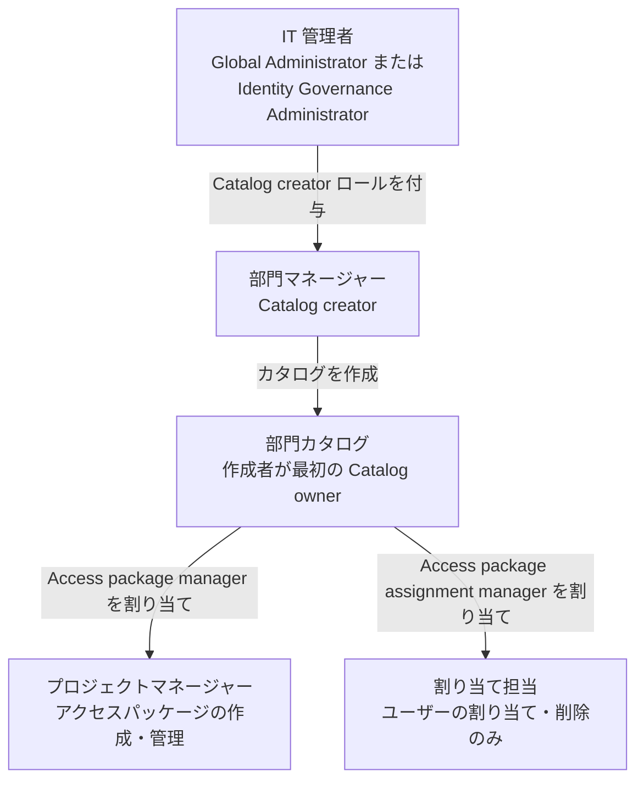

# 【勉強】IGA（アイデンティティガバナンス＆管理）— 管理者ロールと権限委任（Entra・Okta・SailPoint）（2026-10-22）

## 今日のテーマ

「IGA 製品の管理者ロールと権限委任」を学びます。ガバナンス製品は、他のシステムの権限を決める強い力を持ちます。その製品自体を誰が、どこまで操作できるかを設計するのが今日の話題です。

## 概要

これまでの IGA の回は、レビュー、申請、SoD、ロール設計、アプリ連携と、「ガバナンスの中身」を扱ってきました。今日はその操作権限、つまり**ガバナンス製品の管理者ロール**です。

インフラの感覚に置き換えると、変更管理システムの管理者を誰にするか、という問題です。全員をグローバル管理者にすれば簡単ですが、それでは「権限を絞る」ための製品が、最大の権限の集中点になってしまいます。そこで3製品とも、役割ごとの専用ロールを用意しています。

- **Entra ID Governance（Entitlement management）**: Entra の管理者ロールに加え、カタログ単位で委任できる Entitlement management 専用ロールがあります。
- **Okta Identity Governance**: Access certifications administrator や Access requests administrator などの標準ロールがあります。
- **SailPoint ISC**: 「ユーザーレベル」という名前の権限セットがあります。

## 押さえる要点

### Entra ID Governance: 二層で委任する

Microsoft の公式ドキュメントによると、既定では Global Administrator または Identity Governance Administrator が、Entitlement management のすべてを作成・管理できます。ただし現場のことを知っているのは各部門の人なので、権限を最小限にして部門側へ委任できる設計になっています。

Entitlement management 専用ロールは、適用範囲で2種類に分かれます。

- **全体に効くロール**: Catalog creator（カタログを作成できる。カタログを作成した人は自動でそのカタログの最初の Catalog owner になり、所有しないカタログは管理も閲覧もできない）、Connected Organization Administrator（接続組織を作成・管理する）。
- **カタログごとのロール**: Catalog owner、Catalog reader、Access package manager、Access package assignment manager。

Access package manager は、カタログ内の既存リソースから新しいアクセスパッケージを作成し、カタログ内の既存パッケージをすべて編集・管理できます。Access package assignment manager は、既存のアクセスパッケージにユーザーを割り当てたり外したりできますが、パッケージ自体は作成も編集もできません。

なお、承認者（Approver）と申請者（Requestor）は「ロール」ではなく、ポリシーで与えられる権利として整理されています。

下の図は、公式の委任例（IT 管理者から各部門へ）を土台にした概念図です。公式の例ではグループを作って Catalog creator を付与していますが、図では省略しました。また assignment manager は公式の例にはなく、筆者が追加しています。



### Okta Identity Governance: 機能ごとの標準ロール

Okta の公式ドキュメントには、次のようなロールがあります。

- **Access certifications administrator**: 認証キャンペーンの作成、予定されたキャンペーンの起動・編集、実行中キャンペーンの終了、キャンペーンの閲覧、ユーザー・グループ・アプリの閲覧ができます。権限セットは固定です。
- **Access requests administrator**: 全ユーザー・全グループの閲覧、Access Requests アプリ経由でのユーザーのアプリアクセス管理、Access Requests プラットフォームの管理者としての操作ができます。権限セットは固定で、カスタマイズできません。

また、Okta の管理者ロール自体をガバナンスの対象にする機能（**Govern Okta admin roles**）があります。管理者ロールとリソースセットを組み合わせた「管理者ロールバンドル」を作り、期限付きで申請・承認させ、アクセス認証で定期的に見直せます。ドキュメントには Classic Engine での機能と書かれています。

### SailPoint ISC: ユーザーレベルで分ける

SailPoint の公式ドキュメントでは、ガバナンスの主な管理者ロールは次のとおりです。

- **Admin**: すべてのソースに対するすべての権限を持ちます。
- **Cert Admin**: 認証（Certifications）のすべての操作を行います。
- **Role Admin**: ロールの作成・管理・編集を行います。
- **Source Admin**: ソースの作成・設定・管理、アクセスプロファイルの管理を行います。
- **Access Request Administrator**: アクセス要求を閲覧し、承認・再割り当てなどすべての操作を行います。
- **SoD Policy Admin**: 職務分掌ポリシーを作成・管理します。

Role Sub-Admin と Source Sub-Admin もあり、こちらは所属するガバナンスグループに関連づけられたソース上のものだけが対象になります。付与されたユーザーレベルは、認証のなかで「エンタイトルメント」としてレビューできます。

## 手順や設定のイメージ

Entra で、特定のユーザーがどの Entitlement management ロールを持つか調べるには、Microsoft Graph を使います。公式の例は次のとおりです。

```http
GET https://graph.microsoft.com/v1.0/roleManagement/entitlementManagement/roleAssignments?$filter=principalId eq '<ユーザーまたはグループの ID>'&$expand=roleDefinition&$select=id,appScopeId,roleDefinition
```

カタログ固有のロールでは、応答の `appScopeId` がカタログを示します。この応答に出るのは、Entitlement management 内の明示的な割り当てだけです。Entra のディレクトリロールや、ロールに割り当てたグループ経由の権限は含まれません。呼び出すには、委任された `EntitlementManagement.ReadWrite.All` 権限が必要です。

## つまずきやすいところ・注意点

- **Entra の User Administrator は代用できない**: 公式によると、User Administrator ロールだけでは、自分が所有しないカタログの作成やアクセスパッケージの管理ができなくなっています。代わりに Identity Governance Administrator を割り当てます。
- **カタログへのリソース追加は二重の条件**: Global Administrator 以外は、そのリソースを操作する権限と、カタログの Catalog owner ロールの両方が必要です。
- **ポータル制限設定に注意**: Entra 管理センターへのアクセス制限を有効にしていると、委任されたユーザーでも、管理センターでの作業ができない場合があります。
- **外部ユーザー向けの委任**: Catalog owner などは、外部ユーザーが申請できる設定を作れてしまいます。意図しない外部コラボレーションを許さないよう、関係者に周知する必要があります。
- **Okta のレポート閲覧**: Access certifications administrator だけでは、Past Campaign Details などのレポートを閲覧できません。レポート管理者ロールか、近い権限のカスタムロールを割り当てます。
- **Okta のロール削除は即時ではない**: ロールを外すと、確定まで2分間待機します。
- **SailPoint の組み合わせ制限**: Role Admin と Source Sub-Admin など、同時に持てないユーザーレベルの組み合わせがあります。また公式は、Org Admin（Admin に相当）には他の昇格したレベルを持たせないよう推奨しています。
- **SailPoint の SoD Violations Admin**: 公式ページの記述に誤記とみられる箇所があります。権限の詳細は要確認です。

## 今日のまとめ

### ミニ辞書

- **権限委任**: 管理の一部を、全体管理者ではなく現場に近い人へ任せること。
- **Catalog creator / Catalog owner（Entra）**: カタログを作る人と、そのカタログを管理する人。
- **Identity Governance Administrator（Entra）**: Entitlement management などガバナンス機能を管理できる Entra の管理者ロール。
- **Access certifications administrator（Okta）**: 認証キャンペーンを管理する標準ロール。
- **ユーザーレベル（SailPoint）**: ISC での管理権限の単位。
- **最小権限**: 業務に必要な最小限の権限だけを与える原則。

### 理解度チェック

1. Entra で、部門マネージャーに「自部門のカタログだけ」を管理させたいとき、どのロールをどの順で割り当てますか。
2. Entra で、アクセスパッケージの作成はできないが、ユーザーの割り当て・削除だけを任せたいときは、どのロールですか。
3. Okta の Access certifications administrator に、過去キャンペーンのレポートを見せるには、どうしますか。

## 参考リンク

- [Delegation and roles in entitlement management（Microsoft Learn）](https://learn.microsoft.com/entra/id-governance/entitlement-management-delegate)
- [Access certifications administrators（Okta Help Center）](https://help.okta.com/en-us/Content/Topics/security/administrators-access-certs-admin.htm)
- [Access requests administrators（Okta Help Center）](https://help.okta.com/en-us/Content/Topics/Security/administrators-access-request-admin.htm)
- [Govern Okta admin roles（Okta Help Center）](https://help.okta.com/en-us/Content/Topics/security/governance-admin-roles/govern-admin-roles.htm)
- [User Level Permissions（SailPoint Identity Security Cloud）](https://documentation.sailpoint.com/saas/help/common/users/user_levels.html)
