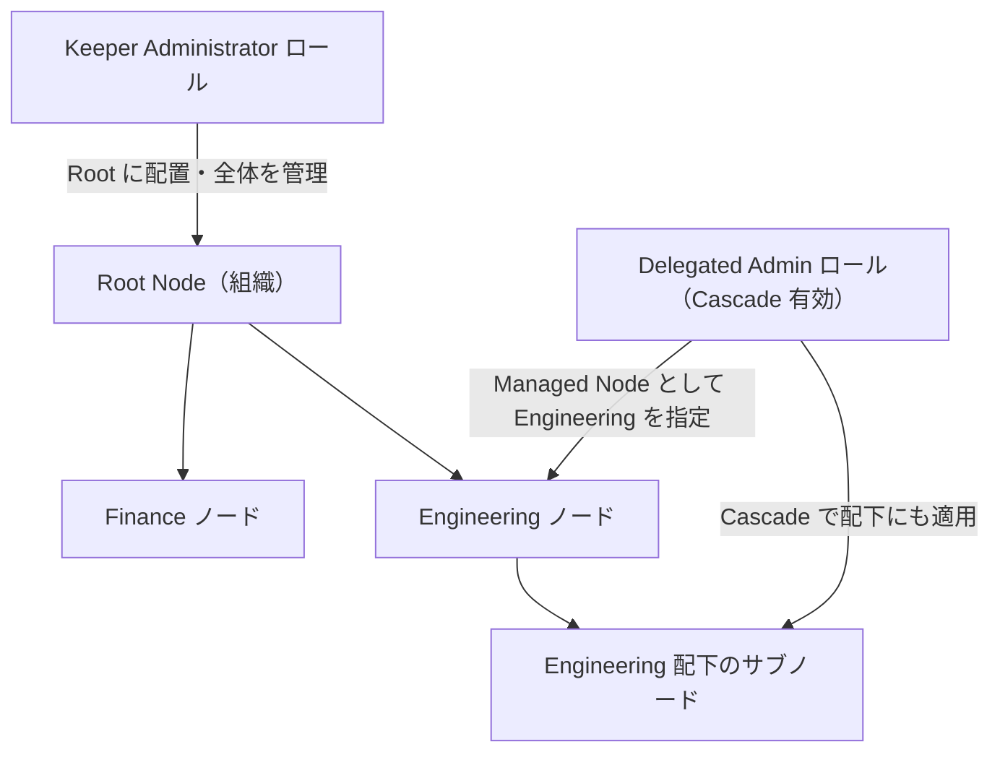
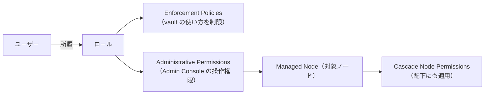

# 【勉強】Keeper — 管理者ロール（Administrative Permissions・Managed Node・権限委任）（2026-10-25）

## 今日のテーマ

Keeper の Admin Console で「誰が何を管理できるか」を決める仕組み、つまり**管理者ロール**を学びます。Entra ID 編の PIM、Okta 編の標準／カスタムロール、Ping 編の組み込み／カスタムロール、Auth0 編のテナントメンバーと同じ立ち位置のテーマです。Keeper では、ロール（Role）に「管理者権限（Administrative Permissions）」と「管理対象ノード（Managed Node）」を持たせることで、権限委任（Delegated Administration）を実現します。

## 概要

Keeper のロールは、ユーザーに適用する機能やセキュリティ設定を決め、管理者権限も与えられる器です。ロールはチーム（Team）とは別物です。チームは共有フォルダーなどを共有する単位で、ロールは権限とポリシーの単位です。ロールを使うことで、職務に応じたアクセス制御（RBAC）と権限委任ができると公式ドキュメントは説明しています。

ここで最初に押さえたいのが、ロールに付く2種類の設定の違いです。

- **Enforcement Policies（強制ポリシー）**: エンドユーザーの vault の使い方やセキュリティを縛る設定です（ログイン設定、2要素認証、共有・インポート制限など）。
- **Administrative Permissions（管理者権限）**: その人が Admin Console で何を操作できるかを決める設定です。

インフラ出身の方向けにたとえると、強制ポリシーは「一般ユーザーに配る GPO」、管理者権限は「OU 単位で委任する管理権限」に近い関係です（たとえであり、仕様の同一性を示すものではありません）。

初期状態では、Root Node（組織ツリーの最上位）に **Keeper Administrator** というロールがあります。最初にアカウントを設定した管理者と、フル権限を持たせたいユーザーに付与されます。公式は、アカウントを失った場合に備えて、このロールに2人目の管理者を入れておくことを勧めています。

下の図は、管理者権限がノードのツリーにどう効くかを示したものです（矢印は「権限が及ぶ範囲」を表します）。



この図の Delegated Admin ロールは Finance には権限を持ちません。権限が及ぶのは、Managed Node に指定した Engineering と、Cascade を有効にしたときのその配下だけです。

## 押さえる要点

- **ロールの置き場所＝管理の起点**: ロールが属するノードが、管理者権限の始まる位置になります。Root に置いて Cascade Node Permissions を有効にすれば全サブノードに及び、サブノードに置けばそのノード配下に限られます。Cascade を外すと、そのノード自身にだけ適用されます。
- **Managed Node**: ロール画面の「+ Add Managed Node」で管理対象ノードを選び、ノードごとの歯車アイコンから権限を設定します。ノードごとに別の権限を持たせられます。
- **主な管理者権限**（公式の一覧から抜粋）: Manage Nodes／Users／Roles／Teams（それぞれの追加・削除・編集）、Manage Bridge/SSO、Manage Reporting and Alerts、Perform Device Approvals（SSO Connect Cloud ユーザーの端末承認）、Transfer Account（ユーザー vault の移管）、Share Admin（共有フォルダー・共有レコードへの強い権限）、Run Compliance Reports、Billing Admin、Manage Record Types in Vault、Manage Endpoint Privilege。MSP 向けには Manage Companies もあります。
- **複数ロールの合成**: ユーザーが複数のロールに属し、強制ポリシーが食い違う場合は、すべてを満たす必要があります。最小権限の考え方で、多くは最も厳しい設定が結果になります（強制ポリシーによって挙動は異なります）。
- **ロールの作り方**: Roles タブで対象ノードを選び「+」から名前を付けて追加し、強制ポリシー・ユーザー・管理者権限を設定します。ほかに SCIM、Keeper Commander、AD Bridge からも作成できます。

次の図は、1つのロールに載る設定の関係です。



## 手順や設定のイメージ

Admin Console では、次の流れで権限委任用のロールを作ります。

1. Roles タブを開き、ロールを置くノードを選んで「+」から「Delegated Admin」のような名前で追加します。
2. 管理者権限を付ける前に、そのロールのユーザーに「invited（招待中）」状態の人がいないことを確認します（公式の制約です）。
3. 「+ Add Managed Node」で管理対象ノードを選び、歯車アイコンから必要な権限だけにチェックを入れます。
4. 配下のサブノードにも及ばせたいときだけ「Cascade Node Permissions」を有効にします。
5. 管理を任せるユーザーをそのロールに追加します。

Keeper Commander（CLI）でも同じことができます。公式のコマンド一覧にあるスイッチを組み合わせた例です（ロール名・ノード名は例です）。

```text
# ロールを作成
enterprise-role --add --name "Delegated Admin" --node "Engineering"

# 管理対象ノードを指定し、配下にも適用する
enterprise-role "Delegated Admin" --add-admin "Engineering" --cascade on

# 管理者権限を追加する（公式例: -ap manage_nodes -ap manage_roles）
enterprise-role "Delegated Admin" -ap manage_user -ap manage_teams
```

上のコマンドは公式のスイッチ一覧から組み立てた例で、公式の例そのものではありません。権限コードは公式の一覧にあるもの（`manage_user`、`manage_teams`、`manage_nodes`、`manage_roles` など）を使います。コマンドで指定できるのは Commander の一覧にあるコードだけで、Admin Console の権限名と1対1には対応しません。公式ページ内にスイッチ表記のゆれ（`-aa` など）もあるため、実環境で確認してください。

## つまずきやすいところ・注意点

- **管理者ロールはチームに紐付けられません**。通常のロールはチーム経由で付与できますが、管理者ロールは意図しない権限昇格を防ぐため対象外です（公式の説明。将来変わる可能性があるとも書かれています）。
- **Keeper Administrator を日常使いしない**: 公式は、管理者権限を必要な最小限のロールにだけ付与するよう勧めています。全体管理者とは別に Delegated Admin ロールを作るのが基本です。
- **Transfer Account は条件付き**: 現在そのロールのメンバーである管理者だけが選べます。アカウント移管（Account Transfer）は任意機能で、Admin Console 概要ページでは Keeper Administrator が初期導入時に設定するよう勧められています。
- **ノード分離（Isolation）との関係**: ノードを isolated にすると、親ノードのユーザー・チームは見えたまま、並列する（兄弟）ノードのユーザー・チームは共有候補に出なくなります。ただし、現在のユーザーのノードに管理権限を持つロールで Share Admin を持つ管理者は、候補に表示されます。
- **SCIM 連携時のロール**: SCIM グループは既定ではチームに対応し、設定した接頭辞で始まる名前のグループだけがロールに対応します。

## 今日のまとめ

### ミニ辞書

- **Role（ロール）**: 強制ポリシーと管理者権限をまとめて持つ、権限とポリシーの単位。チームとは別物。
- **Enforcement Policies**: エンドユーザーの vault 利用とセキュリティを制限するポリシー。
- **Administrative Permissions**: Admin Console 上で何を管理できるかを決める権限。
- **Managed Node**: 管理者ロールが管理できるノード。
- **Cascade Node Permissions**: ノードの権限を配下の全サブノードに適用する設定。
- **Keeper Administrator**: Root Node にある初期のフル権限ロール。

### 理解度チェック

1. 強制ポリシーと管理者権限の違いを、「誰に・何に効くか」で説明してください。
2. Engineering ノードの配下まで管理を任せたい Delegated Admin ロールを作るとき、どの設定が必要ですか。
3. 管理者ロールをチームに紐付けられないのはなぜですか。

## 参考リンク

- [Roles, RBAC, and Permissions（Keeper Docs）](https://docs.keeper.io/enterprise-guide/roles)
- [Delegated Administration（Keeper Docs）](https://docs.keeper.io/enterprise-guide/delegated-administration)
- [Nodes and Organizational Structure（Keeper Docs）](https://docs.keeper.io/enterprise-guide/nodes-and-organizational-structure)
- [Keeper Admin Console Overview（Keeper Docs）](https://docs.keeper.io/enterprise-guide/getting-started-with-keeper-admin-console)
- [Enterprise Management Commands（Keeper Docs）](https://docs.keeper.io/keeperpam/commander-cli/command-reference/enterprise-management-commands)
