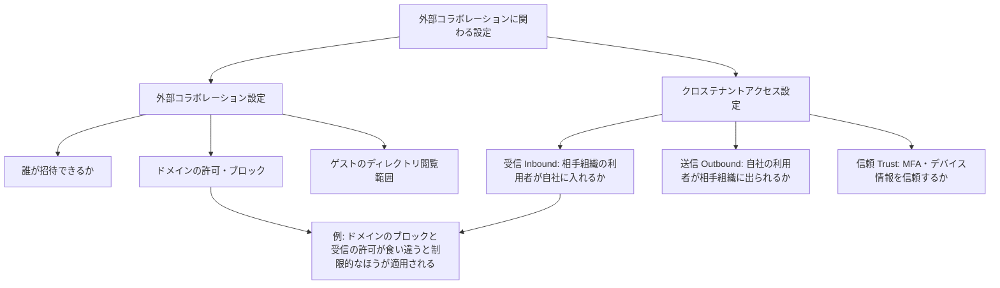
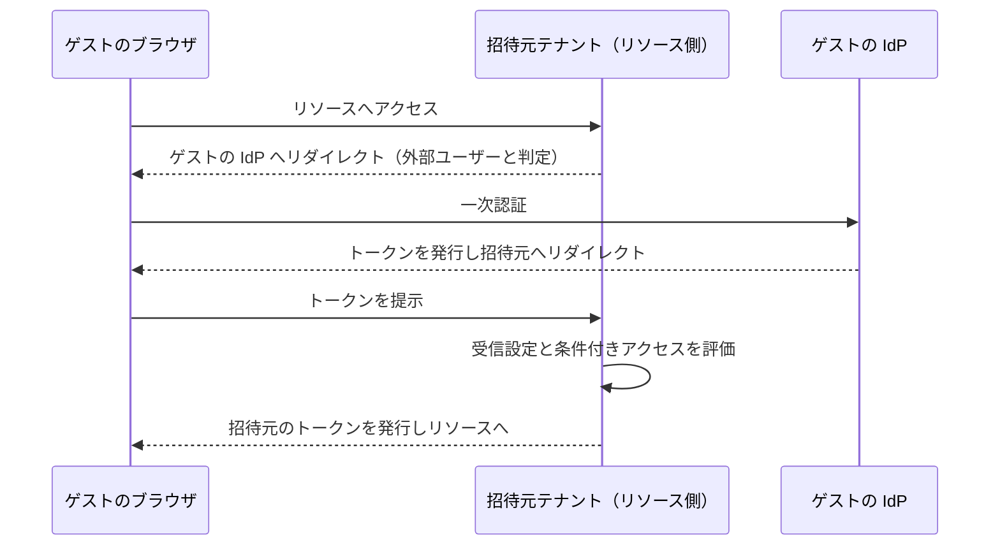

# 【勉強】Microsoft Entra ID — 外部ID（B2B コラボレーション：ゲスト招待・クロステナントアクセス設定）（2026-10-26）

## 今日のテーマ

Microsoft Entra ID の外部コラボレーション機能である **B2B コラボレーション**を学びます。取引先の人を「ゲスト」として自社テナントに招き、自社のアプリやファイルを使わせる仕組みです。ゲストの招待・サインイン・制限のかけ方まで、全体像を押さえます。

## 概要

Entra External ID（旧称 Azure AD External Identities）の B2B コラボレーションは、社外のパートナーに自社のアプリやサービスを共有する機能です。公式の説明では、パートナーは自分の資格情報（職場・学校アカウントやソーシャルアカウントなど）でサインインでき、自社側でパスワードの管理やアカウントの同期、ライフサイクル管理をしなくて済みます。

招待が完了すると、ゲストは自社ディレクトリに**ユーザーオブジェクト**として登録されます。ユーザータイプは通常 `Guest` で、UPN（ユーザープリンシパル名）には `#EXT#` という識別子が入ります。たとえば contoso.com の john さんを fabrikam テナントに招くと、UPN は `john_contoso.com#EXT#@fabrikam.onmicrosoft.com` の形です。

インフラ出身の方向けにたとえると、他社の社員に「自社の VPN アカウント」を発行するのではなく、相手の ID を信頼して入館証（ゲストオブジェクト）だけ発行する、という考え方です。認証は相手側の ID 基盤が担い、認可と制限は自社が握ります。

## 押さえる要点

- **ゲストの 2 つの属性**: `UserType`（Guest か Member）は「組織との関係」を表し、`Identities` は「どこで認証するか」を表します。公式は、この 2 つは独立した属性だと説明しています。
- **2 種類の設定画面（混同しやすい）**: 公式は、次の 2 つが別の側面を管理するとしています。
  - **クロステナントアクセス設定**: 他の Entra 組織の利用者が自社に入れるか、自社の利用者が他組織に出られるかを、受信（Inbound）と送信（Outbound）で制御します。相手組織ごとの個別設定は既定設定より優先されます。
  - **外部コラボレーション設定**: 誰がゲストを招待できるか、ゲストがディレクトリの何を見られるか、どのドメインを許可・ブロックするかを制御します。
- **信頼設定（Trust settings）**: 相手組織で済ませた MFA や、準拠デバイス・Entra ハイブリッド参加デバイスの情報を、自社の条件付きアクセスが信頼するかを決めます。信頼しても自社の MFA ポリシーは適用されますが、相手側で MFA 済みなら再度求められません。
- **B2B direct connect との違い**: 相互に信頼を結び、ゲストオブジェクトを作らずに（Teams の共有チャネルなどで）アクセスする別の仕組みです。公式の既定では B2B コラボレーションは有効、B2B direct connect はブロックです。

次の図は、2 種類の設定の役割分担の整理です。食い違ったときに制限的なほうが適用されるのは、公式がドメインのブロックとクロステナントの許可で例示している挙動です。



## 手順や設定のイメージ

**1. 外部コラボレーション設定を決める**（Entra 管理センターの Entra ID → External Identities → External collaboration settings）。

- ゲストのアクセス権: 「メンバーと同じ（最も広い）」「制限あり（既定）」「自分のオブジェクトのみ（最も厳しい）」の 3 段階です。
- ゲストを招待できる人: 「誰でも（ゲスト含む）」から「誰も不可（管理者含む）」まで 4 段階です。特定の担当者だけに任せるなら、Guest Inviter ロールを付与します。

**2. 招待する**。管理センターのユーザー作成画面から招待メールを送るほか、Microsoft Graph の招待 API でも作れます。最小権限のアクセス許可は `User.Invite.All` です。

```http
POST https://graph.microsoft.com/v1.0/invitations
Content-type: application/json

{
  "invitedUserEmailAddress": "admin@fabrikam.com",
  "inviteRedirectUrl": "https://myapp.contoso.com"
}
```

成功すると 201 が返ります。招待オブジェクトの `status` は `PendingAcceptance` で、`invitedUser` に作成されたゲストの id と UPN が入り、`inviteRedeemUrl` も得られます。メールを Graph から送らず、`inviteRedeemUrl` を自前の通知に使う運用も可能です。

**3. ゲストが招待を引き換える（redeem）**。「招待を承諾する」を押すと、Entra ID が既定の順で相手の認証元を判断します。公式の既定の引き換え順は、概略で次のとおりです。

1. 管理対象の Entra テナントに既存ユーザーがいるか確認する
2. SAML/WS-Fed の直接フェデレーションが設定されていれば、そこへ誘導する
3. Google フェデレーションが有効で gmail.com 系なら、Google へ誘導する
4. 既存の個人 Microsoft アカウント（MSA）があれば、それでサインインさせる
5. どれにも当たらなければ、メールのワンタイムパスコード（OTP）を送る（無効なら MSA の作成を促す）

引き換え後は、プライバシーに関する同意画面（利用規約を設定していれば、その承諾も）を経て、状態が Accepted になります。

次の図は、ゲストの IdP が Entra ID 以外（Google や SAML/WS-Fed の IdP など）のときのサインインの流れです。どの移動もブラウザ経由のリダイレクトである点に注意してください。



## つまずきやすいところ・注意点

- **設定が競合したら厳しいほうが勝つ**: 公式の例では、外部コラボレーション設定で adatum.com をブロックし、クロステナントアクセス設定で全組織を許可していると、招待は制限されます。ブロック追加後も、既存のゲストは使い続けられる点にも注意します。
- **自動引き換えは両側の設定が必要**: 同意画面と招待メールを省けるのは、送信側（ホームテナント）と受信側（リソーステナント）の両方でチェックを入れたときだけです。B2B コラボレーションでは、代わりに操作不要の通知メールがゲストに届きます。
- **MFA の場所**: 相手の MFA を信頼していないと、B2B コラボレーションのゲストは招待元で MFA を求められます。Entra 以外の IdP のゲストは、常に招待元が MFA を担当します。相手の MFA を信頼するなら、Identity Protection の MFA 登録ポリシーから外部ユーザーを除外するよう公式が勧めています（両方あるとアクセス要件を満たせなくなります）。
- **MFA 登録や利用規約でブロックされる**: 条件付きアクセスで MFA や利用規約を求める場合、公式は My Apps（アプリ ID `0000000c-0000-0000-c000-000000000000`）と、利用規約のアプリを許可するよう案内しています。送信側（ホームテナント）は管理センターの「Add other applications」から設定できますが、受信側（リソーステナント）は画面の制約で Graph API で行う必要があります。
- **ユーザーリスクポリシーは効かない**: 外部ユーザーのユーザーリスクはホームテナントで評価され、リソース側では解決できません。「パスワード変更を要求する」ポリシーを課すと、ゲストはブロックされます。リスクベースのポリシーから外部ユーザーのグループを除外する方法が公式に示されています。
- **「承認済みクライアントアプリ」などは使えない**: 公式の比較表では、承認済みクライアントアプリ、アプリ保護ポリシー、パスワード変更の要求は、B2B ゲストでサポート外です。
- **課金**: ゲストは MAU（月間アクティブユーザー数）課金で、無料枠があります。ゲスト向けの ID Governance などは別の追加課金です。クロステナント設定で、特定のユーザーやアプリを指定したり、信頼設定を使ったりするには Entra ID P1 ライセンスが必要です。

## 今日のまとめ

### ミニ辞書

- **B2B コラボレーション**: 外部の人を、相手自身の ID でゲストとして招く仕組み。
- **リソーステナント／ホームテナント**: 共有する側（招待元）／ユーザーが管理されている側。
- **クロステナントアクセス設定**: 他の Entra 組織との受信・送信・信頼を制御する設定。
- **外部コラボレーション設定**: 誰が招待できるか、ドメイン制限、ゲストの権限を制御する設定。
- **引き換え（redemption）**: 招待を承諾して、ゲストが初めてサインインを完了する手順。
- **#EXT#**: ゲストの UPN に入る外部ユーザーの識別子。

### 理解度チェック

1. クロステナントアクセス設定と外部コラボレーション設定は、それぞれ何を決めますか。両者が食い違った場合はどうなりますか。
2. 取引先テナントの MFA を信頼する設定をしないと、ゲストの MFA はどこで求められますか。
3. ゲストの `UserType` と `Identities` は何が違いますか。

## 参考リンク

- [What is Microsoft Entra B2B collaboration?](https://learn.microsoft.com/en-us/entra/external-id/what-is-b2b)
- [Cross-tenant access overview](https://learn.microsoft.com/en-us/entra/external-id/cross-tenant-access-overview)
- [Configure external collaboration settings for B2B](https://learn.microsoft.com/en-us/entra/external-id/external-collaboration-settings-configure)
- [B2B collaboration invitation redemption](https://learn.microsoft.com/en-us/entra/external-id/redemption-experience)
- [Authentication and Conditional Access for External ID](https://learn.microsoft.com/en-us/entra/external-id/authentication-conditional-access)
- [Properties of a B2B guest user](https://learn.microsoft.com/en-us/entra/external-id/user-properties)
- [External ID pricing and billing overview](https://learn.microsoft.com/en-us/entra/external-id/external-identities-pricing)
- [Create invitation (Microsoft Graph)](https://learn.microsoft.com/en-us/graph/api/invitation-post?view=graph-rest-1.0)
