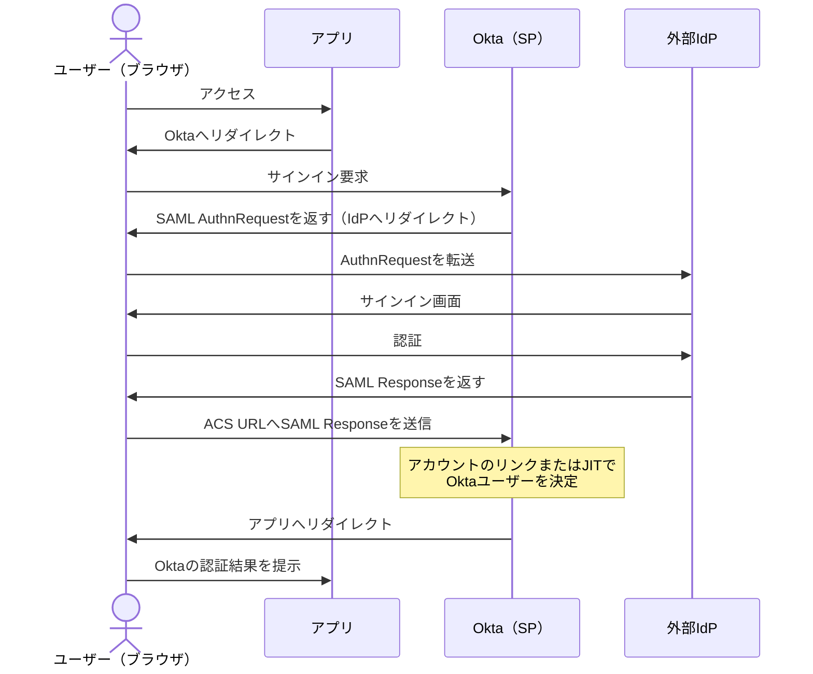
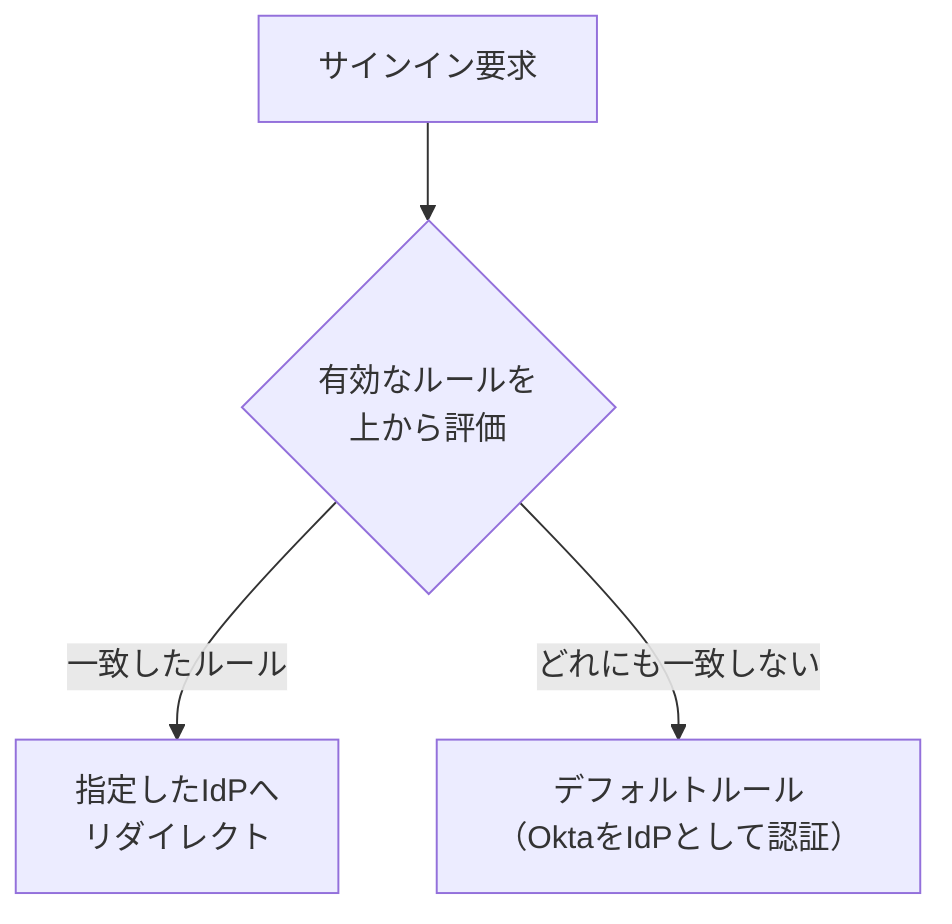

# 【勉強】Okta Workforce Identity Cloud — 外部 IdP 連携（インバウンドフェデレーション・IdP ルーティングルール）（2026-10-27）

## 今日のテーマ

Okta Workforce Identity Cloud を「ログインを受ける側」から見た機能、**外部 IdP との連携（インバウンドフェデレーション）** を学びます。他社や別組織の IdP（ID を管理して認証する仕組み）で認証したユーザーを、Okta 経由で自社アプリに入れる機能です。Entra ID 編の「外部ID（B2B）」の回に対応するテーマです。

## 概要

これまでの SAML 編では、Okta が IdP（認証する側）としてアプリ（SP）にログイン結果を渡す流れを見ました。今回はその逆で、**Okta が SP の立場になり、認証そのものは別の IdP に任せる**構成です。公式ドキュメントでは「インバウンドフェデレーション」と呼ばれ、Okta がユーザーを IdP にリダイレクトし、戻ってきた結果をもとに Okta 側のユーザーとして扱います。アプリは Okta とだけ通信すればよく、IdP の違いを意識しません。

インフラ出身の方向けにたとえると、社内システムの認証を「自前の LDAP」から「取引先の認証基盤への委譲」に切り替えるようなものです。ただし、委譲先の認証結果を Okta の `Universal Directory`（Okta のユーザー台帳）のどのユーザーに結びつけるかを、こちらで決める必要があります。

公式ドキュメントが挙げる IdP の種類は次のとおりです。

- **SAML / OIDC の企業 IdP**: 自社や取引先の IdP。企業向けの SAML と OIDC ではグループ同期も使えます
- **ソーシャル IdP**: Apple や Facebook など。認証はソーシャル側が担当します
- **Okta-to-Okta**: 別の Okta org との連携
- **そのほか**: スマートカード IdP や、本人確認（IDV）ベンダーもあります。IDV は Okta のアカウント管理ポリシーでのみ使えます

今回は最も基本の「SAML 2.0 IdP」を中心に見ます。

### 認証の流れ

下の図は SAML の SP 開始フローです。Okta と IdP は直接通信せず、すべてユーザーのブラウザを経由する点に注意してください。

## 押さえる要点

### 1. 設定の入口と必要な値

管理コンソールの **Security > Identity Providers > Add Identity Provider** から追加します。SAML 2.0 IdP では、次の値をやり取りします。

- IdP から受け取る値: **Issuer URI**（通常はメタデータの entityID）、**Single Sign-On URL**、**署名証明書**
- Okta から IdP へ渡す値: **ACS URL**（Assertion Consumer Service、SAML の応答を受け取る Okta 側の URL）、**Audience URI**

IdP 側が先に Okta の値を求める場合は、仮の値で IdP を作成し、あとからメタデータを取り込んで編集します。Okta のメタデータは IdP 作成後にダウンロードできます。署名証明書は最大 2 枚まで登録できるため、更新時に並行して使えます。

### 2. アカウントのマッチング（リンク）

IdP から来たユーザーを Okta のどのユーザーと同一人物とみなすかを決める部分で、つまずきやすい箇所です。

- **IdP username**: アサーション内のどの値をユーザー名として扱うか。Okta Expression Language で加工できます
- **Match against**: 加工後の値を、Okta のどの項目と照合するか
- **Account link policy**: 一致した既存ユーザーに自動でリンクするかどうか。自動リンクでは、対象グループの絞り込みや、特定ユーザー・管理者の除外ができます
- **Persistent Name ID によるマッチング**: 公式が「より高いセキュリティ」とする方式で、persistent 形式の Name ID で照合します。アサーションも persistent 形式の Name ID を使う必要があります

### 3. 一致しないときの動作（JIT）

一致するユーザーがいない場合は、**Create new user (JIT)** を選ぶと、初回ログイン時にその場で Okta ユーザーを作成します（JIT は Just-In-Time、必要になった瞬間に作る方式）。別の選択肢は「Okta のサインインページへリダイレクト」です。JIT は、まだ Okta に存在しないユーザーにだけ作用します。

JIT 設定には、既存ユーザーの属性をログインのたびに更新する **Update attributes for existing users** と、グループの割り当て方法があります。グループは「なし」「特定グループに割り当て」「不足グループを追加」「**完全同期**」から選べます。完全同期はグループ所属を IdP のアサーションに合わせて同期する方式なので、既存の割り当てが変わらないか事前に確認してください。

### 4. ルーティングルール（IdP Discovery）

IdP が複数ある、または Okta 自身での認証と併用する場合に、**誰をどの IdP に送るか**を決めるのが IdP ルーティングルールです。Okta は有効なルールを評価し、最初に一致したものを適用します。条件には、ネットワークゾーン、デバイスプラットフォーム、アクセス先アプリ、メールドメインやユーザー属性などを使えます。どのルールにも一致しないユーザーには、Okta を IdP とするデフォルトルールが適用されます。

上の図は評価の考え方を表したものです。1 つ目のルールに一致すれば、以降のルールは見ません。

## 手順や設定のイメージ

1. 外部 IdP 側の担当者と、メタデータ（または Issuer・SSO URL・証明書）を交換する準備をする
2. Okta で **Add Identity Provider** から **SAML 2.0 IdP** を選び、名前、IdP username、アカウントのリンク方針を設定する
3. 作成後に表示される ACS URL と Audience URI を IdP に登録する（Okta のメタデータを渡す方法もあります）
4. IdP から受け取った Issuer、SSO URL、証明書を Okta に入力する
5. **Routing Rules** タブで **Add Routing Rule** を作り、条件と **Use this identity provider** を設定して有効化する
6. 通常のブラウザではなく、**プライベートウィンドウ**でテストする（過去のセッションで結果が変わるのを避けるため）

公式のテスト手順には、認可エンドポイント（`/authorize`）に `idp` パラメーターなどを付けて直接試す方法もあります。

## つまずきやすいところ・注意点

- **ルーティングルールはセキュリティ強化ではない**: 公式に、サインインの体験を整える機能であり、セキュリティを高めるものではないと明記されています。アプリのサインインポリシーは IdP ごとに別途設定します
- **自動リンクの扱い**: 自動リンクを有効にすると、外部 IdP のユーザー名と一致する Okta ユーザーに自動で紐づきます。公式は Persistent Name ID の利用を高セキュリティな方式としており、リンク対象のグループ指定や管理者の除外で範囲を絞れます。範囲は必要最小限にしてください
- **IdP 設定の Filter（正規表現）**: B2B やマルチテナントでは、サインインを許可するユーザー名（メールドメイン）を正規表現で絞ります。管理者を追加しても、この Filter は自動更新されない旨が公式にあります。ルーティングルール側にも login に対する正規表現条件がありますが、別の設定です
- **ユーザー属性条件の注意**: ルーティングルールで「User matches」を使う場合は、IdP を 1 つにします。SAML の SP 開始フローでは、`login_hint` などでユーザー識別子を渡さないと、Okta が先にサインイン画面を出します
- **Classic と Identity Engine の違い**: Sign-In Widget の設定手順などは製品の世代で異なります。ドキュメントを見るときは、自分の org がどちらかを確認してください

## 今日のまとめ

### ミニ辞書

- **インバウンドフェデレーション**: 外部 IdP で認証したユーザーを Okta で受け入れること
- **ACS URL**: SAML の応答を受け取る Okta 側の URL
- **Persistent Name ID**: 継続的に同じ値を持つ識別子。アカウントのリンクに使える
- **JIT プロビジョニング**: 初回ログイン時に Okta ユーザーをその場で作成する方式
- **IdP ルーティングルール**: 条件に応じて送り先の IdP を決める仕組み（IdP Discovery とも呼ばれる）

### 理解度チェック

1. インバウンドフェデレーションで、Okta は SP と IdP のどちらの立場ですか。SAML の応答はどの経路で Okta に届きますか。
2. 自動リンクと JIT は、それぞれどんなユーザーに作用しますか。
3. ルーティングルールを作れば、外部 IdP のユーザーのセキュリティも強化されますか。

## 参考リンク

- [External Identity Providers（Okta Developer）](https://developer.okta.com/docs/concepts/identity-providers/)
- [Enterprise identity provider（SAML 2.0・Okta Developer）](https://developer.okta.com/docs/guides/add-an-external-idp/saml2/main/)
- [Identity Providers（IdP の種類一覧・Okta ヘルプ）](https://help.okta.com/en-us/content/topics/security/identity_providers.htm)
- [Add a SAML Identity Provider（Okta ヘルプ）](https://help.okta.com/oie/en-us/Content/Topics/Security/idp-add-saml.htm)
- [Identity Provider routing rules（Okta ヘルプ）](https://help.okta.com/en-us/content/topics/security/identity_provider_discovery.htm)
- [Configure identity provider routing rules（Okta ヘルプ）](https://help.okta.com/oie/en-us/Content/Topics/Security/configure-routing-rules.htm)
