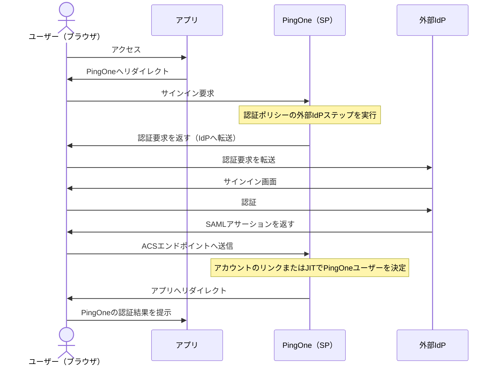
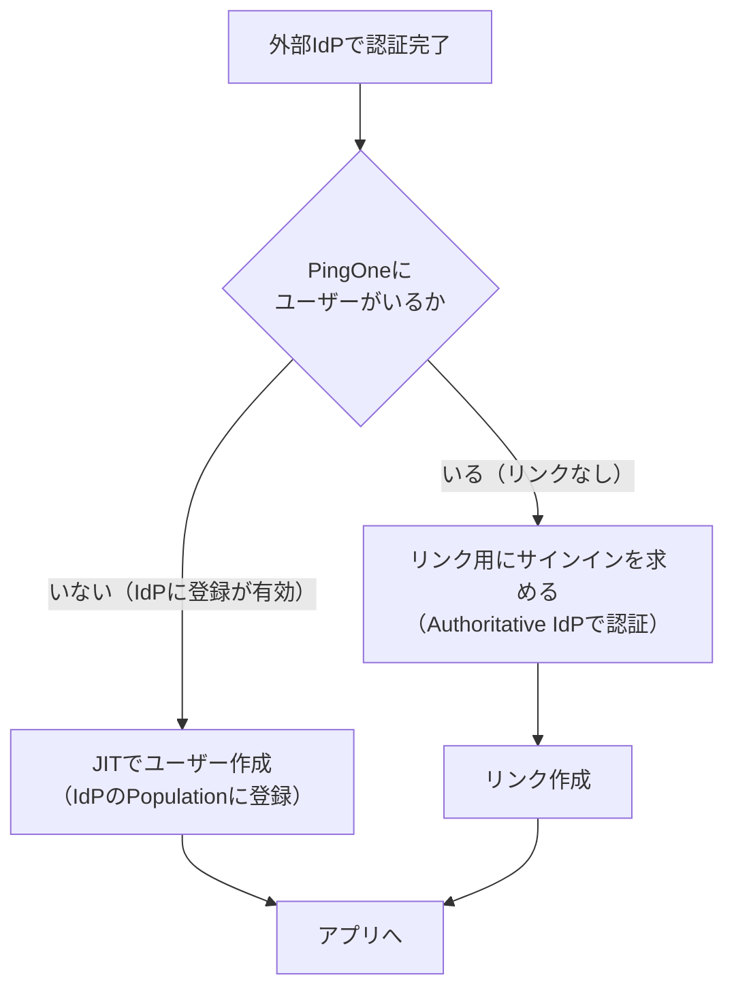

# 【勉強】Ping Identity — 外部 IdP 連携（External IdPs・認証ポリシー・アカウントのリンク）（2026-10-28）

## 今日のテーマ

PingOne を「ログインを受ける側」にして、認証そのものは別の IdP（ID を管理して認証する仕組み）に任せる **External IdPs（外部 IdP 連携）** を学びます。Entra ID 編の「外部ID（B2B）」、Okta Workforce Identity Cloud 編の「外部 IdP 連携（インバウンドフェデレーション）」と同じテーマの Ping 版です。

## 概要

これまでの SAML 編では、PingOne が IdP としてアプリにログイン結果を渡す側でした。今回は逆で、**PingOne が SP（サービスプロバイダー、ログイン結果を受け取る側）になり、ユーザーを別の IdP に認証へ送り出します。** アプリは PingOne とだけ通信し、背後の IdP の違いを意識しません。

インフラ出身の方向けにたとえると、社内システムの認証を自前の LDAP から取引先の認証基盤へ委譲しつつ、「その結果を自社側のどのユーザーとして扱うか」の台帳（PingOne のユーザー）は手元に残す構成です。

PingOne では、管理コンソールの **Integrations > External IdPs** で IdP を追加します。公式の手順ページがあるのは、汎用の **SAML** と **OpenID Connect（OIDC）** です（Microsoft 向けの専用設定もあります）。追加しただけでは使われず、**認証ポリシーに外部 IdP のステップを入れて初めて**ユーザーが使えるようになります。

### 認証の流れ（SAML の SP 開始）

PingOne と IdP は直接通信せず、メッセージはすべてユーザーのブラウザを経由します。SSO Binding は HTTP POST か HTTP Redirect を選べます。

## 押さえる要点

### 1. 設定の入口と SAML で交換する値

SAML の場合、公式の手順は「プロファイル作成 → PingOne 側（SP）の接続情報 → IdP 側の接続情報 → 属性マッピング」の順です。

- **PingOne (SP) Entity ID**: PingOne が IdP へのリクエストの `Issuer` に使う値です。既定は Name を元にした値です
- **ACS Endpoint**: SAML の応答（SSO トークン）を受け取る PingOne 側の URL です。画面に自動表示されるので IdP に登録します
- **Signing Certificate / Signing Algorithm**: PingOne が送る認証要求や SLO メッセージの署名に使います。RSA または EC の証明書を選びます
- **Verification Certificate**: 外部 IdP からのアサーションの署名を検証する証明書です
- IdP の情報は、メタデータ XML のインポート、メタデータ URL からのインポート、手入力のいずれかで入れます

### 2. OIDC の場合

OIDC では Client ID と Client Secret（IdP 側が発行）を入れ、PingOne が表示する **Callback URL** を IdP に登録します。**Discovery Document URI** を入れて「Use Discovery Document」を押すと、Issuer や各エンドポイントが自動入力されます。Issuer、JWKS、認可、トークンの各エンドポイントは `https` が必須です。**PKCE**（認可コードの横取りを防ぐ仕組み）は、Discovery を使い、かつ IdP のメタデータに `S256` がある場合に既定でオンになります。

### 3. 属性マッピングと更新条件

PingOne のユーザー属性と IdP の属性を対応づけます。更新条件は **Empty only**（PingOne 側が空のときだけ更新）か **Always**（毎回上書き）です。

### 4. ユーザーを決める仕組み（JIT とリンク）

- **JIT 登録**: IdP の作成・編集時に **Population** を選ぶと、PingOne にまだいないユーザーを、その Population に初回ログインで作成できます。この設定は認証ポリシー側の登録 Population より優先されます
- **アカウントのリンク**: すでに PingOne にいるユーザーは、初回の外部 IdP ログイン時にアカウントのリンクを求められます（公式のソリューションガイドの記述）。Authoritative IdP の説明では、既存リンクのない外部 IdP でログインするユーザーは、まず Authoritative IdP（既定は PingOne のユーザー名とパスワード）でサインインしてリンクを作る、とされています

上の図は、公式の2つの記述（ソリューションガイドと Authoritative IdP のページ）を組み合わせた概念図です。リンク時の照合条件の詳細は、公式ページでは確認できませんでした（後述）。

### 5. 認証ポリシーへの組み込み

**Authentication > Authentication** でポリシーを追加または編集し、**Add Step** で Step type に **External identity provider** を選び、使う IdP を指定します。

- IdP ステップは管理者が決めるため、ユーザーが IdP を選ぶことはありません
- 登録の設定として、**Enable registration**、**Population**、**Require confirmation of user information**（IdP から渡された名前やメールをユーザーが確認・編集できる）があります
- **Required authentication level** は、SAML の `RequestedAuthnContext` や OIDC の `acr_values` を IdP に送る設定で、MFA を要求したいときなどに使います。この設定は、IdP を含むサインインステップの後ろにこのステップを置いた場合のみ使えます
- IdP が複数ある場合は、メールやユーザー名を入力した後に各ユーザーの Authoritative IdP へ送る Identifier-first や、ログインステップで IdP の一覧から選ばせる方法があります

## 手順や設定のイメージ

1. 外部 IdP の担当者とメタデータ（または Client ID、Secret、Discovery URI）を交換する準備をする
2. **Integrations > External IdPs** で追加し、**SAML** または **OpenID Connect** を選ぶ
3. 名前や Population（JIT を使う場合）を設定する
4. SAML なら ACS Endpoint と Entity ID を、OIDC なら Callback URL を IdP に登録する
5. IdP の接続情報（メタデータ、証明書、エンドポイント）を PingOne に入れる
6. 属性マッピングを設定して保存する
7. 詳細パネル上部のトグルで IdP を**有効化**する
8. 認証ポリシーに External identity provider ステップを追加し、既定ポリシーにするか特定アプリに割り当てる
9. 実際にアプリへアクセスし、リダイレクトと属性反映を確認する

## つまずきやすいところ・注意点

- **有効化と、ポリシーへの追加は別**: IdP は有効化し、認証ポリシーに入れて初めて使われます
- **署名付き認証要求**: 同じ IdP を、既定 URL とカスタムドメイン URL の両方経由のアプリで使う認証ポリシーに入れる場合は、**Enable Signed Authentication Request** をオンにします（公式の注記）
- **PingOne パスワードがないユーザーはリンクできない**: Authoritative IdP が PingOne で、PingOne パスワードを持たないユーザーは、外部 IdP でサインインもリンクもできません。PingID や PingOne MFA のアダプターで作られたユーザーなどで起きやすいと公式が説明しています
- **Authoritative IdP を外部 IdP にした場合**: そのユーザーは外部 IdP で認証できますが、PingOne 経由のリンクはできなくなります
- **SLO はセッション失効とは別**: SAML のシングルログアウト（SLO）メッセージの交換期間（SLO Window）は 1〜24 時間で設定でき、公式は 2 時間からの調整を提案しています。SLO は PingOne のセッション・トークンの失効とは別の仕組みです
- **要確認**: リンク時にどの属性で既存ユーザーを照合するかは、今回確認した公式ページでは詳しく書かれていませんでした。実環境で挙動を確かめてください

## 今日のまとめ

### ミニ辞書

- **External IdP**: PingOne が認証を委譲する外部の IdP（SAML／OIDC など）
- **ACS Endpoint**: SAML の応答を受け取る PingOne 側の URL
- **Callback URL**: OIDC でリダイレクトを受け取る PingOne 側の URL
- **JIT 登録**: 初回ログイン時にユーザーをその場で作る方式
- **Authoritative IdP**: ユーザーが通常認証する場所（既定は PingOne）

### 理解度チェック

1. External IdP で、PingOne は SP と IdP のどちらの立場ですか。SAML の応答はどの経路で PingOne に届きますか。
2. IdP を有効化しただけで、ユーザーはその IdP でログインできますか。
3. PingOne にいないユーザーを初回ログインで自動作成するには、IdP のどの設定が必要ですか。

## 参考リンク

- [Adding a SAML identity provider（PingOne）](https://docs.pingidentity.com/pingone/integrations/p1_add_identity_provider_saml.html)
- [Adding an OpenID Connect identity provider（PingOne）](https://docs.pingidentity.com/pingone/integrations/p1_add_idp_oidc.html)
- [Adding an external IdP sign-on step（PingOne）](https://docs.pingidentity.com/pingone/authentication/p1_add_idp_signon_step.html)
- [Authoritative IdPs（PingOne）](https://docs.pingidentity.com/pingone/integrations/p1_authoritative_idps.html)
- [Delegating authentication to an external IdP（ソリューションガイド）](https://docs.pingidentity.com/solution-guides/workforce_use_cases/htg_delegate_authn_to_external_idp.html)
