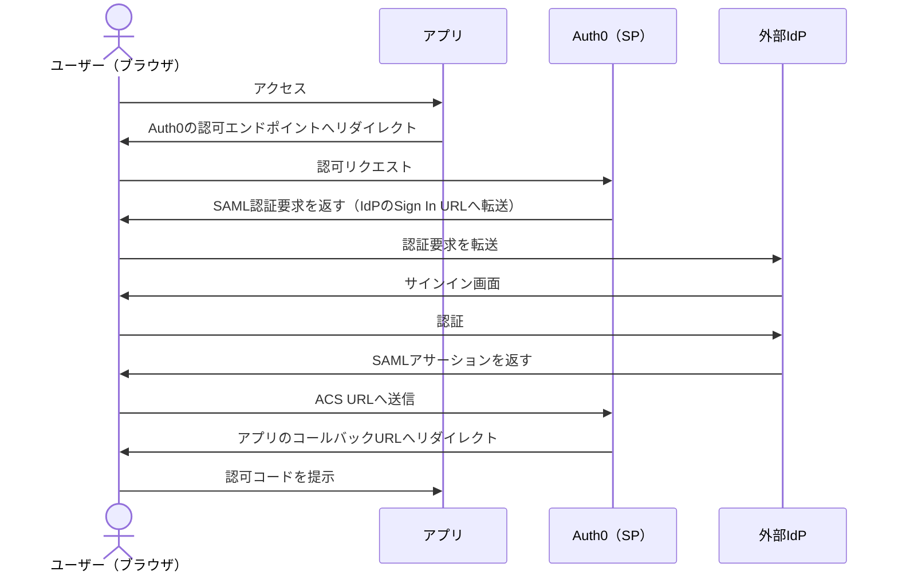
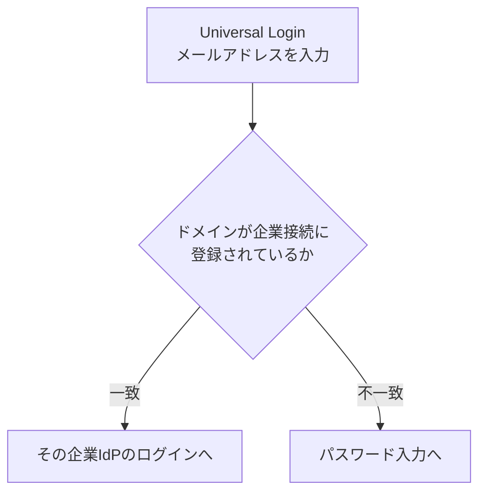

# 【勉強】Okta Customer Identity Cloud (Auth0) — 外部 IdP 連携（Connections・SAML／OIDC・HRD・アカウントのリンク）（2026-10-29）

## 今日のテーマ

Auth0 を「ログインを受ける側」にして、認証そのものは Google などのソーシャル IdP や、企業の SAML／OIDC IdP に任せる **外部 IdP 連携（Connections）** を学びます。Entra ID 編の B2B、Okta Workforce 編のインバウンドフェデレーション、Ping 編の External IdPs と同じテーマの Auth0 版です。

## 概要

Auth0 では、ユーザーの出どころを **Connection（接続）** と呼びます。公式は Connection を「Auth0 とユーザーの出どころをつなぐもの」と位置づけ、種類として外部 IdP（Google、LinkedIn など）、データベース、パスワードレスを挙げています。Auth0 が間に入るので、アプリは出どころの違いを意識せずに済みます。

インフラ出身の方向けにたとえると、アプリの手前に置いたリバースプロキシが、背後の複数の認証基盤を吸収してくれる構成です。アプリは Auth0 とだけ話し、Auth0 が各 IdP と話します。

Dashboard では、ソーシャルは **Authentication > Social**（画面表記は変更される場合があります）、企業向け（SAML、OIDC など）は **Authentication > Enterprise** から作ります。作っただけでは使えず、**Application ごとに Connection を有効化**して初めてそのアプリで使えます。

### SAML 企業接続の認証の流れ（Auth0 が SP）

Auth0 と IdP は直接通信せず、メッセージはすべてユーザーのブラウザを経由します。

この図は SAML の一般的な SP 開始フローを Auth0 の用語に当てはめた概念図です。Auth0 の公式ページには、このリダイレクト連鎖の図そのものはありません（設定手順のみ）。

## 押さえる要点

### 1. SAML 企業接続

公式の手順で IdP 側に登録する Auth0 の値は次の 2 つです。

- **Post-back URL（ACS URL）**: `https://{yourDomain}/login/callback?connection={yourConnectionName}`
- **Entity ID**: 既定は `urn:auth0:{yourTenant}:{yourConnectionName}`（Management API で上書き可能）

Auth0 側に入れる主な項目は、Connection name（作成後は変更不可）、**Sign In URL**、**X.509 Signing Certificate**、Enable Sign Out と Sign Out URL（任意）、Sign Request などです。メタデータは Management API の `metadataXml` か `metadataUrl` で渡せますが、SAML 接続は自動更新されません。`metadataUrl` の内容は一度取得されるだけなので、更新するときは PATCH が必要です。さらに `options` への PATCH はオブジェクト全体を置き換えるため、全パラメーターを含める必要があります。

属性マッピングは Mappings 画面で、IdP のクレームを `email` や `given_name` などの Auth0 の属性に JSON で対応づけます。

### 2. OIDC 企業接続

IdP 側のリダイレクト URI に `https://{YOUR_AUTH0_DOMAIN}/login/callback`（カスタムドメイン利用時はそのドメイン）を登録します。Auth0 側には OpenID Connect Discovery URL、Client ID、**Communication Channel** を設定します。Front Channel は `response_type=id_token`＋`response_mode=form_post`、Back Channel は `response_type=code` で、Back Channel では Client Secret が必要です。Scopes には `openid` が必須で、この接続は `/userinfo` を呼ばないため、ユーザー属性は `id_token` に入っている必要があります。

### 3. ソーシャル接続と開発キー

Google など主要プロバイダーは、Dashboard で有効にするだけで試せます。これは **Auth0 の開発キー（Developer Keys）** が使われるためです。ただし公式は本番で使うべきではないとしています。制限として、同意画面に Auth0 の名前とロゴが出る、**SSO が正しく動かない**、カスタムドメインと併用できない、`prompt=none` が動かず `checkSession()` も壊れる、MFA が失敗する、などが挙げられています。本番では、自分でプロバイダーにアプリを登録し、その Client ID／Secret を Auth0 に設定します。

### 4. Home Realm Discovery（HRD）

メールアドレスを先に入力させ、ドメインから適切な企業 IdP へ振り分ける仕組みです。公式の要件は、New Universal Login、Authentication Profile を Identifier First（または Identifier First + Biometrics）にすること、各企業接続の **Login Experience タブ**にドメインを登録すること（1 接続あたり最大 1,000）です。ドメインが一致しなければパスワード入力に進みます。ボタン表示（Display connection button）でユーザーに IdP を選ばせる方法もあります。

### 5. アカウントのリンク

同じ人が複数の IdP でログインすると、Auth0 ではそのままだと別々のユーザーになります。**アカウントのリンク**は、複数の ID を 1 つのプロフィールにまとめる機能です。プライマリは `user_id` を保持し、セカンダリはプライマリの `identities` に取り込まれます。リンクは `POST /api/v2/users/{id}/identities` で行い、`{id}` はプライマリの `user_id`、本文は `provider` と `user_id` です。必要なスコープは、ユーザー自身が行う場合は `update:current_user_identities`、サーバー側からは `update:users` です。

## 手順や設定のイメージ

1. アプリケーションを Auth0 に登録し、コールバック URL を設定する
2. **Authentication > Enterprise** で SAML または OpenID Connect を作成する（ソーシャルは Social）
3. IdP 側に ACS URL と Entity ID（OIDC は Callback URL）を登録する
4. Auth0 側に Sign In URL と証明書（OIDC は Discovery URL と Client ID）を入れる
5. 属性マッピングを設定する
6. 接続を**対象アプリで有効化**する
7. 必要なら HRD 用のドメインを Login Experience タブに登録する
8. 実際にログインして、リダイレクトと属性反映を確認する

## つまずきやすいところ・注意点

- **有効化し忘れ**: 接続を作っても、Application で有効にしないと使われません
- **開発キーのまま本番へ**: SSO が効かない、同意画面が Auth0 表示になるなどの問題が出ます
- **SAML メタデータは自動更新されない**: IdP の証明書更新時は PATCH が必要です。`options` の PATCH は全体置換です
- **Connection name は変更できない**: ACS URL や Entity ID に入るため、命名は慎重に
- **リンクは認証が前提**: 公式は、リンク前に両方のアカウントを認証するよう求めています。安全でないリンクは、攻撃者が正規アカウントに到達する原因になります
- **要確認**: リンクの自動化条件（メールの検証済みの扱いなど）は、今回確認した公式ページでは明記されていませんでした。実装前に公式で確かめてください

## 今日のまとめ

### ミニ辞書

- **Connection**: Auth0 とユーザーの出どころをつなぐ設定
- **ACS URL**: SAML の応答を受け取る Auth0 側の URL
- **Developer Keys**: 試用向けの Auth0 提供のソーシャル用キー（本番では非推奨）
- **HRD**: メールのドメインで振り分ける仕組み
- **アカウントのリンク**: 複数の ID を 1 つのプロフィールに統合すること

### 理解度チェック

1. SAML 企業接続で、Auth0 は SP と IdP のどちらの立場ですか。SAML の応答はどの経路で Auth0 に届きますか。
2. 接続を作成しただけで、アプリはその IdP でログインできますか。
3. ソーシャル接続を本番で使う前に、なぜ開発キーをやめる必要がありますか。

## 参考リンク

- [Connections（Auth0）](https://auth0.com/docs/authenticate/identity-providers)
- [Connect your app to a SAML identity provider（Auth0）](https://auth0.com/docs/authenticate/identity-providers/enterprise-identity-providers/saml)
- [Connect your app to an OpenID Connect identity provider（Auth0）](https://auth0.com/docs/authenticate/identity-providers/enterprise-identity-providers/oidc)
- [Social Identity Providers（Auth0）](https://auth0.com/docs/authenticate/identity-providers/social-identity-providers)
- [Test Social Connections with Auth0 Developer Keys](https://auth0.com/docs/authenticate/identity-providers/social-identity-providers/devkeys)
- [Identifier First Authentication / Home Realm Discovery（Auth0）](https://auth0.com/docs/authenticate/login/auth0-universal-login/identifier-first)
- [User Account Linking（Auth0）](https://auth0.com/docs/manage-users/user-accounts/user-account-linking)
- [Link User Accounts（Auth0）](https://auth0.com/docs/manage-users/user-accounts/user-account-linking/link-user-accounts)
