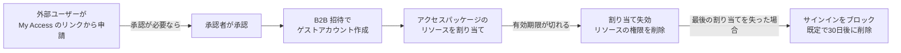

# 【勉強】IGA（アイデンティティガバナンス＆管理）— 外部ユーザー（ゲスト）のガバナンス（Entra：コネクテッド組織・アクセスパッケージ・ゲストのライフサイクル）（2026-11-01）

## 今日のテーマ

「IGA での外部ユーザー（ゲスト）のガバナンス」を学びます。取引先やパートナーを自社のテナントに招き入れるときに、誰が・何に・いつまでアクセスできるかを、招待のたびに手作業で決めるのではなく、ポリシーで管理する方法です。今日は Microsoft Entra ID Governance の Entitlement management（資格管理）を題材にします。

## 概要

外部の人に自社のリソースを使わせたいとき、Entra ID では **B2B コラボレーション**を使います。外部ユーザーは自分の所属組織のディレクトリで認証し、自社ディレクトリには「ゲストアカウント」という分身が作られます。この分身があるので、自社のアプリやグループへ権限を割り当てられます。

ただし、管理者が1人ずつ招待する方式には限界があります。公式ドキュメントも、相手のメールアドレスを事前に知っている必要があること、人数が多い場合や参加者が入れ替わる場合は管理しづらいことを挙げています。

Entitlement management では、次のようにポリシーで運用します。

- 「この組織の人なら、このアクセスパッケージを自分で申請できる」というポリシーを作る
- 承認の要否、アクセスレビューの要否、有効期限（例: 180日）をポリシーに含める
- 期限が切れて最後の割り当てを失ったゲスト（Entitlement management 経由で招待されたゲストが対象）は、既定でサインインをブロックし、30日後に削除する

インフラ運用に例えると、「踏み台サーバーの一時アカウントを、申請・承認・自動失効の仕組みに載せる」ようなものです。アカウントの作りっぱなしを防ぐ点が、IGA の価値です。

## 押さえる要点

- **アクセスパッケージ**: 複数のリソース（グループ、アプリ、SharePoint サイトなど）をひとまとめにして、申請できる単位にしたもの。
- **カタログ**: アクセスパッケージを入れる入れ物。外部ユーザーに使わせるには、カタログの「Enabled for external users」が Yes である必要があります（新規作成の既定値は Yes です）。
- **コネクテッド組織（Connected organization）**: 「付き合いのある外部組織」を表す登録情報。ここに登録した組織の人だけが申請できる、という絞り込みに使います。
- **スポンサー**: コネクテッド組織の窓口になる人（社内メンバー、または招待済みの外部ゲスト）。ポリシーで承認者に指定できます。
- **ポリシーは内部用と外部用で分ける**: 公式によると、1つのポリシーで社内と社外の両方を割り当てることはできません。同じアクセスパッケージに2つのポリシーを作ります。

### コネクテッド組織の識別方法は4種類

公式ドキュメントでは、次の4つが挙がっています。

1. 別の Microsoft Entra ディレクトリのユーザー（どの Microsoft クラウドでも可）
2. SAML/WS-Fed の IdP フェデレーションを設定した、Microsoft 以外のディレクトリのユーザー
3. 組織固有の共通ドメインのメールアドレスを持つ、Microsoft 以外のディレクトリのユーザー（メールのワンタイムパスコードで認証）
4. Microsoft アカウント（live.com など）のユーザー

### 誰に申請を許すか（外部向けポリシーの3択）

「For users not in your directory」を選ぶと、次の3つから選びます。

| 選択肢 | 意味 |
| --- | --- |
| Specific connected organizations | 指定したコネクテッド組織の全ユーザーが申請できる |
| All configured connected organizations | 構成済み（configured）の全コネクテッド組織のユーザーが申請できる |
| All users (All connected organizations + any new external users) | インターネット上の誰でも申請できる。未登録の組織なら、コネクテッド組織が自動作成される |

### 外部ユーザーが入ってから出るまでの流れ

公式の説明（14ステップ）を、要点だけに絞ってフローにしました。



この図は、ゲストの作成から削除までを1本の線で表したものです。実際のポリシーでは、承認なしにしたり、削除しない設定にしたりもできます。

## 手順や設定のイメージ

### 全体の準備手順

公式ドキュメントの流れを要約すると、次の順になります。

1. コネクテッド組織を追加する（Entra 管理センター: ID Governance > Entitlement management > Connected organizations）。
2. カタログの「Enabled for external users」が Yes であることを確認する。
3. 外部向けポリシー（For users not in your directory）を持つアクセスパッケージを作り、対象のコネクテッド組織・承認者・有効期限を指定する。
4. アクセスパッケージを「非表示（Hidden）」にする。非表示にしないと、ポリシーで許可された人が My Access ポータルで一覧から見つけられます。
5. 申請用の My Access ポータルのリンクを、相手組織の窓口（スポンサー）に送る。

操作に必要な権限は、少なくとも Identity Governance Administrator ロールです。

### ゲストのライフサイクル設定

ID Governance > Entitlement management > Control Configurations の「Lifecycle of external users」で、最後の割り当てを失った外部ユーザーの扱いを決めます。

- **Block external user from signing in to this directory**: サインインをブロックする。
- **Remove external user**: ゲストアカウントを削除する。
- **Number of days before removing external user from this directory**: 削除までの日数。0 にすると、最後の割り当てを失った時点で即時に削除します。

既定は「ブロックして、30日後に削除」です（対象は Entitlement management 経由で招待された、または governed に変換されたゲストのみ）。

### Graph PowerShell でコネクテッド組織を確認する

公式の例です。各コネクテッド組織が持つ識別元（identitySources）を一覧にします。

```powershell
Connect-MgGraph -Scopes "EntitlementManagement.ReadWrite.All"

$co = Get-MgEntitlementManagementConnectedOrganization -all

foreach ($c in $co) {
  foreach ($i in $c.identitySources) {
    write-output $c.Id $c.DisplayName $i.AdditionalProperties["@odata.type"]
  }
}
```

### 既存ゲストの棚卸し（アクセスレビュー）

すでにいるゲストの棚卸しには、アクセスレビューを使います。公式では、ゲストを含むグループ、またはゲストが割り当てられたアプリを対象に、次のどちらかでレビューできます。

- ゲスト本人に自分のアクセスが必要かを答えさせる
- グループやアプリのオーナーなど、権限のある人にまとめてレビューさせる

レビュー結果を自動適用し、「回答がなければアクセスを削除」「拒否されたゲストは、30日間サインインをブロックしたうえでテナントから削除」と設定すると、ゲストのB2Bアカウントの掃除まで自動化できます。この削除オプションは「Select Team + Groups」を対象にしたレビューで使え、「All Microsoft 365 groups with guest users」では使えません。

## つまずきやすいところ・注意点

- **自動作成された組織は「proposed」状態**: 「All users」で申請を許すと、未登録の組織のコネクテッド組織が自動作成されます。この状態は proposed で、「All configured connected organizations」の対象には入りません。逆に、管理者が「構成済み」にした組織だけが入ります。ソーシャル ID（個人アカウント）を configured にしないよう公式が注意しています。
- **B2B の許可/拒否リストが優先される**: 許可リストや拒否リストでドメインが弾かれていると、招待できず、アクセスを割り当てられません。「All users」を使うなら、許可リストは外し、拒否リストから正規のドメインを除きます。
- **「All users」にはメールのワンタイムパスコードの有効化が前提**: 公式に前提として書かれています。
- **条件付きアクセスがゲストを締め出すことがある**: ゲストは、登録済みデバイスや既知の場所を持たないのが普通です。ゲストに影響するポリシーから、Entitlement Management アプリを除外しておかないと、My Access にも入れなくなる場合があります。すべてのクラウドアプリをブロックしている場合は、「Request Approvals Read Platform」の除外も必要です。
- **ゲストによる招待は閉じる**: 公式は、Guests can invite を No にし、管理された招待だけを許すことを推奨しています。ゲストがゲストを招待できると、Entitlement management の外側で招待が起きます。
- **削除の対象範囲**: 自動削除されるのは、Entitlement management 経由で招待されたゲスト、または「governed」に変換されたゲストだけです。以前からいたゲストは、そのままでは対象外です。また、アクセスパッケージ以外の方法で与えた SharePoint などの権限があっても、対象のゲストは削除されます。
- **ブロックすると再申請できない**: サインインをブロックされたゲストは、同じアクセスパッケージの再申請も、追加の申請もできません。将来また申請する可能性のある相手には、ブロックの設定を使わない判断もあります。
- **削除時の通知はない**: アクセスパッケージの失効はゲストに通知されますが、アカウントを削除するときの通知はありません。
- **リソース側の設定も必要**: SharePoint の外部共有、Microsoft 365 グループのゲスト受け入れ、Teams のゲストアクセスなどが無効だと、アクセスパッケージに入れても使えません。

## 今日のまとめ

### ミニ辞書

- **B2B コラボレーション**: 外部ユーザーを自社テナントにゲストとして招き、自社リソースを使わせる Entra の仕組み。
- **ゲストアカウント**: 外部ユーザーの、自社ディレクトリ内の分身。
- **コネクテッド組織**: 付き合いのある外部組織の登録情報。configured と proposed の状態がある。
- **スポンサー**: コネクテッド組織の窓口になる人。承認者に指定できる。
- **Lifecycle of external users**: 最後の割り当てを失ったゲストを、ブロックや削除する設定。

### 理解度チェック

1. 取引先 A 社の社員だけに、あるアクセスパッケージを申請させたいとき、まず何を作り、ポリシーのどの選択肢を選びますか。
2. 「All users」で申請を許した結果として自動作成されたコネクテッド組織は、どの状態になりますか。その状態だと、どんな制約がありますか。
3. 外部ユーザーの有効期限が切れて、その人が最後の割り当てを失いました。何も設定を変えていない場合、そのゲストアカウントはどうなりますか。

## 参考リンク

- [Govern access for external users in entitlement management（Microsoft Learn）](https://learn.microsoft.com/en-us/entra/id-governance/entitlement-management-external-users)
- [Manage connected organizations in entitlement management（Microsoft Learn）](https://learn.microsoft.com/en-us/entra/id-governance/entitlement-management-organization)
- [Change request settings for an access package in entitlement management（Microsoft Learn）](https://learn.microsoft.com/en-us/entra/id-governance/entitlement-management-access-package-request-policy)
- [Manage guest access with access reviews（Microsoft Learn）](https://learn.microsoft.com/en-us/entra/id-governance/manage-guest-access-with-access-reviews)
