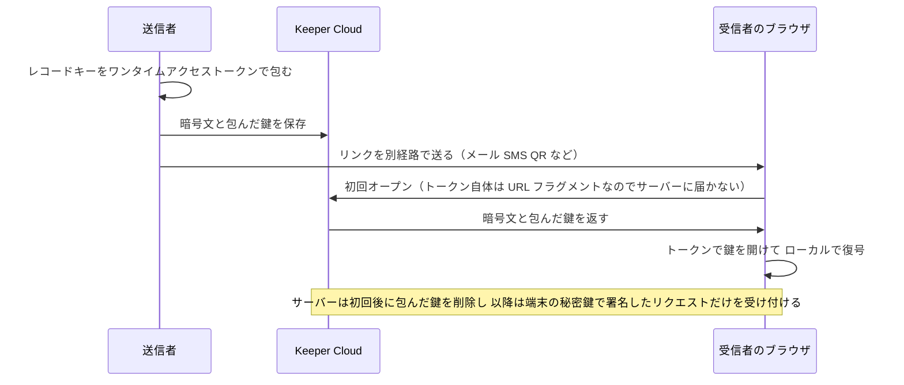

# 【勉強】Keeper — One-Time Share（外部への期限付き共有・デバイス固定・管理者ポリシー）（2026-11-03）

## 今日のテーマ

「Keeper の One-Time Share（ワンタイムシェア）」を学びます。Keeper のアカウントを持たない外部の人（取引先、委託先、入社前の新入社員など）に、レコード（パスワードやファイル）を一時的かつ安全に渡す機能です。外部ユーザーの扱いを学ぶシリーズとして、Entra の B2B ゲスト、Okta・Ping・Auth0 の外部 IdP 連携、IGA のゲストガバナンスに続く、Keeper 版の「外部の人との共有」にあたります。

## 概要

Keeper の通常のレコード共有は、Keeper ユーザー間で行うものです。One-Time Share は「相手が Keeper アカウントを持っていなくても、期限付きのリンクで1件のレコードを渡せる」仕組みです。公式ドキュメントでは、次の性質が挙げられています。

- リンクには有効期限があり、期限が来れば自動的にアクセスできなくなる
- リンクは最初に開いた1台のデバイスにだけ紐付く
- Keeper のゼロナレッジ暗号化で守られ、復号は受信者のデバイス上で行われる

インフラ運用に例えると、「踏み台サーバーの一時ログイン情報を、使い捨てトークン付きのURLで渡し、1回使ったら他の端末では開けない」ような運用を、アプリの機能として提供しているものです。メールやチャットにパスワードを平文で貼る運用を置き換えるのが狙いです。

## 押さえる要点

- **共有の単位はレコード**です。公式ページはレコード単位の共有として説明しています。
- **有効期限**は、1時間・24時間・1週間・30日・90日から選ぶか、日時を指定します（カスタム指定は最長180日）。
- **受け渡し方法**は、リンク、招待文、QRコードから選べます（リンクのほかに招待文もコピーできます）。AirDrop、メール、SMS などの別経路で相手に届けます。
- **デバイス固定**: 最初に開いたデバイスに紐付くため、リンクを転送されても、あるいは受信者のメールアカウントが乗っ取られても、別のデバイスでは開けません。
- **取り消し**: 送信者は共有の横のゴミ箱アイコンでいつでも取り消せます。期限切れの共有は「Expired」タブに移ります。
- **双方向共有（Bidirectional）**: 作成時に「Allow recipient to edit record fields and upload files」にチェックを入れると、受信者がフィールドの編集とファイルのアップロードをでき、変更は送信者のレコードに反映されます（期限切れか取り消しまで）。
- **対応環境**: Web vault のほか、iOS・Android アプリでも使えます。

### 暗号化のしくみ（簡略版）

公式の Enterprise Guide の説明を要約すると、次のとおりです。

1. レコードは 256 ビット AES のレコードキーで暗号化される
2. そのキーを「ワンタイムアクセストークン」で包み、Keeper Cloud には暗号文と、包んだ鍵だけを置く
3. アクセストークンは URL のフラグメント部分（`#` 以降）に入り、フラグメントは Keeper のサーバーに送られないため、Keeper 自身は復号できない
4. 受信者が初めて開いたとき、ブラウザが楕円曲線の鍵ペアを生成して秘密鍵をローカルに保存する。サーバーはそのデバイス向けの包んだ鍵を削除するので、トークンは再利用できない
5. 以降のリクエストは、デバイスの秘密鍵による ECDSA 署名つきで行われる（レスポンスも別の AES-256 通信鍵で保護される。初回はトークンのハッシュで認証されると Enterprise Guide にある）

上の図は仕組みを理解するための簡略版です。ブラウザが生成する鍵ペアの登録など、公式ページに詳細が書かれていない通信は省略しています。

## 設定のイメージ

送信者の操作（Web vault）は次のとおりです。

1. 共有したいレコードを選び、One-Time Share の作成画面を開く（User Guide では「Share」→「One-Time Share」、Enterprise Guide では Edit アイコン→「One-Time Share」と書かれており、画面表記は版により異なる可能性があります）
2. 有効期限を選ぶ。相手に編集させたい場合だけ、編集許可のチェックを入れる
3. 作成したリンク、招待文、QRコードのいずれかで相手に届ける（ボタン名は実画面で要確認）

管理者の操作（Admin Console）は次のとおりです。

- 制御の場所は **Role > Enforcement Policies > 「Creating and Sharing」** です。One-Time Share はここで有効・無効を切り替えます。
- 公式ドキュメントでは、**既存の Enterprise 顧客は、既定のロールポリシーで One-Time Share が無効**になっており、使わせるには管理者が有効にする必要があります。その後に作成したロールポリシーは既定で有効です。
- 公式の User Guide は「管理者は One-Time Share と双方向 One-Time Share を制限できる」と述べていますが、双方向だけを切り替える独立した設定名は、Enterprise Guide の該当ページには載っていません（要確認）。

## つまずきやすいところ・注意点

- **使えるレコードに条件があります**: 2021年4月26日にレコードタイプが導入されたあとに作られたレコードだけが対象です。オプションが出ないときは、新しいレコードで試してください。
- **プライバシースクリーンが有効なレコードでは使えません**（Enterprise Guide の記述）。
- **「共有できない」ときは管理者設定を疑う**: 既存テナントでは既定が無効のため、ロールの「Creating and Sharing」ポリシーを確認します。
- **リンクを誤送信したとき**は、ゴミ箱アイコンで取り消し、新しいリンクを作り直すのが基本です。公式の記載どおり、リンクは最初に開いたデバイスに紐付くため、第三者に先に開かれると、本来の受信者は開けなくなると考えられます（この点は公式に明記された挙動ではなく、仕様からの推測です）。
- **リンクとは別に説明を補う**: リンクのほかに招待文もコピーして送れます。
- 今回の調査では、公式ページ上で One-Time Share の監査イベントの記述を確認できませんでした。監査での追跡方法は要確認です。

## 今日のまとめ

### ミニ辞書

- **One-Time Share**: Keeper アカウントを持たない相手に、期限付きで1件のレコードを共有する機能。
- **ゼロナレッジ**: Keeper のサーバーが、ユーザーのデータを復号できない設計。
- **URL フラグメント**: URL の `#` 以降の部分。ブラウザ内でだけ使われ、サーバーには送られない。
- **デバイス固定**: リンクが最初に開いた端末にだけ紐付くこと。
- **双方向共有**: 受信者がレコードを編集し、送信者側に反映できる設定。

### 理解度チェック

1. 受信者のメールアカウントが乗っ取られても、リンクを別デバイスで開けないのはなぜですか。
2. 既存の Enterprise テナントで、ユーザーが One-Time Share を使えないとき、管理者はどこを確認しますか。
3. Entra の B2B ゲストと Keeper の One-Time Share は、「外部の人に渡す」点が共通ですが、相手のアカウントの有無という観点でどう違いますか。

## 参考リンク

- [One-Time Share（Keeper Docs, User Guide）](https://docs.keeper.io/user-guides/sharing/one-time-share)
- [One-Time Share（Keeper Docs, Enterprise Guide）](https://docs.keeper.io/enterprise-guide/sharing/one-time-share)
- [Sharing（Keeper Docs, Enterprise Guide。One-Time Share は一行の概要のみ）](https://docs.keeper.io/enterprise-guide/sharing)
