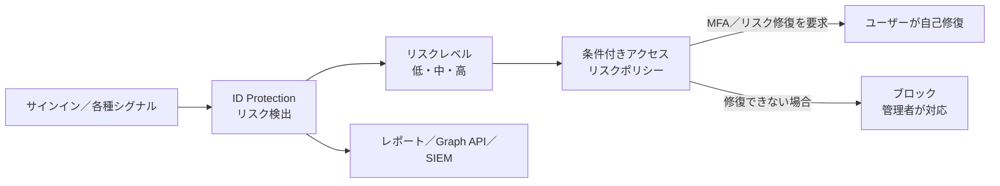
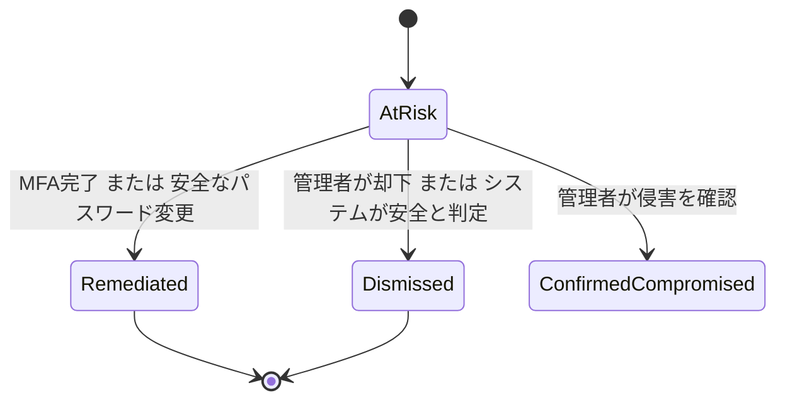

# 【勉強】Microsoft Entra ID — ID Protection（リスク検出とリスクベース条件付きアクセス）（2026-11-04）

## 今日のテーマ

Microsoft Entra ID Protection で「危ないサインイン／危ないユーザー」を自動検知し、条件付きアクセス（Conditional Access）と組み合わせて自動で対処する仕組みを学びます。

## 概要

ID Protection は、アイデンティティに関するリスクを「検出（Detect）→調査（Investigate）→修復（Remediate）」する機能です。検出したリスクは、条件付きアクセスでのアクセス判断に使えるほか、SIEM に送って調査・相関分析にも使えます。

インフラ出身の方には、「IDの世界の異常検知（IDS/IPS 的なもの）が、認証のたびに走り、結果を認可ポリシーに直結できる」と捉えると掴みやすいと思います。

大事なのは、リスクが 2 種類あることです。

- **サインインリスク**: 「そのサインインが侵害されているかもしれない」可能性の高さ。サインインのたびに評価されます。
- **ユーザーリスク**: 「このアカウント自体が侵害されているかもしれない」可能性。漏洩した資格情報の検出などで上がります。

リスクレベルは低・中・高の 3 段階です。高は「アカウントが侵害されている確度が高い」ことを示します。

次の図は、検出から自動修復までの全体の流れです。

この図は「検出したリスクのレベルを条件付きアクセスが受け取り、ユーザーに自己修復させる（できなければブロック）」という流れを表しています。

## 押さえる要点

- **ライセンス**: リスクポリシーとレポートの全機能には Microsoft Entra ID P2（または Entra Suite）が必要です。Free／P1 では、一部の検出の詳細が見えず「Additional risk detected（追加のリスクを検出）」と表示されます。
- **3 つのレポート**: 「リスク検出」「リスクのあるサインイン」「リスクのあるユーザー」です。
- **検出のタイミング**: リアルタイム検出はレポートに 5〜10 分で反映され、オフライン検出は最大 48 時間かかります。そのためリスクレベルは後から変わることがあります。
- **代表的な検出の例**:
  - 匿名 IP アドレス（Tor や匿名 VPN など。リアルタイム、Free／P1 でも利用可）
  - 漏洩した資格情報（Leaked credentials。常に高リスク。オフライン、Free／P1 でも利用可）
  - パスワードスプレー（スプレー後に攻撃者が資格情報の検証に成功したときのみ検出）
  - 通常と異なる移動（Atypical travel）、見慣れないサインインプロパティ
  - 異常なトークン（Anomalous token）などのトークン窃取系
- **リスクの保持期間**: 低リスクの検出とユーザーは 6 か月で自動的に消えます。中・高は修復または却下されるまで残ります。
- **必要なロール**: レポートの参照は Security Reader（読み取り専用なら Global Reader も可）、リスクの却下は Security Operator、ポリシーの作成は Conditional Access Administrator が最小権限として案内されています。パスワードのリセットには別途 User Administrator が必要です。

## 手順や設定のイメージ

現在のリスクポリシーは、**条件付きアクセスの中**で作ります。ID Protection 側にあった旧来のリスクポリシーは、公式ドキュメントで 2026 年 10 月 1 日に廃止されると案内されています。まだ旧ポリシーを使っている環境があれば、条件付きアクセスへの移行が必要です。

Microsoft の推奨構成は次の 2 本です。

1. **ユーザーリスクポリシー**: 条件「ユーザーのリスク」を **高** にし、許可コントロールで「リスクの修復を要求する」を選びます。すると「認証強度を要求」が自動で選択され、セッションコントロールに「サインインの頻度：毎回」が自動で適用されます。パスワードを持つユーザーは MFA のあとに安全なパスワード変更を求められ、パスワードレスのユーザーはセッションが失効して再認証になります。
2. **サインインリスクポリシー**: 条件「サインインのリスク」を **中と高** にし、許可コントロールで認証強度「多要素認証」を要求します。セッションの「サインインの頻度：毎回」も併用します。

設定の流れは、Entra 管理センターの［Entra ID］>［条件付きアクセス］>［新しいポリシー］です。いきなり有効化せず、最初に **レポート専用** で作り、影響を確認してから「オン」にします。

ユーザーの修復後には、リスクの状態が次のように遷移します。

この図は、リスクの状態（At risk／Remediated／Dismissed／Confirmed compromised）の遷移を表しています。管理者が「侵害を確認」した場合は、パスワード変更の要求やリフレッシュトークンの失効なども別途検討します。

## つまずきやすいところ・注意点

- **事前に MFA 登録が必要**: ユーザーは、リスクに遭遇する前に MFA を登録しておく必要があります。未登録のユーザーはブロックされ、管理者の介入が必要になります。
- **ハイブリッド環境**: 同期されたユーザーがパスワード変更で自己修復するには、パスワードライトバックが必要です（リスクポリシーの前提として公式が明記）。オンプレミスでのパスワード変更でリスクをリセットするには、パスワードハッシュ同期の有効化と、ID Protection の設定「Allow on-premises password change to reset user risk」の有効化が必要です。
- **サインインリスクとユーザーリスクの条件は同じポリシーに入れない**: 公式が「別々のポリシーにする」よう警告しています。
- **除外設定**: 緊急用アクセス（break-glass）アカウントは必ずポリシーから除外します。サービスアカウントは、ユーザー対象のポリシーでは守られないため、ワークロード ID 向けの条件付きアクセスやマネージド ID への置き換えを検討します。
- **自動ブロック**: ID Protection は、リスクの確度が非常に高いサインインを自動でブロックします。多いのはレガシー認証プロトコルでのサインイン、または悪意ある試行の特徴を示すサインインです。ユーザーにはエラー 50053 が返ります。解除は、信頼できる場所への IP 追加か、モダン認証への切り替えで行います。
- **トークン窃取系の検出**: 異常なトークンなどの検出では、MFA 済みのセッションでも自動修復されなくなっています。ユーザーリスクポリシーがあると、安全なパスワード変更と再認証を求められます。
- **「パスワード変更」と SSPR は別の流れ**: リスク修復のパスワード変更は、現在のパスワードを知っているユーザーが MFA 後に行う操作です。SSPR（自己サービスのパスワードリセット）は忘れた場合の回復用で、こちらもユーザーリスクを修復します。

## 今日のまとめ

### ミニ辞書

- **サインインリスク**: そのサインインが侵害されている可能性の高さ。
- **ユーザーリスク**: アカウント自体が侵害されている可能性の高さ。
- **リスクレベル**: 低・中・高の 3 段階。
- **自己修復**: ユーザーが MFA や安全なパスワード変更を完了して、自分でリスクを解消すること。
- **レポート専用モード**: ポリシーを強制せず、影響だけを記録するモード。
- **break-glass アカウント**: 全管理者がロックアウトされたときの緊急用アカウント。

### 理解度チェック

1. サインインリスクポリシーとユーザーリスクポリシーで、推奨される対象リスクレベルと許可コントロールはそれぞれどう違いますか。
2. ユーザーが MFA を登録していない状態でリスクポリシーに該当すると、何が起きますか。
3. 旧来の ID Protection のリスクポリシーはどうなり、何に移行すべきですか。

## 参考リンク

- [What is Microsoft Entra ID Protection?](https://learn.microsoft.com/en-us/entra/id-protection/overview-identity-protection)
- [What are risk detections?（Risk detection and event types）](https://learn.microsoft.com/en-us/entra/id-protection/concept-identity-protection-risks)
- [Risk detection types and levels](https://learn.microsoft.com/en-us/entra/id-protection/concept-risk-detection-types)
- [Configure and enable risk policies](https://learn.microsoft.com/en-us/entra/id-protection/howto-identity-protection-configure-risk-policies)
- [Remediate risks and unblock users](https://learn.microsoft.com/en-us/entra/id-protection/howto-identity-protection-remediate-unblock)
