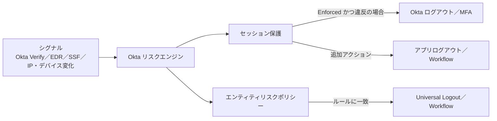
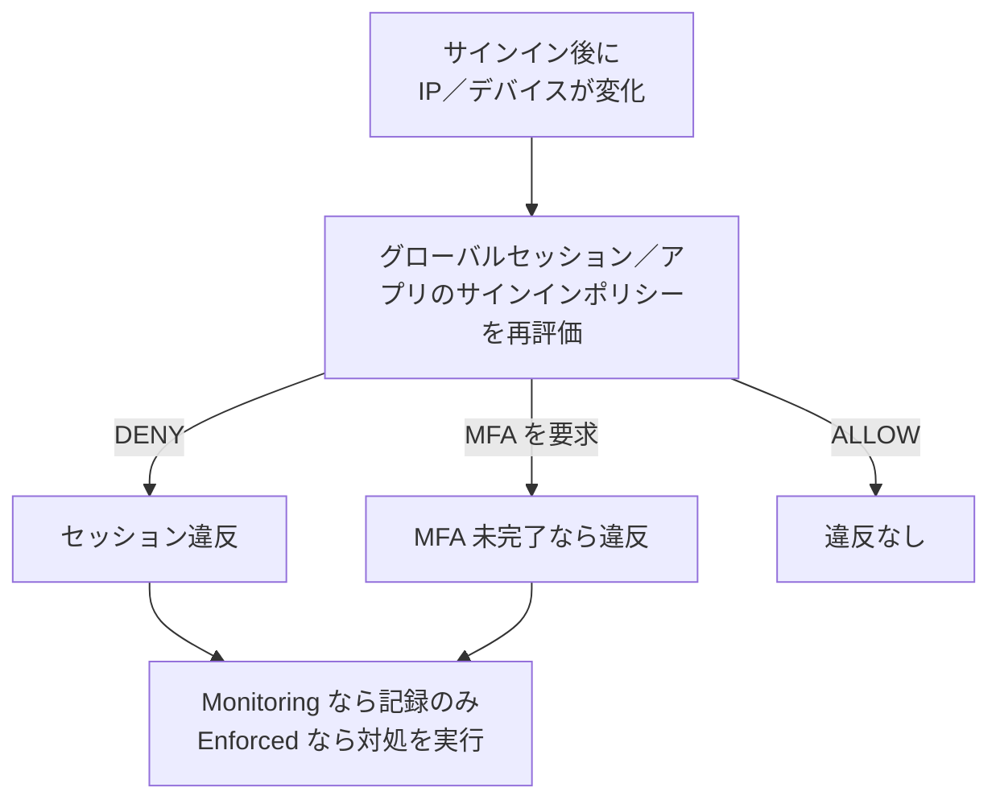

# 【勉強】Okta Workforce Identity Cloud — Identity Threat Protection（セッション保護・エンティティリスクポリシー・Universal Logout）（2026-11-05）

## 今日のテーマ

Okta Identity Threat Protection（ITP）が、サインイン後のセッションとユーザーのリスクを継続的に監視し、異常があれば自動で対処する仕組みを学びます。昨日の Entra ID Protection の Okta 版にあたるテーマです。

## 概要

通常の認証ポリシーは「サインインの瞬間」に評価されます。ITP は、サインインした後も IP やデバイスの変化、リスクシグナルを見続け、状況が変われば再評価して対処します。公式ドキュメントでは、ITP を継続的な ID 脅威対策（continuous identity threat solution）と位置づけています。

インフラ出身の方には、「入口のファイアウォール（認証ポリシー）」に加えて、「通信中も監視し続けて不審なら接続を切る IPS」が付くイメージが近いと思います。

ITP の対処は大きく 2 つの機構に分かれます。

- **セッション保護（Session protection）**: セッションの乗っ取りを検知して防ぐ。IP やデバイスが変わったら再評価する。
- **エンティティリスクポリシー（Entity risk policy）**: ユーザー単位のリスク検出に応じて、ログアウトや Workflows を実行する。

どちらの対処にも、アプリ側のセッションとトークンを無効化する **Universal Logout** を組み合わせられます。

次の図は、全体の流れです。

この図は、複数のシグナルがリスクエンジンに集まり、2 つのポリシーを経て、ログアウトや Workflow に至る流れを表しています。

## 押さえる要点

- **シグナルの入口**: Okta Verify と連携した EDR（対応は CrowdStrike Falcon と Windows Security Center）、Shared Signals Framework（SSF）で連携するセキュリティイベントプロバイダーなどです。
- **リスクの種類**: 公式のリスクエンジンはログイン・セッション・エンティティの各リスクを算出します。本記事では、このうちセッションリスクとエンティティリスクを扱います。セッションリスクの代表が「セッション乗っ取りの疑い」です。エンティティリスクの検出は System Log の `user.risk.detect` に記録されます。
- **エンティティリスク検出の例**: 漏洩した資格情報の検出（High）、ブルートフォースの疑い（Medium）、「This wasn't me」というユーザー報告（High）、管理者によるリスク変更（Low／Medium／High）などです。公式ページには全 13 種類が載っています。
- **リスクレベル**: Low／Medium／High の 3 段階です。
- **セッション保護のステータス**: **Monitoring** は違反を System Log に記録するだけで、対処はしません。**Enforced** はセッション違反のあるユーザーに対し、Okta からのログアウトと MFA を実際に実行します（MFA は「MFA if possible」で、ポリシーが要求する場合に限られます）。公式の Get started ページによると、セッション保護ポリシーは既定で監視し、System Log に記録します。
- **エンティティリスクポリシー**: 組織に 1 つあり、既定ルールは記録のみです。追加ルールで、グループ・検出の種類・リスクレベルを条件に、ログアウトやトークン失効、Workflow を実行できます。

## 手順や設定のイメージ

**セッション保護**（スーパー管理者または org admin が設定）:

1. 管理コンソールで［Security］>［Identity Threat Protection］>［Detection and Response］タブ>［Session Protection］を開く。
2. ステータスを Monitoring か Enforced にする。
3. 「Session violation detection」で、再評価するリスクレベル（既定は Low and above）と、ユーザーの新しい IP の条件（Any IP／指定ゾーン内／指定ゾーン外）を決める。
4. 「Enforcement settings」では、MFA if possible と Okta logout が既存のポリシーから継承されて表示される。追加で、［Run an additional action］からアプリログアウトまたは Workflow を選ぶ。アプリログアウトは、アプリのサインインポリシー違反で、かつ Universal Logout 対応アプリの場合に働く。
5. 「Groups impacted」で、追加アクションを適用するグループを選び、［Save］する。

次の図は、セッションの再評価の結果を表しています。

**エンティティリスクポリシーのルール**（スーパー管理者、または Manage policy 権限と Entity risk policy リソースを持つカスタムロール）:

1. ［Security］>［Entity Risk Policy］>［Add Rule］。
2. ルール名、グループ、検出（Any／含める／除外する）、Entity Risk Level（Any／Low／Medium／High）を選ぶ。
3. ［Take this action］で、No further action、Logout and revoke tokens（Universal Logout か Partial Universal Logout）、Run a Workflow のいずれかを選ぶ。ログアウト系と Workflow は組み合わせられる。
4. ［Save］。

**Universal Logout の有効化**は、アプリごとに行います。［Applications and Resources］>［Applications］で対象アプリを開き、［Sign On］または［Authentication］タブの［Logout］で［Okta system or admin initiates logout］を選びます。OIN アプリの場合は、アプリ側の管理者の認証情報を入力して［Connect account］で接続します。汎用 SAML／OIDC アプリの場合は、［Global Token Revocation］でログアウトエンドポイントの URL を指定します（認証タイプは既定で Signed JWT、サブジェクト形式は Issuer and Subject Identifier か Email Identifier）。

## つまずきやすいところ・注意点

- **まず Monitoring から始める**: 既定のまま記録だけを見て影響範囲を確認してから、Enforced にします。
- **前提条件**: Okta FastPass と Okta Verify の導入と、ユーザーの登録が必要です（Okta Verify は Android 7.26／iOS 9.9／macOS 9.8／Windows 4.9.1 以降）。
- **プロキシ経由の場合**: 公式の手順に従い、元のクライアント IP を `X-Forwarded-For` に入れ、Trusted proxy IPs にプロキシの IP を含む有効な IP ゾーンを設定し、IP exempt zone でゲートウェイの IP からの通信を許可します（IP 変化を検出するための手順です）。
- **Universal Logout の対象**: 汎用 SAML／OIDC アプリは、Global Token Revocation と署名付き JWT に対応している必要があります。Federation Broker Mode が有効なカスタム SAML／OIDC アプリでは動きません。Okta Identity Governance と Okta Privileged Access は非対応です。
- **デバイスのログアウト**: デバイスは 15 分ごとのベストエフォートでコマンドを取得するため、即時ではありません。また、デバイスと Okta org の間の接続が有効であることが必要です。
- **ライセンス**: 公式の Get started ページに必要なエディションの記載はありません。要確認（契約や営業窓口で確認してください）。

## 今日のまとめ

**ミニ辞書**

- **ITP**: サインイン後も継続して脅威を評価し、自動対処する Okta の機能。
- **セッション保護**: IP／デバイスの変化で再評価し、乗っ取りを防ぐ仕組み。
- **エンティティリスクポリシー**: ユーザーのリスク検出に応じて対処を決めるポリシー。
- **Universal Logout**: 対応アプリのセッションとトークンをまとめて無効化する機能。
- **SSF**: セキュリティイベントを標準形式で共有する Shared Signals Framework。

**理解度チェック**

1. セッション保護の Monitoring と Enforced では、何が違いますか。
2. エンティティリスクポリシーの既定ルールは、何をしますか。
3. 汎用 SAML アプリで Universal Logout を使うには、アプリ側に何が必要ですか。

## 参考リンク

- [Identity Threat Protection（概要）](https://help.okta.com/oie/en-us/Content/Topics/itp/overview.htm)
- [Identity Threat Protection key concepts](https://help.okta.com/oie/en-us/Content/Topics/itp/key-concepts.htm)
- [Get started with Identity Threat Protection](https://help.okta.com/oie/en-us/Content/Topics/itp/get-started.htm)
- [Risk detections](https://help.okta.com/oie/en-us/Content/Topics/itp/detections.htm)
- [Entity risk policy](https://help.okta.com/oie/en-us/Content/Topics/itp/entity-risk-policy.htm)
- [Add an entity risk policy rule](https://help.okta.com/oie/en-us/Content/Topics/itp/add-entity-risk-policy-rule.htm)
- [Session protection](https://help.okta.com/oie/en-us/Content/Topics/itp/continuous-access-evaluation.htm)
- [Configure session protection](https://help.okta.com/oie/en-us/Content/Topics/itp/configure-session-protection.htm)
- [Universal Logout](https://help.okta.com/oie/en-us/Content/Topics/itp/universal-logout.htm)
- [Configure Universal Logout for supported apps](https://help.okta.com/oie/en-us/Content/Topics/itp/config-universal-logout.htm)
- [Universal Logout supported apps and devices](https://help.okta.com/oie/en-us/Content/Topics/itp/universal-logout-supported-apps.htm)
