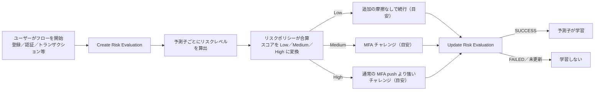
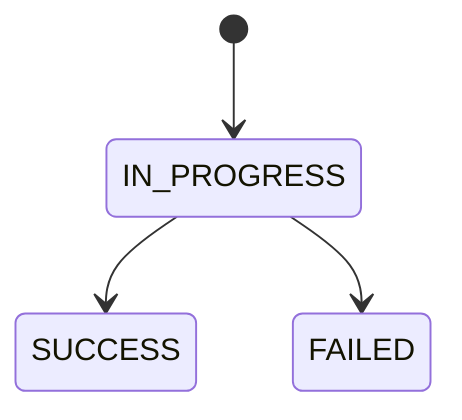

# 【勉強】Ping Identity — PingOne Protect（予測子・リスクポリシー・リスク評価と完了ステータス）（2026-11-08）

## 今日のテーマ

PingOne Protect が、サインインや登録のたびに「このリクエストはどれくらい怪しいか」を採点し、Low／Medium／High を返す仕組みを学びます。Entra ID の ID Protection（11/4）、Okta の Identity Threat Protection（11/5）に続く、Ping Identity 版のリスク検知です。

## 概要

PingOne Protect は、アカウント乗っ取りや新規アカウント詐欺を防ぎつつ、MFA の頻度を減らしてユーザー体験を良くするためのサービスです。公式ドキュメントでは、アクセス・認証・認可・登録・トランザクションの各フローで使えると説明されています。

土台になる要素は 2 つです。

- **予測子（Predictor）**: 「匿名ネットワークからのアクセスか」のように、1 つの要因だけを見てリスクレベルを見積もる部品です。
- **リスクポリシー（Risk policy）**: 複数の予測子の結果を合算し、最終的に Low／Medium／High を決めるルール集です。

そして、ユーザーがフローを始めるたびに作られるのがリスク評価（Risk evaluation）です。インフラ出身の方には、複数のセンサー（予測子）の出力を重み付けで足し合わせ、しきい値でアラートの重大度を決める監視設計に近いイメージだと思います。

次の図は、DaVinci などのフローにリスク評価を組み込んだときの流れです。

この図は、評価を作る段階と、フローの終わりに結果を返す段階が対になっていることを表しています。Low／Medium／High ごとの対応は、公式のベストプラクティスで示された目安です（recommendedAction が付く場合はそちらを優先します）。

## 押さえる要点

- **予測子は 14 種類**: AitM（Adversary-in-the-Middle）、匿名ネットワーク検出、ボット検出、メールレピュテーション、ジオベロシティ異常、IP レピュテーション、IP ベロシティ、新規デバイス、PingID Device Trust（ワークフォースのみ）、不審デバイス、トラフィック異常、ユーザーベースのリスク行動、ユーザー位置異常、ユーザーベロシティです。
- **ライセンスで使える予測子が変わる**: PingOne Risk ライセンスで使えるのは、匿名ネットワーク検出、ジオベロシティ異常、IP レピュテーション、IP ベロシティ、新規デバイス、ユーザーベースのリスク行動、ユーザー位置異常、ユーザーベロシティの 8 つです。残りは PingOne Protect ライセンスが必要です（PingID Device Trust は加えて PingID ライセンスが必要）。
- **Signals SDK が必須の予測子**: AitM、ボット検出、不審デバイス、ユーザーベースのリスク行動の 4 つは、PingOne Signals (Protect) SDK が必須です。新規デバイスは SDK が必須とは明記されておらず、SDK が使えない場合は外部デバイス ID やクッキー＋User Agent で代替できます。SDK は端末側でシグナルを集めるライブラリで、リスク評価にそのデータを渡します。
- **スコア方式**: 予測子のリスクレベルを数値（最大 100）に対応づけて足し合わせます。既定のリスクポリシーは、IP 関連の予測子の High を 50、それ以外を 75 にしています。公式は「IP 関連の予測子は、他の予測子より危険な状況を示す度合いが低い」という前提だと説明しています。重み（Weights）方式は、新規の PingOne 環境では非推奨です。
- **ポリシーの種類**: Global（従来型。環境内で渡すポリシーを選ぶ）と Targeted（フロー種別・アプリ・グループを条件にする）があります。Targeted は一覧の上から順に評価し、条件に合った時点で止まります。
- **オーバーライドとミティゲーション**: オーバーライドは、計算されたスコアに関係なく最終レベルを固定するルールです（Global ポリシー向け）。ミティゲーションは「新規デバイスなら MFA を要求」のように推奨アクションを返すルールで、上から順に評価して最初に一致した時点で止まります。範囲の狭いルールを上に置きます。
- **評価結果の主な項目**: `result.level`（LOW／MEDIUM／HIGH）と `result.score` は常に返ります。`result.recommendedAction` は攻撃の種類に応じて返ることがあり、値は `ACCOUNT_RECOVERY`／`AITM_MITIGATION`／`BOT_MITIGATION`／`DENY`／`TEMP_EMAIL_MITIGATION` です。`result.mitigations` は、一致したミティゲーションルールがある場合のみ返ります。`result.value` はオーバーライドの Notes（自由記述）です。

## 手順や設定のイメージ

リスクポリシーを作る流れ（管理コンソール）:

1. ［Threat Protection］>［Risk Policies］を開き、Global か Targeted のタブを選ぶ。
2. 追加アイコンで新規作成する。名前を付ける。Global ポリシーなら、［Assistant］（Risk Policy Assistant）で質問に答えて雛形を作れる。
3. Targeted ならフロー種別・アプリ・グループを選ぶ。
4. 予測子を追加し、リスクレベルごとのスコアを設定する。
5. Medium と High になる合計スコアのしきい値を決める。
6. 必要ならオーバーライドやミティゲーションを足し、Apply で保存する。

DaVinci フローでの組み込み:

- 判断したい位置に PingOne Protect コネクターの **Create Risk Evaluation** を置く。入力は User Name／User ID／IP などで、Risk Policy ID は任意（省略すると既定のポリシー）。
- 端末の識別には Signals SDK のデータを渡す。SDK を使えない場合の代替として、永続クッキーと User Agent、または独自の外部デバイス ID も使える。
- 結果の level や recommendedAction で分岐させる。
- フローの終わりに完了ステータスを返す（下の図）。リスク評価の後に、成功・失敗を返すレスポンス系のコネクターなどが各分岐にあれば自動で処理されます。ない場合は Update Risk Evaluation を手動で追加します。

この図は、公式の説明を図にしたもので、完了ステータスの遷移を表しています。SUCCESS は「アクセスを許可した、または MFA に成功した」場合、FAILED は「拒否した、または MFA に失敗した」場合です。更新しなければ IN_PROGRESS のままで残ります。

## つまずきやすいところ・注意点

- **完了ステータスを返し忘れると学習しない**: 多くの予測子は、ユーザーの場所や OS などの特徴を成功したアクセスから学習します。学習できるのは `completionStatus=SUCCESS` のイベントだけで、更新しないと予測子は訓練モードのままです。
- **新規デバイス予測子は、デバイス識別情報が必要**: 既定のポリシーに入っていても、フローから端末を識別できる情報を渡さないと実際の評価には反映されません。識別は、外部デバイス ID、SDK のデバイス ID、クッキー＋User Agent の順で試されます。
- **カスタマイズは学習後に**: 最初は既定ポリシーで本番データを学習させます。目安は、ワークフォースで 1〜3 週間、カスタマー用途で 2〜4 週間です。その後に誤検知を分析してスコアを調整します。
- **しきい値の変更は、ステージングポリシーで試す**: 本番ポリシーを直接触る前に影響を確認できます。
- **High の扱いは状況で分ける**: 公式のベストプラクティスは、High は正当なユーザーにも返ることがあるため、一律にブロックせず通常の MFA push より強いチャレンジを出すことを勧めています（should probably not block）。一方、AitM（アカウントのロックも推奨）やトラフィック異常の DENY のように、recommendedAction が明確なケースは拒否が推奨されています。
- **ミティゲーションの順序**: 広い範囲のルールを先に置くと、下の狭いルールが評価されません。

## 今日のまとめ

**ミニ辞書**

- **予測子**: 1 つの要因を見てリスクレベルを出す部品。
- **リスクポリシー**: 予測子の結果を合算して最終レベルを決めるルール。
- **リスク評価**: フローごとに作られる、スコアとレベルを含む評価結果。
- **ジオベロシティ**: 2 回のサインイン地点間を移動できる時間かどうかで不審さを見る指標。
- **AitM**: リバースプロキシで資格情報とセッショントークンを盗む攻撃。OTP 型 MFA の保護を回避する。
- **完了ステータス**: 評価に対する結果（SUCCESS／FAILED）。予測子の学習に使う。

**理解度チェック**

1. Create Risk Evaluation だけを置いて Update Risk Evaluation を省略（かつ自動処理もされない）と、予測子にどんな影響が出ますか。
2. Targeted ポリシーが複数あるとき、どのポリシーが使われますか。ミティゲーションルールの評価順序との共通点は何ですか。
3. AitM、ボット検出、不審デバイス、ユーザーベースのリスク行動の予測子を使うために、フロー側で何を用意しますか。

## 参考リンク

- [Getting started with PingOne Protect](https://docs.pingidentity.com/pingone/threat_protection_using_pingone_protect/p1_protect_getting_started.html)
- [Risk policies](https://docs.pingidentity.com/pingone/threat_protection_using_pingone_protect/p1_protect_risk_policies.html)
- [Adding a risk policy](https://docs.pingidentity.com/pingone/threat_protection_using_pingone_protect/p1_protect_adding_risk_policy.html)
- [Predictors](https://docs.pingidentity.com/pingone/threat_protection_using_pingone_protect/p1_protect_risk_predictors.html)
- [Risk evaluations](https://docs.pingidentity.com/pingone/threat_protection_using_pingone_protect/p1_protect_risk_evaluations.html)
- [Updating completion status for risk evaluations](https://docs.pingidentity.com/pingone/threat_protection_using_pingone_protect/p1_protect_updating_completion_status_risk_evaluations.html)
- [Best practices for PingOne Protect](https://docs.pingidentity.com/pingone/threat_protection_using_pingone_protect/p1_protect_best_practices.html)
- [PingOne Protect Connector](https://docs.pingidentity.com/connectors/p1_protect_connector.html)
