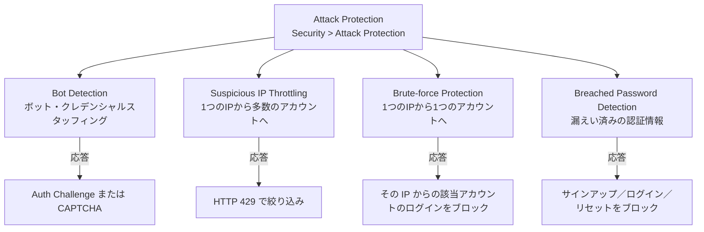
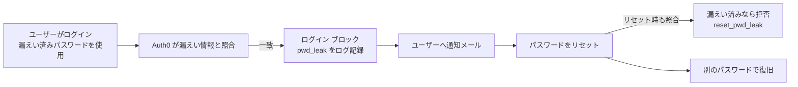

# 【勉強】Okta Customer Identity Cloud (Auth0) — Attack Protection（Brute-force・Suspicious IP・Bot Detection・漏えいパスワード検知）（2026-11-09）

## 今日のテーマ

Auth0 の「Attack Protection（攻撃防御）」を学びます。パスワードを総当たりで試す攻撃や、漏えい済みのパスワードを使い回す攻撃を、テナント側の設定だけでどこまで止められるかが論点です。Entra ID の ID Protection（11/4）、Okta の Identity Threat Protection（11/5）、PingOne Protect（11/8）に続く、Okta Customer Identity Cloud（Auth0）版の防御機能です。

## 概要

Auth0 の公式ドキュメントでは、Attack Protection は次の 4 つの機能で構成されています。

- **Bot Detection（ボット検知）**: ログイン・サインアップ・パスワードリセットに対するボットを、統計モデルで検知します。
- **Suspicious IP Throttling（不審な IP の絞り込み）**: 1 つの IP から多数のアカウントを狙う高速な通信を絞ります。
- **Brute-force Protection（ブルートフォース防御）**: 1 つの IP から 1 つのアカウントを狙う連続失敗を止めます。
- **Breached Password Detection（漏えいパスワード検知）**: すでに漏えいが確認された認証情報の利用を検知・遮断します。

設定場所は Auth0 Dashboard の［Security］>［Attack Protection］です。インフラ出身の方には、WAF のレート制限（Suspicious IP）、fail2ban のような連続失敗の遮断（Brute-force）、IP レピュテーション（Bot Detection）、漏えい情報との突き合わせ（Breached Password）が 1 つの画面に並んでいる、というイメージが近いと思います。

次の図は、4 つの機能が「何を」見て「どう応答するか」を整理したものです。

この図は 4 機能の守備範囲の違いを表しており、検知の軸が「IP の評判」「IP あたりの速度（アカウント横断）」「IP あたりの速度（アカウント単位）」「認証情報そのもの」と異なる点が重要です。

## 押さえる要点

- **Brute-force Protection**: 既定で有効（公式の記載は「Block Brute-force Logins が既定でオン」）で、管理者を含むすべてのユーザーが対象です。既定のしきい値は「同じ IP から同じ識別子（ユーザー名やメールなど）への連続 10 回の失敗」で、カスタム設定では 1〜100 回の範囲で指定できます。しきい値に達すると、以降のリクエストは HTTP 429（`too_many_attempts`）で拒否されます。対象はログインのみで、ブロック中の識別子でもサインアップは可能です。
- **2 つのブロック設定**: 「Block Brute-force Logins」（既定でオン）は、攻撃元の IP からその識別子へのログインだけを止めます。「Account Lockout」（既定でオフ）は、どの IP からでもその識別子のログインを止めます。後者は強力ですが、筆者の推測として、攻撃者が任意のユーザーを締め出せる余地も生みうると考えられます（公式の記述ではありません）。
- **ブロックの解除**: ブロックは最後の失敗から 30 日で自然に消えるほか、ユーザーが通知メールの解除リンクを押す、パスワードを変更する、管理者がしきい値を上げる、Management API の `DELETE /user-blocks`（識別子を指定）を呼ぶことでも解除されます。
- **Suspicious IP Throttling**: 既定で有効で、Auth0 は無効化しないよう強く勧めています。ログインとサインアップを別々に数えます。カスタムしきい値では、ログインは「1 日あたりの失敗回数（Maximum Attempts）」と「新しいトークンの付与レート（Throttling Rate）」、サインアップは「Maximum Attempts」と付与レートを設定します（Dashboard の説明は「1 分あたり」ですが、同じページの仕組みの節には「1 日あたり」とも読める記述があり、**要確認**）。既定の数値も公式ページに明記がありません。
- **Bot Detection**: 既定の応答は Auth Challenge（CAPTCHA を使わない検証。JavaScript が必要）です。ほかに Simple CAPTCHA やサードパーティの CAPTCHA も選べます。CAPTCHA を出す条件は Never／When Risky／Always で、When Risky の場合は Bot Detection Level（Low／Medium／High、既定は Medium）で感度を決めます。Enterprise や Social の接続、Auth0 がホストしないクロスオリジンの `co/authenticate` フローは対象外です。
- **Breached Password Detection**: 3 つのブロックを個別に切り替えます。新規アカウントのサインアップ、既存アカウントのログイン（ユーザーはパスワードのリセットが必要）、パスワードリセット時の漏えい済みパスワードの使用です。上位プランの追加オプションである Credential Guard を使うと、検知が早まります。公式は、通常の検知が最大 7〜13 か月かかりうるのに対し、Credential Guard では 12〜36 時間程度と説明しています。
- **通知**: ブルートフォース関連のユーザー通知メールは、同一 IP につき最大 1 時間に 1 通（SMS は識別子ごとに 1 時間に 1 通）です。管理者へのメールは、ブロック中は 1 時間に 1 通です。漏えい検知の管理者通知は、即時・日次・週次・月次から頻度を選べます。
- **モニタリングモード**: 応答（ブロックや通知）を何も有効にしないと、イベントがテナントログに記録されるだけの状態になります。本番に入れる前に影響を見る用途に向きます。

漏えいパスワード検知の流れは、次の図のとおりです。

この図は、「ブロック→通知→リセット」の流れと、リセット時にも照合が働く点を表しています。ブロックや通知の各設定は個別にオンオフできます。なお、リセット時の遮断がどの設定で効くかは、公式ページ内でも記述が揺れているため、**要確認**です。

## 手順や設定のイメージ

1. ［Security］>［Attack Protection］を開く。
2. 各機能のタブで、検知の有効化と、応答（ブロック・通知）を選ぶ。まず応答を外してモニタリングモードで観察し、問題がなければ有効化する。
3. 社内ネットワークや検証用 IP は、各機能の IP AllowList に登録する（IPv4/IPv6 または CIDR 形式。Suspicious IP と Bot Detection は最大 100 件。Brute-force は上限の記載なし）。
4. 動作確認として、漏えいパスワードの検知は、公式が案内するテスト用パスワード（`AUTH0-TEST-` で始まる文字列）で試せる。テナントログの種別 `signup_pwd_leak`／`pwd_leak`／`reset_pwd_leak` で結果を確認する。
5. 運用では、テナントログのイベント `limit_mu`（IP のブロック）と `limit_wc`（アカウントのブロック）を監視対象にする。どの機能のブロックかは公式ページに対応表がないため、**要確認**です。

## つまずきやすいところ・注意点

- **ROP フローでは利用者の IP を渡す**: バックエンドから直接呼ぶ Resource Owner Password（ROP）のフローでは、Auth0 から見える IP がサーバーのものになります。公式はユーザーの IP を `auth0-forwarded-for` ヘッダーで渡すよう案内しています。渡さないと、サーバーの IP に対して制限が掛かり、同じサーバー経由の全ユーザーに影響しうると考えられます（影響範囲は筆者の推測）。
- **共有プロキシの背後のユーザー**: 同じ IP から多数のユーザーがアクセスすると、しきい値に早く達します。IP AllowList で対処します。
- **Account Lockout は慎重に**: どの IP からでもその識別子のログインが止まるため、有効化するなら通知と解除手順を先に整えます（ロックアウトの悪用リスクは筆者の推測です）。
- **解除リンクとメールスキャナ**: 自動解除の設定では、メールのセキュリティ製品がリンクを先に開くと解除が消費される可能性があります。そのため手動解除（ユーザーがボタンを押す方式）が用意されています。
- **サポート範囲**: Bot Detection は SDK のバージョン要件があり、カスタムログインページでは CAPTCHA の処理をアプリ側で実装する必要があります。Lock のバージョン要件など、詳細は公式ページで確認してください。
- **プランによる差**: Breached Password Detection は Professional 以上、Credential Guard は Enterprise の追加オプションと公式に記載があります。ほかの機能のプラン要件は公式ページから確認できないため、**要確認**です。

## 今日のまとめ

**ミニ辞書**

- **ブルートフォース**: パスワードを総当たりで試す攻撃。Auth0 では「IP×識別子」の失敗回数で検知する。
- **クレデンシャルスタッフィング**: 他サービスで漏えいした ID とパスワードの組を、大量に試す攻撃。Bot Detection が対象にする。
- **スロットリング**: 通信量を制限して絞ること。Auth0 は HTTP 429 を返す。
- **ROP（Resource Owner Password）**: アプリがユーザー名とパスワードを直接 Auth0 に送る認証フロー。
- **モニタリングモード**: ブロックや通知をせず、ログだけ残す状態。

**理解度チェック**

1. Suspicious IP Throttling と Brute-force Protection は、何の違いで使い分けられますか。
2. Account Lockout を有効にすると、Block Brute-force Logins と比べてどんなリスクがありますか。
3. バックエンドの ROP フローで Attack Protection を使うとき、何を渡す必要がありますか。

## 参考リンク

- [Attack Protection](https://auth0.com/docs/secure/attack-protection)
- [Brute-Force Protection](https://auth0.com/docs/secure/attack-protection/brute-force-protection)
- [Suspicious IP Throttling](https://auth0.com/docs/secure/attack-protection/suspicious-ip-throttling)
- [Breached Password Detection](https://auth0.com/docs/secure/attack-protection/breached-password-detection)
- [Bot Detection](https://auth0.com/docs/secure/attack-protection/bot-detection)
- [View Attack Protection Events](https://auth0.com/docs/secure/attack-protection/view-attack-protection-events)
