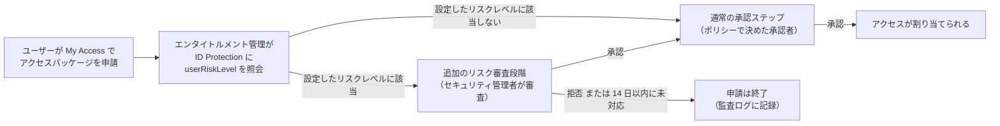
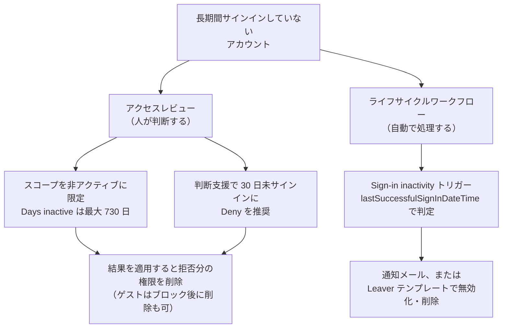

# 【勉強】IGA（アイデンティティガバナンス＆管理）— リスクシグナルとガバナンスの連携（ID Protection ベースの承認・非アクティブユーザーの棚卸し）（2026-11-10）

## 今日のテーマ

IGA に「リスクの信号」をつなぐ方法を学びます。題材は Microsoft Entra ID Governance で、次の 2 つを扱います。

1. **ID Protection ベースの承認（プレビュー）**: 侵害の疑いがあるユーザーがアクセスを申請したら、通常の承認の前にセキュリティ担当の審査を挟む
2. **非アクティブユーザーの棚卸し**: 長くサインインしていないアカウントを、アクセスレビューとライフサイクルワークフローで見つけて片付ける

Entra ID の ID Protection（11/4）、Okta の Identity Threat Protection（11/5）、PingOne Protect（11/8）、Auth0 の Attack Protection（11/9）に続く、IGA 版の「リスク」回です。前の 4 本が「ログインの瞬間に攻撃を止める」話だったのに対し、今日は「権限を渡す・持ち続ける判断にリスクを反映する」話です。

## 概要

これまでの IGA 回で学んだアクセス要求（8/24）やアクセスレビュー（8/6）は、「業務上その権限が必要か」を人が判断する仕組みでした。ただ、業務上は正当な申請でも、申請者のアカウント自体が乗っ取られていれば話は別です。また、誰も使っていないアカウントに権限が残り続けると、攻撃者にとって格好の入口になります。

そこで Entra ID Governance には、セキュリティ側の信号をガバナンスの判断材料に取り込む機能があります。

- **申請の入口で効かせる**: エンタイトルメント管理（アクセスパッケージの申請・承認の仕組み）が、申請時に ID Protection の**ユーザーリスク**を問い合わせ、リスクが高ければ承認段階を 1 つ追加します。
- **保持している権限に効かせる**: アクセスレビューを「非アクティブなユーザーだけ」に絞ったり、ライフサイクルワークフローを「サインインしていない日数」で起動したりして、使われていない権限やアカウントを整理します。

> 用語メモ：**ユーザーリスク**とは、ID Protection が「このアカウントは侵害されているかもしれない」と見積もった度合いです（11/4 の回を参照）。1 回のサインインの怪しさを表す「サインインリスク」とは別物です。

## 押さえる要点

### 1. ID Protection ベースの承認（プレビュー）

- **仕組み**: ユーザーが My Access ポータル（エンドユーザー向けの申請画面）からアクセスパッケージを申請すると、エンタイトルメント管理が ID Protection にそのユーザーの現在の userRiskLevel を問い合わせます。管理者が選んだリスクレベル（例: Medium や High）に該当すると、通常の承認の**前に**リスク審査の段階が自動で追加されます。
- **審査するのは誰か**: Entra ID の**セキュリティ管理者**（Security Administrator）ロールを持つユーザーにルーティングされます（ドキュメントには、リスクのあるユーザー向けの承認者・フォールバック承認者が My Access から承認・拒否できるとも書かれています）。アクセスパッケージごとに承認者を選ぶ通常の承認とは別枠です。
- **結果**: 承認されれば、そのあと通常の承認ステップに進みます。拒否されれば申請はそこで終了し、監査ログに記録されます。
- **期限**: 承認者が対応できるのは最大 14 日です。期限内に対応がなければ自動的に拒否されます。
- **インサイダーリスクとの併用**: Microsoft Purview のインサイダーリスク管理（IRM）に基づく承認も別に設定できます。両方を有効にすると、ID Protection の承認者 → IRM の承認者 → アクセスパッケージのポリシーの承認者、の順に回ります。
- **前提**: ID Protection が展開済みであること。ライセンスは Microsoft Entra ID Governance または Microsoft Entra Suite が必要です。

次の図は、リスクのあるユーザーが申請したときの承認の流れです。

### 2. 非アクティブユーザーのアクセスレビュー

- **スコープを非アクティブに絞る**: グループのメンバーシップをレビューするとき、ユーザースコープで「**Inactive users (on tenant level)**」にチェックを入れ、「**Days inactive**」（非アクティブとみなす日数）を指定します。最大 730 日（2 年）まで指定できます。対象になるのは、テナントに対話型・非対話型のどちらのサインインもしていないユーザーです。
- **作成直後のユーザーは除外される**: たとえば 90 日に設定すると、作成・招待から 90 日たっていないユーザーはレビュー対象になりません。一度もサインインする機会がないまま消される事故を防ぐためです。
- **判断支援（decision helpers）**: レビュー作成時に有効にすると、レビュー担当者に推奨（Approve／Deny）が表示されます。
  - **非アクティブユーザーの推奨**: 直近 30 日間テナントにサインインしていないユーザーに「Deny」を推奨します。アプリケーションの割り当てをレビューする場合は、テナント全体ではなくそのアプリでの最終アクティビティで判定します。判定はレビュー開始時に一度だけ行われ、レビュー中には更新されません。
  - **ユーザーとグループの関連性（User-to-Group Affiliation）**: 機械学習による推奨です。組織の上司・部下の構造（レポートライン）で見て、他のメンバーから「遠い」ユーザーに Deny を推奨します。ユーザーに manager 属性が設定されている必要があり、600 人を超えるグループは対象外です。Entra ID Governance ライセンスが必要です。
- **ゲスト向けの追加アクション**: スコープを「Guest users only」にしたときだけ、「Action to apply on denied guest users」で「30 日間サインインをブロックし、その後テナントから削除」を選べます（10/26・11/1 のゲスト回とつながる話です）。

### 3. ライフサイクルワークフローの「サインイン非アクティブ」トリガー

- ライフサイクルワークフロー（入社・異動・退職などのタイミングで自動処理を走らせる仕組み、8/14 の JML 回を参照）には、**Sign-in inactivity**（サインイン非アクティブ）というトリガーがあります。指定した日数を超えてサインインしていないユーザーに対してワークフローが動きます。
- 非アクティブかどうかは `lastSuccessfulSignInDateTime`（最後に成功したサインインの日時）属性で判定されます。
- 組み込みタスクに「**Send email about user inactivity**」（非アクティブであることをメールで知らせる）があります。アカウントの無効化や削除のような退職者（Leaver）向けタスクを使う場合は、Leaver のワークフローテンプレートを選ぶ必要があります。

次の図は、非アクティブなアカウントに対する 2 つの手段の使い分けを整理したものです。

## 手順や設定のイメージ

### ID Protection ベースの承認を有効にする

1. Microsoft Entra 管理センターに、少なくとも **Identity Governance 管理者**（Identity Governance Administrator）としてサインインする
2. **ID Governance** > **Entitlement management** > **Control configurations** を開く
3. **Risk-based approval (Preview)** のカードで **View settings** を選ぶ
4. **Require approval for users with ID protection risk (Preview)** の横の **Customize** を選ぶ
5. 対象とする ID Protection のユーザーリスクレベルを選んで **Save** する

設定はアクセスパッケージごとではなく、エンタイトルメント管理の「Control configurations」という全体設定の画面から行います。

### 非アクティブなユーザーを自動で片付けるワークフロー

1. 少なくとも **Lifecycle Workflows 管理者**としてサインインする
2. **ID Governance** > **Lifecycle workflows** > **workflows** を開き、新規作成する（無効化・削除を行うなら Leaver テンプレートを選ぶ）
3. **Basics** タブでトリガーに **Sign-in inactivity** を選び、**Days of inactivity** に日数を入れる
4. **Scope** で対象ユーザーを絞り込む
5. **Review Tasks** で実行するタスク（例: 非アクティブ通知メール）を選んで作成する

インフラ的にたとえると、ID Protection ベースの承認は「変更申請に対して、申請者の端末がマルウェア感染の疑いありなら、まずセキュリティチームの審査を通す」というゲートです。非アクティブの棚卸しは「長期間ログインのないサーバーアカウントを定期的に洗い出して無効化する」運用を、ID 基盤側で自動化するものです。

## つまずきやすいところ・注意点

- **ID Protection ベースの承認はプレビュー**: 本番運用に組み込む前に、プレビューの条件と最新のドキュメントを確認してください。
- **セキュリティ管理者が承認者になる**: リスク審査段階の承認者は、Security Administrator ロールの保持者です。このロールを PIM で「資格のある（eligible）」割り当てにしている場合に、承認画面へのアクセスにロールの有効化が必要かどうかは**要確認**です。運用前に実際の動きを確かめてください。
- **14 日放置で自動拒否**: セキュリティチームが承認依頼に気づかないと、正当な申請も自動で拒否されます。通知の受け手と対応の SLA を先に決めておきましょう。
- **判定は申請時点のリスク**: ドキュメントの記述は「申請時に現在のリスクを照会する」というものです。割り当て後にリスクが上がったときに既存の割り当てが自動で外れるわけではないと読めますが、明記はないため**要確認**です。保持中の権限には、リスクベースの条件付きアクセス（11/4）など別の手段を組み合わせるのが筋です。
- **「非アクティブ」の定義が 2 種類ある**: 判断支援の「30 日」は固定の基準です。一方、スコープの「Days inactive」は管理者が最大 730 日まで指定できます。両者を混同しないようにしましょう。
- **判断支援の判定はレビュー開始時点で固定**: レビュー期間中にユーザーがサインインしても、推奨は更新されません。
- **ライセンスは機能ごとに違う**: ライセンスの一覧表では、「非アクティブユーザーだけにスコープを絞ったレビュー」は Entra ID Governance（または Entra Suite）が必要です。一方、「アクティブ・非アクティブ両方を対象にし、非アクティブ向けの判断支援を使うレビュー」は Entra ID P2 でも使えます。同じ「非アクティブ」でも、スコープで絞るか判断支援で示すかでライセンスが変わります。
- **拒否しただけでは権限は消えない**: レビュー結果を実際に反映するには、「Auto apply results to resource」を有効にするか、手動で結果を適用（Apply）する必要があります。

## 今日のまとめ

### 重要用語のミニ辞書

- **エンタイトルメント管理**: アクセスパッケージ（権限のセット）の申請・承認・期限切れを管理する Entra ID Governance の機能。
- **userRiskLevel（ユーザーリスクレベル）**: ID Protection が算出する「アカウントが侵害されている可能性」の度合い。
- **Risk-based approval**: 申請者のリスクに応じて承認段階を追加する、エンタイトルメント管理の設定（プレビュー）。
- **Inactive users (on tenant level)**: アクセスレビューのスコープを、指定日数サインインしていないユーザーだけに絞る設定。
- **decision helpers（判断支援）**: レビュー担当者に Approve／Deny の推奨を表示する機能。
- **Sign-in inactivity トリガー**: 指定日数サインインのないユーザーに対してライフサイクルワークフローを起動するトリガー。

### 理解度チェック

1. ID Protection ベースの承認で、リスク審査段階の承認者になるのは誰ですか。また、14 日以内に誰も対応しなかった場合はどうなりますか。
2. アクセスレビューのスコープで Days inactive を 90 日に設定しました。60 日前に招待したゲストで、一度もサインインしていない人はレビュー対象になりますか。
3. 判断支援の「非アクティブユーザーの推奨」で、アプリケーションの割り当てをレビューするときは、何を基準に非アクティブと判定しますか。

## 参考リンク

- Configure ID Protection-based approvals for access package requests in Entitlement Management (Preview) — https://learn.microsoft.com/entra/id-governance/entitlement-management-configure-id-protection-approvals
- Review recommendations for Access reviews — https://learn.microsoft.com/entra/id-governance/review-recommendations-access-reviews
- Create an access review of groups and applications in Microsoft Entra ID — https://learn.microsoft.com/entra/id-governance/create-access-review
- What are access reviews?（ライセンス要件） — https://learn.microsoft.com/entra/id-governance/access-reviews-overview
- Microsoft Entra ID Governance licensing fundamentals — https://learn.microsoft.com/entra/id-governance/licensing-fundamentals
- Manage inactive users using Lifecycle Workflows — https://learn.microsoft.com/entra/id-governance/lifecycle-workflow-inactive-users
- Using multi-stage reviews to meet your attestation and certification needs — https://learn.microsoft.com/entra/id-governance/using-multi-stage-reviews
- Monitor and clean up stale guest accounts using access reviews — https://learn.microsoft.com/entra/identity/users/clean-up-stale-guest-accounts
