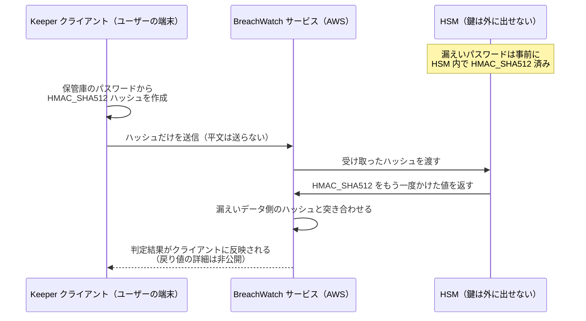
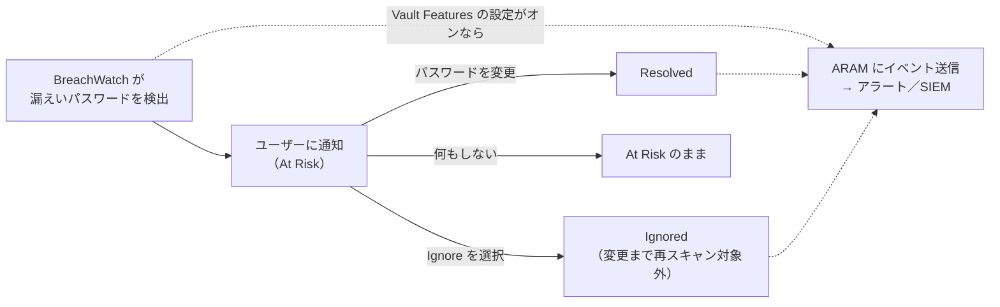

# 【勉強】Keeper — BreachWatch とセキュリティ監査（ダークウェブ監視・HSM による照合・監査スコア）（2026-11-12）

## 今日のテーマ

Keeper の **BreachWatch（ダークウェブ監視）** と **セキュリティ監査（Security Audit）** を学びます。「保管庫に入っているパスワードが、すでに漏えいしていないか」「弱いパスワードや使い回しがどれくらいあるか」を、ゼロ知識を保ったまま見える化する仕組みです。

Entra ID の ID Protection（11/4）、Okta の Identity Threat Protection（11/5）、PingOne Protect（11/8）、Auth0 の Attack Protection（11/9）、IGA のリスクシグナル（11/10）に続く、「リスク」回の Keeper 版です。ほかの製品が「ログインの瞬間の怪しさ」を評価していたのに対し、Keeper が評価するのは**保管しているパスワードそのものの危険度**です。ここが今日いちばんの違いです。

## 概要

Keeper は IdP（認証を担うサービス）ではなく、パスワード管理製品です。そのため、Keeper にとってのリスクは「保管庫に入っている認証情報が危ない状態にあるか」になります。これを見るための機能が 2 つあります。

- **BreachWatch**: 保管庫のレコードのパスワードが、公になっている漏えいデータ（いわゆるダークウェブに出回った ID／パスワードのリスト）に含まれていないかを調べ、含まれていればユーザーと管理者に知らせます。ユーザーがアクセスできるすべてのレコード（自分のものも共有されたものも）が対象です。Keeper のドキュメントでは「アドオン」として扱われています。
- **セキュリティ監査（Security Audit）**: パスワードの強度、使い回しの有無、2 要素認証（2FA）の利用状況などからユーザーごとのスコアを出し、管理コンソールで組織全体を一覧できます。

> 用語メモ：**ゼロ知識**（Zero-Knowledge）とは、データの暗号化と復号をユーザーの端末だけで行い、Keeper のサーバーは中身を読めない設計のことです。「サーバーが中身を読めないのに、どうやって漏えいリストと照合するのか」が BreachWatch の面白いところです。

## 押さえる要点

### 1. BreachWatch の照合の仕組み（ゼロ知識を壊さない工夫）

Keeper の暗号化モデルのドキュメントによると、照合は次のように行われます。

- BreachWatch は AWS 上のマネージドサービスとして動いており、Keeper のバックエンド API やユーザーの保管庫データとは**物理的に分離**されています。
- サーバー側では、漏えいデータに含まれる大量のパスワードを、**ハードウェアセキュリティモジュール**（HSM）の中で、取り出し不可能な鍵を使った **HMAC_SHA512** でハッシュ化して保持しています。
- 端末側（BreachWatch が有効なとき）は、保管している各パスワードから HMAC_SHA512 のハッシュを作ってサーバーに送ります。平文のパスワードは送りません。
- サーバーは受け取ったハッシュを HSM の中でもう一度 HMAC_SHA512 にかけ、この「ハッシュのハッシュ」同士を比べて一致するかを判定します。
- HSM の鍵が外に出せないため、ハッシュ化はオンラインでしか実行できず、手元に持ち出して総当たりで逆算する攻撃を防ぐ、と説明されています。

> 用語メモ：**HMAC** は「鍵付きハッシュ」です。普通のハッシュと違い、鍵を知らない人は同じ値を計算できません。**HSM** は暗号鍵を外に出さずに中で計算だけをする専用ハードウェアです。インフラで言えば、秘密鍵を絶対にディスクに置かない TPM や CloudHSM のイメージです。

次の図は、パスワード 1 件をチェックするときのやり取りです。



図の最後の矢印は、ドキュメントに「ハッシュのハッシュを比べて漏えいを判定する」とだけあるため、結果の返し方の細部は省略しています（要確認）。

なお、ドキュメントには端末側のハッシュ化で「pepper」を使うとだけ書かれており、その中身や由来は書かれていません（要確認）。

### 2. ユーザー側の動き：Resolve か Ignore か

- 漏えいしたパスワードが見つかると、クライアントはユーザーに「Resolve（解消）」を促します。選択肢は 2 つです。
  - **パスワードを変更する**: 対象のサイトでパスワードを変え、保管庫のレコードも更新します。
  - **Ignore（無視）**: そのレコードは、パスワードが変更されるまで以後のスキャンで対象外になります。
- 何もしなければ、そのレコードは **At Risk（危険）** の状態のまま残ります。

### 3. 管理者側の動き：有効化と可視化

- **展開はロールのエンフォースメントポリシーで行う**: 「Pause BreachWatch on client devices」という設定で、端末上での BreachWatch の稼働（とイベント送信）を止められます。ロール（ノードに紐づくロール）単位で段階的に展開したいときに使います。
- **管理コンソールでの可視化**: BreachWatch の画面で全体の概要と、ユーザーが通知にどう対応したか（At Risk／Ignored など）の集計表を見られます。ユーザー別のレポートには、そのユーザーが**所有する**レコードだけが含まれ、共有されているだけのレコードは含まれません。パスワードのないレコードは数えられません。
- **アラート・SIEM 連携は既定でオフ**: BreachWatch のイベントを Advanced Reporting & Alerts Module（ARAM、監査ログとアラートのアドオン。9/14 の回を参照）に送るには、Role > Enforcement Policies > Vault Features で BreachWatch のイベント送信のポリシー（ドキュメントの画面キャプションでは「Enable BreachWatch Enforcement Policy」）をオンにします。過去にさかのぼっては送られず、オンにした時点以降のイベントだけが流れます。
- **おすすめのアラート**: Reporting & Alerts > Alerts で、BreachWatch カテゴリの次の 3 つのイベントを選んでアラートを作るのが推奨されています。
  - BreachWatch detected high-risk record password（高リスクのパスワードを検出）
  - User ignored detected high-risk record password（ユーザーが無視した）
  - User resolved detected high-risk record password（ユーザーが解消した）

次の図は、検出から管理者への通知までの流れです。



### 4. セキュリティ監査スコアの計算

ユーザーごとのスコアは、次の 4 項目の平均です。

- **強いパスワードの割合**: 全レコードのうち「Strong」と判定されたものの割合（Medium は加点されません）
- **一意なパスワードの割合**: 使い回されていないパスワードの割合
- **2FA**: 有効なら 100%、無効なら 0%
- **マスターパスワードの強度**: 強ければ 100%、そうでなければ 0%（この値はクライアントや管理コンソールには表示されません）

例として、強いパスワード 60%、一意 80%、2FA なし 0%、マスターパスワード強い 100% なら、(60＋80＋0＋100)÷4＝60% です。組織全体のスコアは各ユーザーのスコアの平均です。公開ドキュメントの計算式に BreachWatch の結果は含まれていません。

管理コンソールのセキュリティ監査画面では、全体スコア、パスワード強度、一意なパスワード、2FA の利用状況が表示され、既定ではスコアの低いユーザーから並びます。スコアは企業の公開鍵で暗号化して保存され、管理者の端末で復号されます。ここでもゼロ知識の考え方が守られています。

### 5. Commander（CLI）での確認

Keeper Commander（9/27 の Terraform 回でも登場した CLI）でも同じ情報を扱えます。

```bash
# 自分の保管庫で漏えいパスワードを一覧（-a で無視したものも含める）
breachwatch list
breachwatch scan

# 管理者向け：組織の BreachWatch レポートを CSV で出力
breachwatch report --format csv --output breachwatch_report.csv

# 管理者向け：セキュリティ監査レポート（-b で BreachWatch の観点を出す）
security-audit-report -b
security-audit-report --format csv --output sar.csv
```

`breachwatch report` は `security-audit-report --breachwatch` と同じ結果になる、とドキュメントに書かれています。`-b`（`--breachwatch`）は Commander v16.5.5 以降で使え、BreachWatch が有効でない場合は無視されます。また、`--score-type` オプションでスコアの算出方法を切り替えられるため、CLI の数値が画面と違って見えるときはこの指定も確認します。

## つまずきやすいところ・注意点

- **BreachWatch は「ログインのリスク」ではない**: 他製品のリスクエンジンのように、ログイン時の場所や端末を評価するものではありません。見ているのは保管しているパスワードの状態です。ログインそのものの保護は、9/4 の回で学んだエンフォースメントポリシー（MFA の強制など）や SSO 側の条件付きアクセスが担います。
- **ARAM へのイベント送信は既定でオフ**: BreachWatch を契約しただけではアラートは飛びません。Vault Features の設定をオンにしたロールのユーザーについてだけ、オンにした時点からイベントが流れます。
- **Ignore は「解決」ではない**: 無視されたレコードはスキャンから外れますが、危険が消えたわけではありません。Ignored の件数も定期的に確認しましょう。
- **ユーザー別レポートは所有レコードだけ**: 共有フォルダのパスワードは、所有者のレポートに出ます。チームで共有しているアカウントが見当たらないときは所有者を確認します。
- **強度区分の表記がページで異なる**: 管理者向けページ（Weak／Fair／Medium／Strong）と利用者向けページ（Very Weak〜Very Strong の 5 段階）で、強度の区分と境界値の書き方が違います。数値の境界で説明するときは要確認です。
- **`breachwatch password` の扱いに注意（筆者の注意喚起）**: パスワードを直接チェックするコマンドもあり、公式の例では平文を引数に渡しています。ただし、ターミナルや Commander の履歴・ログに残る可能性があるため、本番のパスワードを打ち込むのは避けたほうが安全です。

## 今日のまとめ

### ミニ辞書

- **BreachWatch**: 保管庫のパスワードが既知の漏えいデータに含まれるかを調べる Keeper のアドオン
- **HMAC_SHA512**: 鍵付きハッシュ。鍵がないと同じ値を作れない
- **HSM**: 鍵を外に出さずに暗号処理を行う専用ハードウェア
- **At Risk／Ignored／Resolved**: 検出されたパスワードの状態（未対応／無視／変更済み）
- **セキュリティ監査スコア**: 強いパスワード・一意なパスワード・2FA・マスターパスワード強度の 4 項目の平均
- **ARAM**: Advanced Reporting & Alerts Module。監査イベントのレポートとアラートを担うアドオン

### 理解度チェック

1. BreachWatch は、Keeper のサーバーが平文のパスワードを知らないまま、どうやって漏えいデータと照合しているでしょうか。HSM が果たす役割も含めて説明してください。
2. BreachWatch を導入したのに、ARAM に BreachWatch のアラートが 1 件も来ません。まず確認すべき設定は何でしょうか。
3. 強いパスワード 50%、一意 100%、2FA 有効、マスターパスワードが弱いユーザーのセキュリティ監査スコアは何 % でしょうか。

（答えの目安：1 は「端末で HMAC 化したハッシュだけを送り、HSM 内の外に出せない鍵でもう一度 HMAC をかけて比べる」。2 は「Role > Enforcement Policies > Vault Features の BreachWatch イベント送信の設定」。3 は (50＋100＋100＋0)÷4＝62.5%）

## 参考リンク

- [BreachWatch（Keeper Enterprise Guide）](https://docs.keeper.io/enterprise-guide/breachwatch)
- [Keeper Encryption Model（BreachWatch の照合方式）](https://docs.keeper.io/enterprise-guide/keeper-encryption-model)
- [Security Audit（Keeper Enterprise Guide）](https://docs.keeper.io/enterprise-guide/security-audit)
- [Security Audit Score Calculation](https://docs.keeper.io/enterprise-guide/security-audit/security-audit-score-calculation)
- [Security Audit（Keeper User Guides）](https://docs.keeper.io/user-guides/security-audit)
- [Recommended Alerts](https://docs.keeper.io/enterprise-guide/recommended-alerts)
- [Breachwatch Commands（Commander CLI）](https://docs.keeper.io/keeperpam/commander-cli/command-reference/enterprise-management-commands/breachwatch-commands)
- [Reporting Commands（security-audit-report）](https://docs.keeper.io/keeperpam/commander-cli/command-reference/reporting-commands)
