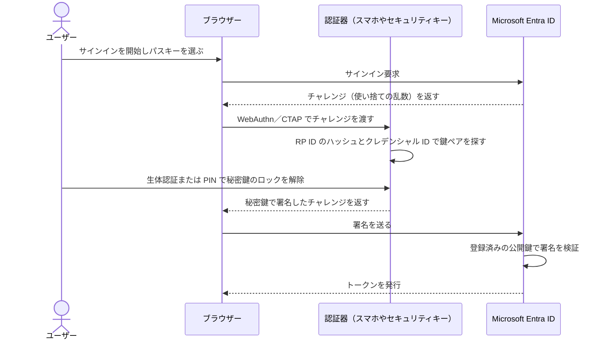
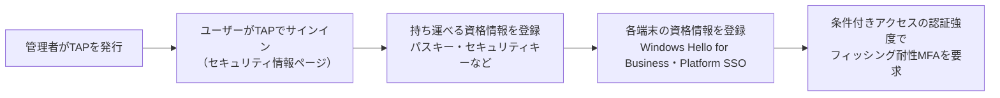

# 【勉強】Microsoft Entra ID — パスワードレス認証（認証方法ポリシー・パスキー（FIDO2）・一時アクセスパス）（2026-11-13）

## 今日のテーマ

Microsoft Entra ID で「パスワードを使わないサインイン（パスワードレス認証）」を始めるための設定の全体像を学びます。中心になるのは、**認証方法ポリシー**、**パスキー（FIDO2）**、そして最初の登録を助ける**一時アクセスパス（TAP）**の 3 つです。

> 前提：8/26 の「条件付きアクセスと MFA」では、どの方式でサインインさせるかを**要求する側**（認証強度）を扱いました。今日はその手前で、どの方式を**使えるようにするか・どう登録させるか**を扱います。

## 概要 — パスワードレスとは何を変えるのか

パスワードは「サーバーとユーザーが同じ秘密を知っている」方式です。そのため、偽サイトに入力させれば盗めます。パスキーは**公開鍵暗号**を使います。秘密鍵はユーザーの端末側にだけあり、Entra ID には公開鍵だけが登録されます。インフラの方には「SSH の公開鍵認証を、ブラウザーとスマホの生体認証でやるもの」と考えると近いです。

さらにパスキーは**登録したサイト（RP：Relying Party、利用側サービス）にしか応答しない**ように作られています（origin-bound）。偽サイトから求められても署名を返さないので、フィッシングに強い方式とされています。

Entra ID でパスワードレスに使える主な方式は次のとおりです。

| 方式 | 置き場所 | フィッシング耐性 |
| --- | --- | --- |
| パスキー（FIDO2）：セキュリティキー／Authenticator 内／同期パスキー | 持ち運べる（portable） | あり |
| Windows Hello for Business | Windows 端末（TPM） | あり |
| macOS の Platform Credential（Platform SSO） | Mac（Secure Enclave） | あり（Secure Enclave キー方式の場合） |
| 証明書ベース認証（CBA） | スマートカードや端末 | あり（多要素として構成した場合） |
| Microsoft Authenticator の電話によるサインイン（プッシュ通知） | スマホ | **なし**（パスワードレスではあるがフィッシング耐性はない） |

最後の行が重要です。「パスワードレス」と「フィッシング耐性がある」は同じ意味ではありません。

## 押さえる要点

### 1. 認証方法ポリシー（Authentication methods policy）

- **どの認証方法を、どのグループに使わせるか**を決める、テナントの中心となる設定です。場所は Entra 管理センターの **Entra ID ＞ 認証方法 ＞ ポリシー**です。
- 編集には少なくとも**認証ポリシー管理者**ロールが必要です。
- 対象はグループ単位で指定します。個々のユーザーを直接指定する機能は削除されたため、グループに寄せるのが推奨です。
- 対象グループを増やしすぎると、ポリシーのサイズ上限（20 KB）で保存できなくなることがあります。
- 以前は「従来の MFA 設定」と「SSPR（セルフサービスパスワードリセット）設定」でも認証方法を管理していました。2025 年 9 月 30 日以降は、これらの従来ポリシーで認証方法を管理できなくなっています（公式ドキュメントの記載）。管理は認証方法ポリシーに一本化するのが前提です。移行の状態は「移行前／移行中／移行完了」の 3 段階で、**移行完了にすると従来ポリシーの設定は無視**されます。なお、秘密の質問は現時点でも従来の SSPR ポリシー側でしか有効化できません。

### 2. パスキー（FIDO2）とパスキープロファイル

- パスキー（FIDO2）という認証方法自体は、Entra のパスキー有効化ドキュメントでは **Entra ID Free を含むすべてのエディションで追加ライセンスなし**とされています。ただし、後述の条件付きアクセス（認証強度）で強制するには Entra ID P1 が必要です（Intune 側のドキュメントにはパスキーの前提として P1 を挙げる記載もあるため、ライセンスは導入時に要確認）。
- 種類は 2 つあります。
  - **デバイスバインド型**：秘密鍵が 1 台の機器から出ない。例：FIDO2 セキュリティキー、Microsoft Authenticator 内のパスキー。
  - **同期型（synced）**：秘密鍵が暗号化されてクラウドのパスキープロバイダーに同期され、他の端末でも使える。例：Apple の iCloud キーチェーン、Google パスワードマネージャー。
- **パスキープロファイル**を使うと、グループごとに条件を変えられます。設定できるのは「構成証明（アテステーション）の強制」「許可するパスキーの種類」「AAGUID による機種の許可・ブロック」です。
  - **構成証明（attestation）**：登録時に「本物の、その機種の認証器か」を検証する仕組みです。同期パスキーは構成証明に対応していないため、**構成証明を強制したプロファイルではデバイスバインド型だけが許可されます**。
  - **AAGUID**：認証器の機種を表す 128 ビットの識別子です。
- プロファイルは既定のプロファイルを含めて最大 3 つまでです。プロファイル機能は**一度オプトインすると元に戻せません**。
- 公式の例では、管理者や役員向けには「デバイスバインド型のみ・構成証明を強制」、一般部門向けには「同期型も許可」というように使い分けています。

次の図は、ブラウザーで同じ端末のパスキーを使ってサインインするときの流れです（QR コードを使う別端末の流れやネイティブアプリの場合は省略しています）。チャレンジ（使い捨ての乱数）はブラウザー経由で認証器に渡り、署名もブラウザー経由で Entra ID に返ります。



ここで出てくる **WebAuthn** はブラウザーとサイトの間の API、**CTAP** はブラウザー（端末）と認証器の間のプロトコルです。2 つを合わせて FIDO2 と呼びます。

### 3. 一時アクセスパス（TAP：Temporary Access Pass）

- パスキーを登録するには「直近 5 分以内に MFA を完了していること」が必要です。では、**まだ何の認証方法も持っていない新入社員はどうするのか**。この問題を解くのが TAP です。
- TAP は管理者が発行する**期限付きのパスコード**です（TAP 自体はフィッシング耐性のある方式ではありません。あくまで登録・復旧の入口です）。これでサインインして、パスキーなどを登録します。認証器をなくした人の復旧にも使えます。
- 既定値は次のとおりです：有効期間の既定 1 時間（10 分〜30 日の範囲で設定可）、最大有効期間 8 時間、長さ 8 文字（8〜48 文字）、ワンタイム使用は既定でオフ。
- 発行できるロール：**認証管理者**は一般メンバーに、**特権認証管理者**は管理者とメンバーに発行できます（いずれも自分自身には発行できません）。
- ユーザー 1 人につき TAP は 1 つだけです。また **TAP はパスワードを置き換えるものではありません**。

次の図は、公式ガイドが推奨する導入の流れを単純化したものです。まず持ち運べる資格情報（portable）を作り、それを足がかりに各端末の資格情報（local）を作り、最後に条件付きアクセスで強制します。



## 手順や設定のイメージ

**パスキーを有効にする**

1. 認証ポリシー管理者で Entra 管理センターにサインインし、**Entra ID ＞ 認証方法 ＞ ポリシー**（ドキュメントによっては「セキュリティ」を挟んだパスで記載）で **Passkey (FIDO2)** を開く。
2. バナーのリンクからパスキープロファイルにオプトインする（元に戻せない）。既存の設定は「既定のパスキープロファイル」に引き継がれる。
3. **構成**タブで「セルフサービス設定を許可」を「はい」にする（「いいえ」だとユーザーがセキュリティ情報ページから登録できない）。
4. 必要ならプロファイルを追加し、パスキーの種類・構成証明・キー制限を設定する。
5. **有効化と対象**タブで、グループにプロファイルを割り当てる。
6. （任意）条件付きアクセスで、組み込みの「フィッシング耐性のある MFA」認証強度を要求する。特定の機種だけに絞るなら、カスタム認証強度で AAGUID を指定する。

**TAP を有効にして発行する**

1. 認証方法ポリシーで **Temporary Access Pass** を有効にし、使えるグループを指定する。発行はできても、**ポリシーの対象外のユーザーは TAP でサインインできません**。
2. ユーザーの「認証方法」から TAP を追加する。表示された値は「OK」を押すと二度と見られないので、その場で控える。

Microsoft Graph PowerShell では次のように発行できます（コマンドレットリファレンスの例をもとにした形）。

```powershell
# 一度だけ使えるTAPを発行する
$properties = @{ isUsableOnce = $true; lifetimeInMinutes = 60 }
New-MgUserAuthenticationTemporaryAccessPassMethod -UserId user@contoso.com -BodyParameter $properties

# 発行済みTAPの情報を確認する（コード自体は表示されない）
Get-MgUserAuthenticationTemporaryAccessPassMethod -UserId user@contoso.com
```

## つまずきやすいところ・注意点

- **登録の時間制限（10 分ルール）**：ワンタイムの TAP でサインインした場合、パスワードレス方式の登録はサインインから 10 分以内に終える必要があります。公式ドキュメントでは、これは TAP 固有ではなく MFA が必要な認証方法の登録全般に共通する制限だと説明されています（パスキーのページでは「登録前の 5 分以内に MFA を完了」と別の時間が書かれており、両者の関係は要確認）。Windows のセットアップのように時間がかかる作業では、2 つ目の TAP を渡すか、複数回使える TAP を使います。
- **TAP の期限が切れてもセッションは切れない**：TAP でのサインイン時に発行されるトークンの寿命は、その時点の TAP の有効期限で頭打ちになります。ただし、既に確立したセッションを後からさかのぼって無効にはしません。長く残したくない場合は、条件付きアクセスのサインイン頻度で制御します。
- **フェデレーションドメインでは TAP が優先される**：TAP を持つユーザーは、フェデレーション先の IdP にリダイレクトされず Entra ID で認証を終えます。外部 IdP 連携をしている環境では挙動の違いに注意します。
- **キー制限を変えると既存ユーザーが締め出される**：以前許可していた AAGUID を外すと、その機種で登録済みのユーザーもサインインできなくなります。同様に、プロファイルで同期パスキーを無効にすると、登録済みの同期パスキーでもサインインできなくなります。
- **構成証明の強制は登録時だけ**：後から構成証明を強制しても、構成証明なしで登録済みのパスキーはサインインをブロックされません。
- **ゲストはパスキーを登録できない**：B2B ゲストを含むゲストユーザーは、リソーステナントでパスキーを登録できません。TAP も外部ゲストには発行できません（内部ゲストは可）。
- **UPN を変えたらパスキーは再登録**：UPN（ユーザーのサインイン名）が変わると既存のパスキーは修正できないため、ユーザーが削除して登録し直す必要があります。
- **同期パスキーの位置づけ**：Microsoft は同期パスキーを「フィッシング耐性はあるが、構成証明のない認証器と同じセキュリティレベル」として扱うよう案内しています。特権ユーザーにはデバイスバインド型を使い分けるのが基本です。

## 今日のまとめ

**ミニ辞書**

- **認証方法ポリシー**：どの認証方法をどのグループに使わせるかを決める、Entra ID の中心的な設定。
- **パスキー（FIDO2）**：公開鍵暗号を使う、フィッシングに強いパスワードレスの資格情報。WebAuthn と CTAP で動く。
- **デバイスバインド型／同期型**：秘密鍵が 1 台から出ないか、クラウド経由で複数端末に同期されるか。
- **構成証明（attestation）**：登録時に認証器が本物で、どの機種かを検証する仕組み。
- **AAGUID**：認証器の機種を表す 128 ビットの識別子。
- **TAP（一時アクセスパス）**：最初の登録や復旧のために管理者が発行する、期限付きのパスコード。

**理解度チェック**

1. Authenticator の「電話によるサインイン（プッシュ通知）」とパスキーは、どちらもパスワードレスです。フィッシング耐性の観点で両者はどう違うでしょうか。
2. 管理者グループのパスキープロファイルで「構成証明を強制」をオンにしました。このグループのユーザーは iCloud キーチェーンのパスキーを登録できるでしょうか。理由も答えてください。
3. 新入社員に 1 時間有効なワンタイム TAP を渡しました。サインインしてから 15 分後にパスキーを登録しようとしたところ失敗しました。考えられる原因は何でしょうか。

## 参考リンク

- [Manage authentication methods for Microsoft Entra ID（認証方法ポリシー）](https://learn.microsoft.com/en-us/entra/identity/authentication/concept-authentication-methods-manage)
- [How to enable passkeys (FIDO2) in Microsoft Entra ID](https://learn.microsoft.com/en-us/entra/identity/authentication/how-to-enable-passkey-fido2)
- [Authentication methods in Microsoft Entra ID - passkeys (FIDO2)](https://learn.microsoft.com/en-us/entra/identity/authentication/concept-authentication-passkeys-fido2)
- [Configure Temporary Access Pass to register passwordless authentication methods](https://learn.microsoft.com/en-us/entra/identity/authentication/howto-authentication-temporary-access-pass)
- [Plan a phishing-resistant passwordless authentication deployment in Microsoft Entra ID](https://learn.microsoft.com/en-us/entra/identity/authentication/how-to-deploy-phishing-resistant-passwordless-authentication)
- [Passwordless authentication with Microsoft Intune（方式ごとのフィッシング耐性）](https://learn.microsoft.com/en-us/intune/solutions/passwordless)
- [New-MgUserAuthenticationTemporaryAccessPassMethod（コマンドレットリファレンス）](https://learn.microsoft.com/en-us/powershell/module/microsoft.graph.identity.signins/new-mguserauthenticationtemporaryaccesspassmethod)
