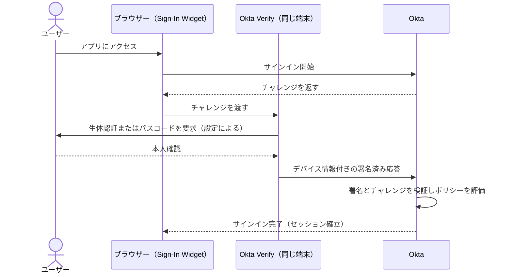
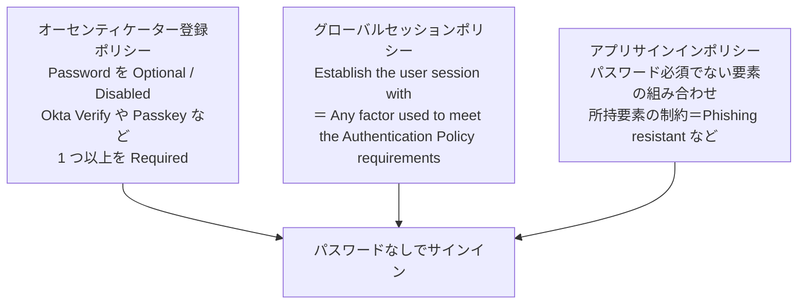

# 【勉強】Okta Workforce Identity Cloud — パスワードレス認証（Okta FastPass・パスキー（FIDO2 WebAuthn）・パスワード任意化）（2026-11-15）

## 今日のテーマ

Okta（Identity Engine）で「パスワードを使わないサインイン」を実現する仕組みを学びます。主役は **Okta FastPass** と **Passkey（FIDO2 WebAuthn）オーセンティケーター**、そしてパスワードそのものを任意にする **パスワードレス（Password optional）設定** の 3 つです。

> 前提：11/13 の Entra ID 編と同じテーマです。Entra では「認証方法ポリシー」で使える方式を決めました。Okta では同じ役割を **オーセンティケーター登録ポリシー** と **アプリサインインポリシー** の組み合わせで担います。

## 概要 — Okta でのパスワードレスの考え方

Okta では、認証の部品を **オーセンティケーター**（Authenticator：本人確認に使う手段。パスワード、Okta Verify、パスキーなど）と呼びます。パスワードレスとは、パスワード以外のオーセンティケーターだけでサインインを完結させることです。

公式ドキュメントでは、**Passkey（FIDO2 WebAuthn）と Okta FastPass（Okta Verify に含まれる機能）** が「フィッシング耐性のあるオーセンティケーター」と明記されています。どちらも公開鍵暗号を使います。FastPass とデバイス固定（デバイスバインド）型のパスキーでは、秘密鍵は端末から出ません（同期型パスキーは、秘密鍵がクラウド経由で複数端末に同期されます）。インフラの方には「SSH 公開鍵認証を、生体認証付きでブラウザーのサインインに持ち込んだもの」と考えると近いです。

## 押さえる要点

### 1. Okta FastPass

- Okta Verify アプリの機能の一つで、公式には「フィッシング耐性のある、パスワードレスのオーセンティケーター」と説明されています。Android・iOS・Linux・macOS・Windows で使えます。
- 仕組み：Okta が一回限りのチャレンジ（乱数の問題）を発行します。ブラウザー上のサインイン画面（Sign-In Widget）がそれを**同じ端末の** Okta Verify に渡します。Okta Verify は端末の情報（デバイスシグナル）を集め、登録時に作られた秘密鍵で応答に署名します。Okta は署名とチャレンジを検証し、端末の状態も含めてポリシーを評価します。
- Windows Hello・Touch ID・Face ID などの生体認証と連携します。
- **デバイスアシュアランス**（OS バージョンなど端末の健全性の条件）と組み合わせて評価できます。

次の図は FastPass でのサインインの流れを簡略化したものです（ブラウザーから Okta Verify へのチャレンジの受け渡し方式の詳細は省略しています）。

### 2. Okta Verify の「ユーザー検証」設定

**Security ＞ Authenticators ＞ Setup タブ ＞ Okta Verify ＞ Actions ＞ Edit** で設定します。

- 検証オプションで **Okta FastPass（All platforms）** を選ぶと FastPass が有効になります。
- **ユーザー検証（User verification）**：端末のパスコードまたは生体認証を求めるかどうかです。
  - **Preferred**：ユーザーが任意で有効化します。生体認証のない端末でも登録できます。
  - **Required**：パスコードか生体認証の設定を求めます。生体認証がなければパスコードで代用できます。
  - **Required with biometrics only**：生体認証のみ。生体認証のない端末では登録も認証もできません。
- パスワードレスで使う場合、公式は User verification を **Required** にするよう案内しています。FastPass の設定ガイドでも、パスワードなしでアプリにアクセスするには Okta Verify で生体認証かパスコードによる検証を有効にする必要がある、とされています。
- 「Sign in with Okta FastPass」ボタンの表示は既定ではオフです。オンにすると、サイレント認証（ユーザー操作なしの FastPass 起動）が失敗したときにボタンから Okta Verify を起動できます。

### 3. Passkey（FIDO2 WebAuthn）オーセンティケーター

- 管理画面の新しいドキュメントでは「Passkey（FIDO2 WebAuthn）」という名前で説明されています（旧ページでは「FIDO2（WebAuthn）」）。
- **Create passkeys** を有効にするとパスキー（Resident Key 必須）として作成され、パスキー向けの機能がすべて使えます。
- **ユーザー検証** は「登録時」と「認証時」で別々に Required／Preferred（既定）／Discouraged を選べます。ポリシー間で矛盾した場合は、より安全な設定が使われます。
- **Block synced passkeys**：iCloud キーチェーンや Google パスワードマネージャーなど、**同期型パスキー**の新規登録を組織全体でブロックします。構成証明（アテステーション）による判定ではなく、同期型を作る既知の認証器をブロックする方式です。
- **Certificate-based attestation validation**：FIDO MDS（認証器の公式カタログ）の証明書、または管理者がアップロードしたカスタム AAGUID 用の証明書で、本物の認証器かを検証します。登録時と認証時の両方に適用されます。
- **オーセンティケーターグループ**：Okta が認識している認証器の機種をグループにまとめ、登録ポリシーでそのグループを指定できます。指定すると、有効な構成証明（アテステーション）証明書を提示した、グループ内の認証器だけを登録できます。証明書を出さない認証器は、Early Access の「Match on AAGUID alone」を使えば AAGUID（認証器の機種 ID）だけで照合できますが、機種の真正性は Okta では確認できません。

### 4. パスワードを「任意」にする 3 つのポリシー

パスワードレスは、次の 3 層の設定がそろって初めて成立します。

- **登録ポリシー**：対象グループで Password を Optional または Disabled にし、少なくとも 1 つのオーセンティケーターを Required にします。
- **グローバルセッションポリシー**：既定では「Establish the user session with」が「A password」になっています。これを「Any factor used to meet the Authentication Policy requirements」に変えると、アプリサインインポリシーで使った要素でセッションを確立できます。
- **アプリサインインポリシー**：「User must authenticate with」で、パスワードを明示的に要求しない選択肢を選びます。**Possession factor constraints** で「Phishing resistant」「Hardware protected」「Require user interaction」などを指定すると、FastPass やパスキーに限定できます。
- ユーザー作成時は、Directory ＞ People ＞ Add Person で「I will set the password」のチェックを外すと、パスワードなしのユーザーになります。

## つまずきやすいところ・注意点

- **グローバルセッションポリシーの変更は影響が大きい**：公式は、この変更で「全体のパスワード要件」が外れ、認証の強さの責任が各アプリサインインポリシーに移ると警告しています。先にすべてのアプリのポリシーを固めてから変更します。
- **管理者は分ける**：管理者用のグループに専用の登録ポリシー・グローバルセッションポリシー・アプリサインインポリシーを作り（登録ポリシーは優先度 1）、メインの管理者アカウントはパスワードレスのポリシーから明示的に除外するのがベストプラクティスとされています。
- **LDAP 連携ユーザーは対象外**です。RADIUS 認証もパスワードが必要です（2FA Only モードを除く）。
- **元に戻すのが難しい**：パスワードレスを無効化しても、パスワード未登録のユーザーは自動では元に戻りません。無効化前にサポートへ相談するよう案内されています。
- **FastPass が常にフィッシング耐性を持つとは限らない**：WebView を使う一部アプリでは使えず、macOS の Safari では SSO 拡張の構成が必要です。ルーターの DNS リバインド保護が判定を妨げることもあります。
- **同期パスキーをブロックすると、iPhone ユーザーは Passkey オーセンティケーターを使えなくなります**（macOS Monterey の Safari では Touch ID も登録できなくなります）。公式は代わりに FastPass か NFC／USB-C のセキュリティキーを推奨しています。
- **パスワードレス ≠ MFA 不要**：パスワードを外しても、アプリサインインポリシーで要素の数や制約を指定するのは管理者の責任です。

## 今日のまとめ

**ミニ辞書**

- **オーセンティケーター**：Okta での本人確認手段（パスワード、Okta Verify、パスキーなど）。
- **Okta FastPass**：Okta Verify の機能。端末内の秘密鍵でチャレンジに署名する、フィッシング耐性のあるパスワードレス方式。
- **ユーザー検証（User verification）**：端末上で生体認証やパスコードによって本人を確かめること。生体情報は端末から出ない。
- **同期型パスキー**：秘密鍵がクラウド経由で複数端末に同期されるパスキー。
- **Possession factor constraints**：アプリサインインポリシーで所持要素に課す条件（フィッシング耐性、ハードウェア保護など）。

**理解度チェック**

1. パスワードレスを実現するために変更が必要な 3 つのポリシーと、それぞれで何を設定するかを説明してください。
2. Okta Verify の User verification を「Required」にすると、パスワードレスにとって何がうれしいのでしょうか。
3. 「Block synced passkeys」を有効にしたとき、iPhone ユーザーにどんな影響が出て、代わりに何が推奨されていますか。

## 参考リンク

- [Okta FastPass](https://help.okta.com/oie/en-us/content/topics/identity-engine/devices/fp/fp-main.htm)
- [Configure Okta Verify options](https://help.okta.com/oie/en-us/content/topics/identity-engine/authenticators/configure-okta-verify-options.htm)
- [Enable Okta FastPass](https://help.okta.com/oie/en-us/content/topics/identity-engine/devices/fp/fp-enable.htm)
- [Configure a global session policy for Okta FastPass](https://help.okta.com/oie/en-us/content/topics/identity-engine/devices/fp/fp-osop.htm)
- [Configure an app sign-in policy for passwordless authentication with Okta FastPass](https://help.okta.com/oie/en-us/content/topics/identity-engine/devices/fp/fp-asop.htm)
- [Phishing-resistant authentication](https://help.okta.com/oie/en-us/content/topics/identity-engine/authenticators/phishing-resistant-auth.htm)
- [Configure the Passkey (FIDO2 WebAuthn) authenticator](https://help.okta.com/oie/en-us/content/topics/identity-engine/authenticators/configure-passkeys.htm)
- [Configure the Passkey (FIDO2 WebAuthn) access controls](https://help.okta.com/oie/en-us/content/topics/identity-engine/authenticators/passkeys-access-controls.htm)
- [Configure the Passkeys (FIDO2 WebAuthn) authenticator groups](https://help.okta.com/oie/en-us/content/topics/identity-engine/authenticators/passkeys-authenticator-groups.htm)
- [Set up a passwordless sign-in experience](https://help.okta.com/oie/en-us/content/topics/identity-engine/password-optional/password-optional-disabled.htm)
- [Add a global session policy rule](https://help.okta.com/oie/en-us/content/topics/identity-engine/policies/add-okta-sign-on-policy-rule.htm)
- [Global session policy changes（既定値「A password」の記載）](https://help.okta.com/oie/en-us/content/topics/identity-engine-upgrade/okta-sign-on-policy-changes.htm)
- [Create an authenticator enrollment policy](https://help.okta.com/oie/en-us/Content/topics/identity-engine/policies/create-mfa-policy.htm)
