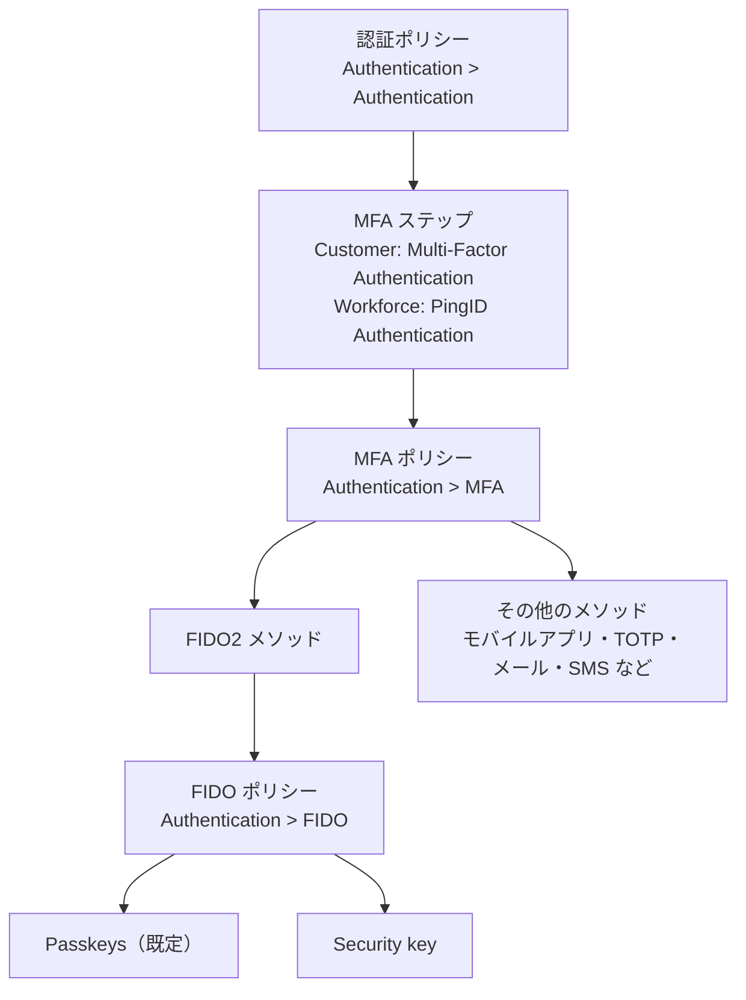
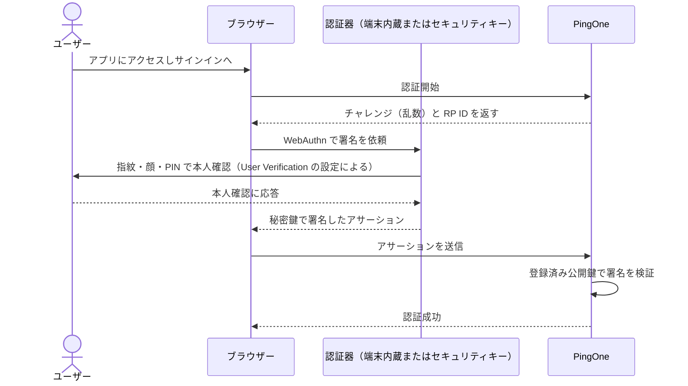

# 【勉強】Ping Identity — パスワードレス認証（FIDO ポリシー・パスキー・MFA ステップ）（2026-11-16）

## 今日のテーマ

PingOne で「パスワードを使わないサインイン」を構成する仕組みを学びます。主役は **FIDO ポリシー**（パスキーなど FIDO2 デバイスの扱いを決める設定）と、それを束ねる **MFA ポリシー**・**認証ポリシー** の 3 層構造です。

> 前提：11/13 の Entra ID 編、11/15 の Okta 編と同じテーマです。Entra では「認証方法ポリシー」、Okta では「オーセンティケーター登録ポリシー＋アプリサインインポリシー」が中心でした。PingOne では **認証ポリシー → MFA ポリシー → FIDO ポリシー** の入れ子で同じことを表現します。

## 概要 — PingOne でのパスワードレスの考え方

PingOne の公式ドキュメントでは、パスワードレス認証ポリシーを「ユーザー名と、メール／SMS で届くワンタイムパスコード（OTP）またはモバイルのプッシュ通知だけでサインインできるポリシー」と説明しています。つまり PingOne のいう「パスワードレス」は、**認証ポリシーの最初のステップを（パスワード入力の）ログインではなく MFA にする**ことで実現します。

ただし、OTP やプッシュはパスワードが不要になるだけで、フィッシング耐性まで公式に明記されているのは **FIDO2（パスキー、生体認証、セキュリティキー）** です。公式は FIDO2 の利点として、フィッシング・中間者攻撃・リプレイ攻撃への防御、公開鍵暗号ベースであること、サーバー側に共有秘密（盗まれると困る秘密情報）を持たないことを挙げています。

インフラの方には「SSH の公開鍵認証」を思い浮かべると近いです。サーバー（PingOne）は公開鍵だけを持ち、秘密鍵は利用者側の端末（またはクラウド同期されたパスキー）にあります。

次の図は、設定の入れ子関係を表しています。

## 押さえる要点

### 1. 認証ポリシーで「MFA だけのステップ」を作る

- 管理コンソールの **Authentication > Authentication** で **Add Policy** し、Step Type に **Multi-Factor Authentication** を選んで MFA ポリシーを指定します。
- **Workforce 環境**（シンガポール・カナダ以外のリージョン）では、ステップ種別が **PingID Authentication** になります。また、MFA ポリシーの設定ガイドには「Workforce 環境では PingOne が認証ポリシーを自動作成する」と書かれています（MFA ポリシーへの紐づけも PingID では自動）。
- 公式の注意点は 2 つです。1 つ目は、有効化の前に自分とユーザーの MFA デバイスを登録・検証しておくことです（パスワードがないので、第二要素がないとサインインできません）。2 つ目は、パスワードレスのポリシーを**既定のポリシーにすることは強く非推奨**とされている点です。

### 2. 「None or incompatible methods」（Customer 環境）

使えるデバイスを持たないユーザーの扱いを決める設定です。

- **Block**：サインインさせない。
- **Bypass**：MFA を飛ばす。ただし公式は、Bypass を使うにはユーザーが**すでに認証済み**（ログインステップでのパスワード認証、または署名付き `login_hint_token`）である必要があると明記しています。ログインステップのないパスワードレス構成では、この前提に注意が必要です。

### 3. FIDO ポリシー（Authentication > FIDO）

環境の作成時に **Passkeys（既定）** と **Security key** の 2 つのポリシーが自動で作られます。公式はこれを「ベストプラクティス構成」と位置づけています。主な設定項目は次のとおりです。

- **Relying Party ID（RP ID）**：パスキーを紐づけるドメインです。PingOne（既定、例: pingone.com）／Custom Domain／Other から選びます。Custom Domain は PingID では使えません。
- **Discoverable Credentials**（端末側にユーザー情報を保存し、ユーザー名入力なしで使える資格情報）：Discouraged／Preferred（既定）／**Required**。**ユーザー名なし（usernameless）認証には Required が必要**です。
- **Authenticator Attachment**：Platform（端末内蔵の生体認証など）／Cross-platform（セキュリティキーなど外付け）／Both（既定）。
- **User Verification**（指紋や PIN による本人確認）：Discouraged／Preferred（既定）／Required。**usernameless では Required が必須**です。PIN の最小桁数の強制（セキュリティキーのみ、4〜10 文字、既定 4）も設定できます。
- **Backup Eligibility**：パスキーのような**クラウド同期された資格情報**での認証を Allow／Disallow します。
- **Attestation**（登録時にデバイスの機種を証明させる仕組み）：None／Direct／Enterprise。許可要件として「FIDO 認定デバイスのみ」「指定した機種のみ」なども選べます。
- **FIDO Device Aggregation**：Yes にすると、登録済みの FIDO デバイスを 1 つの認証方法としてまとめて提示し、どれを使うかは OS が選びます。
- **User Presence Timeout**：既定 2 分。ただし実際のタイムアウトはブラウザー側が決めるため「ヒント」扱いです。

### 4. MFA ポリシーで FIDO2 を有効にする（Authentication > MFA）

- **Allowed Authentication Methods** で **FIDO2** にチェックし、**FIDO Policy** を選びます（既定ポリシーの利用も可）。
- **Failure Limit** と **Lock Duration**（2〜7 分、既定 3 分）で、失敗が続いたときのロックを設定します。
- 旧来の「FIDO2 biometrics」「FIDO2 security key」メソッドはレガシー扱いです。公式の注記（レガシー FIDO2 実装の Workforce 環境向け）では、新規の MFA ポリシーではこれらを使えず、既存ポリシーで使っている場合は FIDO2 メソッド＋新しい FIDO ポリシーへの置き換えが必要とされています。

## 手順や設定のイメージ

1. **Authentication > FIDO** で、既定の Passkeys ポリシーを確認します。usernameless まで狙うなら Discoverable Credentials と User Verification を **Required** にします。
2. **Authentication > MFA** で MFA ポリシーを作成・編集し、FIDO2 を有効にして手順 1 の FIDO ポリシーを指定します。
3. **Authentication > Authentication** で新しい認証ポリシー（例: Passwordless）を作り、ステップに MFA（Workforce なら PingID Authentication）を追加して手順 2 の MFA ポリシーを選びます。
4. 既定ポリシーにはせず、対象アプリだけにこのポリシーを割り当てて検証します。

次の図は、パスキー（WebAuthn）でのサインインの流れを簡略化したものです。PingOne とパスキーは直接通信せず、**必ずブラウザーが仲介**します。

## つまずきやすいところ・注意点

- **RP ID は最初に決める**：WebAuthn の資格情報は RP ID に紐づきます。運用開始後に RP ID を変えると、登録済みパスキーが使えなくなるおそれがあります（WebAuthn の仕様上の性質）。
- **Credential Mediation を Conditional にする場合**：公式は User Verification を **Discouraged** にするよう求めており、それ以外だと登録・認証で問題が出る可能性があるとしています。usernameless 向けの「Required」と逆になるので混同しないようにします。
- **Workforce＋PingFederate の構成**：PingID のパスキーでのパスワードレスは、PingFederate 側にパスワードレス用ポリシーを作り（PingFederate 9.3 以降）、PingID 管理画面（Setup → PingID → Configuration）で FIDO2 を有効化します。FIDO ポリシーの Discoverable Credentials は Preferred か Required にします（非 discoverable の資格情報はパスワードレスに使えません）。
- **OTP／プッシュでのパスワードレス**は、パスワード漏えいのリスクは減りますが、フィッシング耐性を求めるなら FIDO2 を選ぶのが公式の説明に沿った選択です。

## 今日のまとめ

**ミニ辞書**

- **FIDO ポリシー**：どの FIDO2 デバイスを、どう登録・認証させるかを決める PingOne の設定。
- **RP ID（Relying Party ID）**：パスキーが紐づくドメイン。
- **Discoverable Credentials**：ユーザー名なしで使える資格情報。usernameless には Required が必要。
- **Backup Eligibility**：クラウド同期パスキーを許可するかどうか。
- **None or incompatible methods**：使えるデバイスを持たないユーザーを Block するか Bypass するか。

**理解度チェック**

1. PingOne でパスワードレスにするには、認証ポリシーのどのステップをどう構成しますか。
2. usernameless 認証のために FIDO ポリシーで Required にする必要がある 2 つの項目は何ですか。
3. 同期パスキーを禁止し、デバイス固定の認証器だけを許可したいとき、どの設定を変えますか。

## 参考リンク

- [Setting up passwordless authentication（PingOne）](https://docs.pingidentity.com/pingone/authentication/p1_set_up_paswordless_auth.html)
- [Adding a multi-factor authentication or PingID step（PingOne）](https://docs.pingidentity.com/pingone/authentication/p1_add_mfa_step.html)
- [FIDO policies（PingOne）](https://docs.pingidentity.com/pingone/authentication/p1_fido_policies.html)
- [Adding a FIDO policy（PingOne）](https://docs.pingidentity.com/pingone/authentication/p1_creating_a_fido_policy.html)
- [FIDO2（PingOne）](https://docs.pingidentity.com/pingone/authentication/p1_fido2.html)
- [Configuring FIDO2 authentication (Passkeys)（PingOne）](https://docs.pingidentity.com/pingone/strong_authentication_mfa/p1_strong_auth_configuring_fido.html)
- [Configuring an MFA policy for strong authentication（PingOne）](https://docs.pingidentity.com/pingone/strong_authentication_mfa/p1_creating_an_mfa_policy_for_strong_auth.html)
- [Configuring passwordless authentication for passkeys（PingID）](https://docs.pingidentity.com/pingid/pingid_service_management/pid_configuring_fido2_passwordless_auth_passkeys.html)
- [Web Authentication Level 3（W3C）](https://www.w3.org/TR/webauthn-3/)
