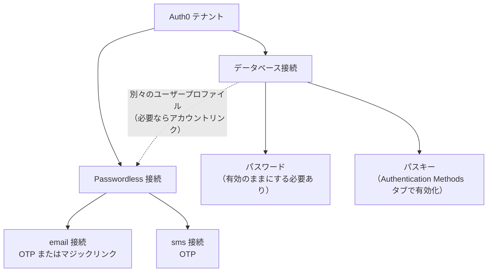
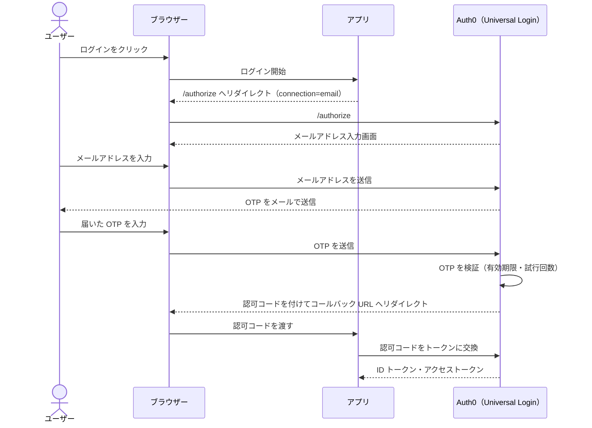

# 【勉強】Okta Customer Identity Cloud (Auth0) — パスワードレス認証（パスキー・Passwordless 接続（メール／SMS OTP））（2026-11-17）

## 今日のテーマ

Auth0 で「パスワードを使わないサインイン」を実現する 2 つの仕組みを学びます。1 つ目は **データベース接続のパスキー**、2 つ目は **Passwordless 接続（メール／SMS のワンタイムパスコード）** です。

> 前提：11/13 の Entra ID 編、11/15 の Okta 編、11/16 の Ping Identity 編と同じテーマです。Workforce 向けの 3 製品は「社員のサインインをどう強くするか」というポリシー設計が中心でした。Auth0 は顧客向け（CIAM）なので、**ログイン画面（Universal Login）と「接続（Connection）」の種類**で表現する点が大きく違います。

## 概要 — Auth0 の 2 つのパスワードレス

Auth0 では、ユーザーの認証元を **接続（Connection）** という単位で管理します。8/13 のユーザー／グループ管理編で見たとおり、ID とパスワードを Auth0 に保存する「データベース接続」、Google などの「ソーシャル接続」、SAML／OIDC の「エンタープライズ接続」があります。パスワードレスはこの接続の考え方の上に、次の 2 通りで実装されます。

- **パスキー**：**データベース接続の追加機能**です。パスワードで登録したユーザーが、同じアカウントにパスキーを追加できます。
- **Passwordless 接続**：`email` と `sms` という**独立した接続タイプ**です。メールアドレスや電話番号を入力すると、ワンタイムパスコード（OTP、一度だけ使える使い捨ての暗証番号）が届きます。

次の図は、2 つの方式が接続のどこに位置するかを表しています。



インフラの方向けに言い換えると、パスキーは「SSH の公開鍵認証を既存アカウントに追加する」イメージ、Passwordless 接続は「ワンタイムパスワード専用の別の認証基盤を立てる」イメージです。

## 押さえる要点

### 1. パスキー（データベース接続）

**前提条件**（公式の Configure Passkey Policy より）

- テナント側：**Universal Login**（Auth0 がホストするログイン画面）を使うこと、**Identifier First**（最初に識別子だけを入力させ、次の画面で認証方法を選ぶログイン方式）を有効にすること、カスタムログインページを無効にすること。
- データベース接続側：「ユーザー名必須」を無効にする（または Flexible Identifiers を有効にする）こと。「独自データベースを使う（Use your own database）」を無効にするか、ユーザーインポートを有効にすること。
- **パスワードは無効にできません**。パスキー非対応のブラウザーや古い端末からもアクセスできるようにするためです。
- カスタムドメインは必須ではありませんが**推奨**です。パスキーはドメインに紐づくため、後からドメインを変えると既存のパスキーが使えなくなります。

**主な設定**（Authentication > Database > 対象の接続 > Authentication Methods タブ > Passkey の Configure）

- **Enable passkeys**：パスキーを有効にします。
- **Passkey Authentication UI**：「Passkey button & autofill」「Autofill」「Passkey button」の 3 択です。Autofill は、ブラウザーの入力候補からパスキーを選ばせる方式です。
- **Progressive Enrollment**（既定オン）：パスワードでログインしたユーザーにパスキー作成を促します。ユーザーは 30 日ごとに先送りできます。
- **Local Enrollment**（既定オン）：別の端末のパスキー（クロスデバイス）でログインしたとき、今使っている端末にもパスキーを作るよう促します。スキップも可能です。

**その他**

- 対応するのは**データベース接続のみ**です。1 ユーザーあたり最大 **20 個**まで登録できます。
- **Relying Party ID**（パスキーが紐づくドメイン）は Tenant Settings の「Relying Party IDs」タブで設定します。親ドメイン（例: example.com）にすると、サブドメイン間で同じパスキーを使えます。

### 2. パスキーと MFA の関係

ここは他製品と考え方が異なるので注意が必要です。Auth0 では、MFA を有効にしていると、**既定ではパスワードでもパスキーでもログイン後に MFA を求めます**（公式は「設定やリスク評価によっては、パスキーでのサインイン後にも MFA を求められることがある」と説明しています）。パスキーでログインしたときに MFA を省略したい場合は、post-login Action（ログイン後に実行される Auth0 のスクリプト）で制御する方法が公式に紹介されています。

### 3. Passwordless 接続（メール／SMS）

- **方式**：メールは **OTP** と **マジックリンク**（メール内のリンクをクリックするだけでログインする方式）の 2 種類、SMS は OTP のみです。
- **Universal Login での対応**：Universal Login がネイティブに対応するのは **OTP** です。**マジックリンクは Universal Login では使えず**、Classic Login（旧来のログイン画面）でのみ実装できます。なお参考リンクの「Configure Email or SMS…」には「Universal Login でマジックリンク」とも読める記述がありますが、これは Custom Login Page をオンにして Lock (passwordless) テンプレートを使う構成で、実質 Classic Login 側の話です。
- **ユーザープロファイルは別**：`email`／`sms` 接続のユーザーは、データベース接続のユーザーとは**別のプロファイル**として作られます。同一人物として扱いたい場合はアカウントリンクを使います。
- **OTP のルール**：既定の有効期限は **3 分**です。有効なのは最後に発行した OTP だけで、**失敗は 3 回まで**です。有効期限を延ばす場合は、推測されにくくするため OTP の桁数も増やすよう公式は勧めています。
- **送信プロバイダー**：Auth0 既定のメール送信はテスト用で、テンプレートのカスタマイズもできません。本番では独自のメールプロバイダー（Amazon SES、SendGrid、カスタム SMTP など）を設定します。SMS は Twilio か、Actions を使ったカスタムプロバイダーを Branding > Phone Provider で設定します。
- **Disable Sign Ups**：既存ユーザーだけにログインを許可する設定です。公式は、ユーザー列挙攻撃（存在するアカウントを探られる攻撃）につながりうると注意しています。

## 手順や設定のイメージ

**パスキーを有効にする**

1. Authentication > Authentication Profile で **Identifier First** を選びます。
2. （推奨）カスタムドメインを先に設定しておきます。
3. Authentication > Database > 対象の接続 > **Authentication Methods** タブで、Passkey の **Configure** を開き、**Enable passkeys** をオンにして保存します。保存できない場合は、パネル上部の前提条件の表示を確認します。

**メール OTP の Passwordless 接続を作る**

1. Authentication > Passwordless で **Email** をオンにし、Settings で From・件名・本文、OTP Expiry、OTP Length を設定します（From に `auth0.com` ドメインを使うと既定テンプレートで送られます）。
2. Applications ビューで、この接続を使うアプリを有効にします。
3. データベース接続も有効なアプリでは、`/authorize` に `connection=email` を付けて呼び出します。

```text
https://{テナントのドメイン}/authorize?
  response_type=code&
  client_id={クライアントID}&
  redirect_uri={コールバックURL}&
  scope=openid profile email&
  connection=email
```

次の図は、Universal Login でメール OTP を使ったログインの流れです。Auth0 とアプリのやり取りは、**認可コードを受け取るまでブラウザーのリダイレクトを経由**します。



## つまずきやすいところ・注意点

- **パスキーでも既定では MFA が求められる**：Entra ID や Okta の感覚で「パスキーなら MFA 済み」と考えると、ログイン後に MFA を二重に求められて驚きます。必要なら Action で制御します。
- **ドメインは最初に決める**：カスタムドメインや Relying Party ID を後から変えると、既存のパスキーは使えなくなり、再登録が必要です。
- **プロファイルの重複**：同じメールアドレスでもデータベース接続と `email` 接続は別ユーザーになります。メールアドレスや電話番号を変えたときにも重複が起きうるため、アカウントリンクの設計が必要です。
- **マジックリンクは Classic Login 専用**：さらに、リンクを要求したブラウザーと開いたブラウザーが同じでないと失敗します（例: メールアプリから別ブラウザーで開いたとき）。
- **SSO の挙動**：`email`／`sms` 接続を指定したログインは既存の Auth0 セッションを使わないため、ユーザーは再度ログインを求められます。
- **フィッシング耐性**：OTP はパスワードをなくせますが、入力したコードを偽サイトに中継される可能性は残ります。ドメインに紐づく公開鍵暗号を使うパスキーの方がフィッシングに強い、というのが WebAuthn の一般的な性質です。

## 今日のまとめ

**ミニ辞書**

- **接続（Connection）**：Auth0 での認証元の単位。データベース・ソーシャル・エンタープライズ・Passwordless がある。
- **Identifier First**：最初に識別子だけを入力させるログイン方式。パスキーと Universal Login での Passwordless に必要。
- **Progressive Enrollment**：パスワードでログインしたユーザーにパスキー作成を促す設定。
- **Passwordless 接続**：`email`／`sms` の OTP（メールはマジックリンクも）でログインさせる独立した接続。
- **Relying Party ID**：パスキーが紐づくドメイン。

**理解度チェック**

1. Auth0 でパスキーを有効にしたデータベース接続で、パスワードを無効にできないのはなぜですか。
2. MFA を有効にしたテナントで、パスキーでログインしたユーザーに MFA を求めないようにするにはどうしますか。
3. データベース接続のユーザーが、同じメールアドレスで `email` 接続からログインすると、ユーザープロファイルはどうなりますか。

## 参考リンク

- [Passkey Authentication for Database Connections（Auth0 Docs）](https://auth0.com/docs/authenticate/database-connections/passkeys)
- [Configure Passkey Policy（Auth0 Docs）](https://auth0.com/docs/authenticate/database-connections/passkeys/configure-passkey-policy)
- [Passwordless Connections（Auth0 Docs）](https://auth0.com/docs/authenticate/passwordless)
- [Configure Email or SMS for Passwordless Authentication（Auth0 Docs）](https://auth0.com/docs/authenticate/login/auth0-universal-login/passwordless-login/email-or-sms)
- [Passwordless with Universal Login（Auth0 Docs）](https://auth0.com/docs/authenticate/passwordless/passwordless-with-universal-login)
- [Email OTP（Auth0 Docs）](https://auth0.com/docs/authenticate/passwordless/authentication-methods/email-otp)
- [SMS OTP（Auth0 Docs）](https://auth0.com/docs/authenticate/passwordless/authentication-methods/sms-otp)
- [Email Magic Link（Auth0 Docs）](https://auth0.com/docs/authenticate/passwordless/authentication-methods/email-magic-link)
