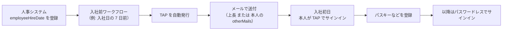
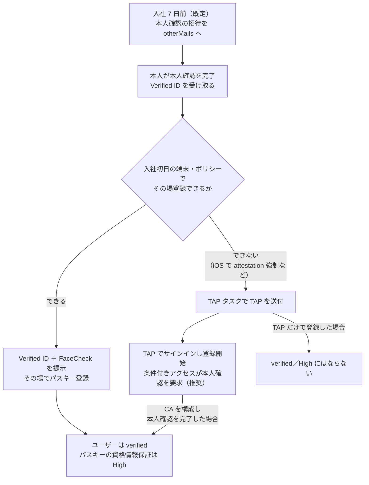

# 【勉強】IGA（アイデンティティガバナンス＆管理）— パスワードレス・オンボーディング（ライフサイクルワークフローによる TAP 自動発行・本人確認付き入社フロー）（2026-11-18）

## 今日のテーマ

IGA の仕組みで「入社初日からパスワードを使わずに始められる」オンボーディングを自動化する方法を学びます。題材は Microsoft Entra ID Governance の **ライフサイクルワークフロー（Lifecycle Workflows）** です。中心は、入社前に **一時アクセスパス（TAP）** を自動で発行して届けるタスクです。あわせて、プレビュー中の **本人確認（Verified ID）付きオンボーディング** の考え方も押さえます。

> 前提：11/13 の Entra ID 編、11/15 の Okta 編、11/16 の Ping Identity 編、11/17 の Auth0 編と同じ「パスワードレス」テーマの IGA 版です。前の 4 本は「認証の仕組みとポリシー」の話でした。今日は「新入社員に最初の資格情報を、いつ・誰に・どう渡すか」という **ライフサイクルの運用** の話です。8/14 の Joiner／Mover／Leaver 編で一行だけ触れた「入社前に TAP を発行して渡す」構成を掘り下げます。

## 概要 — なぜ IGA がパスワードレスに関わるのか

パスワードレス化で必ず出てくるのが「**最初の 1 個目の資格情報をどう渡すか**」という問題です。11/13 で見たとおり、パスキーを登録するには先に何らかの認証が必要です。しかし新入社員は、まだ何の認証方法も持っていません。そこで、管理者が期限付きのパスコードである TAP を発行し、それでサインインしてパスキーを登録してもらいます。

ここで手作業が残ると、入社のたびにヘルプデスクが TAP を発行し、メールやチャットで手渡しすることになります。人数が増えると、発行漏れや期限切れ、誤送信が起きやすくなります。

ライフサイクルワークフローは、人事データの **入社日（employeeHireDate）** などの属性をきっかけに、決まったタスクを自動実行する IGA の機能です。インフラの方向けにたとえると、「入社日を入力しておくと、cron ジョブが入社日の数日前や当日に、決まった初期化スクリプトを流してくれる」仕組みです。その中に「TAP を発行してメールで送る」組み込みタスクがあります。

次の図は、入社前から初日までの流れを表しています。

## 押さえる要点

### 1. 入社前テンプレート「Onboard pre-hire employee」

- ライフサイクルワークフローには用途別のテンプレートがあります。**Onboard pre-hire employee（入社前の従業員のオンボーディング）** の既定は、入社日の **7 日前**（Days from event = -7、Before、employeeHireDate）に実行され、タスクは **Generate TAP And Send Email** の 1 つです。日数とタスクは変更できます。
- 公式チュートリアルでは、営業部（department = Sales）のユーザーを対象に、入社日の 2 日前に実行する例が紹介されています。
- 対象ユーザーの絞り込み（スコープ）は、トリガーの種類で変わります。日付属性や属性変更をトリガーにする場合は部署などの属性によるルール、グループのメンバー変更をトリガーにする場合はグループで指定します。

### 2. TAP 発行タスクの設定項目

管理センターでは、次の 2 つを必ず設定します。

- **Activation duration（有効期間）**：TAP が有効な時間です。タスクとしては最短 10 分、最長はおよそ 30 日です（公式ドキュメント内で 43,000 分と 43,200 分の表記揺れがあり、上限の正確な値は要確認）。さらに、**テナントの TAP ポリシーで許可された範囲内** に収める必要があります。
- **One time use（1 回限り）**：1 回だけ使えるか、有効期間内なら何度でも使えるかを選びます。

送り先も選べます。

- タスク名は「…send via email to user's manager（上長にメールで送る）」ですが、**送り先は変更可能**です。**To recipient** を **User**、**To recipient email address property** を **otherMails**（本人の個人メールなど、社外のアドレスを入れておく属性）にすれば、本人に直接届けられます。
- 本文はカスタマイズでき、`{{temporaryAccessPass}}` という差し込み項目で TAP の値を埋め込めます。

### 3. TAP の開始時刻は「入社日」

- 発行された TAP の **有効開始時刻は、ユーザーの employeeHireDate** です。ワークフロー実行時点で入社日が過ぎていれば、現在時刻が開始時刻になります。
- つまり、7 日前にメールが届いても、TAP 自体は入社日まで使えません。入社日に有効になり、そこから有効期間が数えられます。

### 4. 前提条件（ここで失敗しやすい）

- テナントで **TAP の認証方法ポリシーが有効** で、そのユーザーが TAP を使える対象に入っていること。TAP を「発行できる」ことと「使える」ことは別です。
- 上長宛てに送る場合は、ユーザーの **manager（上長）** 属性と、上長の **mail** 属性が入っていること。
- 本人の otherMails 宛てに送る場合でも、**既定のメール本文を使うなら manager 属性は必要**です（上長の mail は不要）。本文をカスタマイズすれば、この manager の要件はなくなります。
- **重要**：このタスクの対象ユーザーは、**他の認証方法、サインイン履歴、Microsoft Entra のロール割り当てを持っていてはいけません**。つまり「まっさらな新規アカウント」専用のタスクです。
- ライセンスは **Microsoft Entra ID Governance** または **Microsoft Entra Suite** が必要です。

### 5. 実行タイミングの仕組み

- ワークフローは作成時に有効ですが、**スケジュール実行は手動でオンにする** 必要があります（チュートリアルには「作成すると 3 時間ごとに自動実行される」とも読める記述があり、ドキュメント間で表現が揺れています。実際の画面で Scheduled 列を確認してください）。
- スケジュールが有効になると、既定では **3 時間ごと** に条件に合うユーザーがいないか評価されます。間隔は 1〜24 時間で変更できます（テナント共通の設定）。
- テスト時は **Run on demand（オンデマンド実行）** で、特定ユーザーに即時実行できます。オンデマンド実行は実行条件を満たしているかどうかを問わずタスクを適用します。また、ワークフロー自体が無効だとオンデマンド実行もできません。

### 6. （プレビュー）本人確認付きオンボーディング

TAP をメールで送るだけでは、「メールを受け取った人が本当に本人か」は保証されません。そこで、Verified ID（デジタルの身分証明）を使う **プレビュー** のテンプレートが用意されています。

- **Pre-hire identity verification initiation (Preview)**：入社日の 7 日前（既定）に、本人の otherMails へ本人確認の招待を送ります。本人はメールのワンタイムパスコードで招待リンクを開き、本人確認を済ませて Microsoft Authenticator に Verified ID を受け取ります。
- **New Hire employee onboarding with identity verification (Preview)**：入社日当日に、アカウントを有効化し、Verified ID と FaceCheck（顔照合）の提示を求め、その流れの中でパスキーを登録させます。
- iOS で attestation（認証器の正当性証明）を強制している場合や、Android の仕事用プロファイルに登録したい場合は、この「その場で登録」が使えません（Android では、その場登録のパスキーは個人用プロファイル側に作られます）。その場合は TAP タスクに差し替え、**条件付きアクセスで「セキュリティ情報の登録」に「本人確認を要求」** をかけることが推奨されています。
- なお、すでに強い認証方法を持つユーザーは、その場登録ではなく通常の My Sign-ins の登録画面に誘導されます。

次の図は、プレビューの本人確認付きフローで、入社初日の登録経路が 2 通りあることを表しています。

## 手順や設定のイメージ（入社前 TAP ワークフロー）

1. 認証方法ポリシーで **Temporary Access Pass** を有効にし、新入社員が対象に入るようにする（11/13 の Entra ID 編を参照）。
2. 人事連携（HR 主導プロビジョニングなど）で、employeeHireDate、department、manager、必要なら otherMails を正しく入れる。
3. Microsoft Entra 管理センターに **Lifecycle Workflows Administrator** 以上でサインインし、**ID Governance** > **Lifecycle workflows** > 新しいワークフロー > **Onboard pre-hire employee** を選ぶ。
4. **Basics** で実行タイミング（Days from event）を決め、**Configure scope** で対象ルール（例: department が Sales）を指定する。
5. **Review tasks** で TAP タスクを開き、Activation duration、One time use、送り先を設定する。
6. スケジュールはオフのまま作成し、テストユーザーで **Run on demand** を実行して、**Workflow history** でタスクの成否を確認する。
7. 問題なければ、ワークフローのプロパティで **Enable Schedule** をオンにする。

## つまずきやすいところ・注意点

- **「まっさらなアカウント」でないと失敗する**：他の認証方法、サインイン履歴、ロール割り当てのあるユーザーにはこのタスクが効きません。検証で使い回したテストアカウントで失敗しがちです。
- **時刻とタイムゾーン**：employeeHireDate の **時刻部分** が実行タイミングに影響します。ワークフローは属性の時刻より前には動かず、さらにスケジュール間隔（既定 3 時間）の分だけ遅れることがあります。公式ドキュメントでは、入社日の時刻は午前 1 時や 5 時など一日の早い時間にすること、TAP を使う場合は最大有効期間を 24 時間にしてタイムゾーン差で期限切れにならないようにすることが推奨されています。
- **TAP ポリシーの範囲外の値は使えない**：タスクで長い有効期間を指定しても、テナントの TAP ポリシーの上限を超えていれば使えません。
- **メール送付は本人確認ではない**：TAP をメールで送っただけでは、受け取った人が本人である保証はありません。公式ドキュメントでも、TAP の発行やサインインだけでは本人確認済みの状態や High の資格情報保証にはならないと明記されています。上長経由で手渡すか、本人確認（プレビュー）や条件付きアクセスと組み合わせるかを、リスクに応じて決めます。
- **ゲストは別扱い**：内部ゲストには TAP を発行できますが、外部ゲストにはリソーステナントで TAP を発行できません。また、ゲストはパスキーを登録できません。
- **本人確認付きテンプレートはプレビュー**：本番に組み込む前に、プレビューの条件と最新のドキュメントを確認してください。

## 今日のまとめ

### 重要用語のミニ辞書

- **ライフサイクルワークフロー（Lifecycle Workflows）**：入社・異動・退職などのイベントをきっかけに、決まったタスクを自動実行する Entra ID Governance の機能。
- **employeeHireDate**：ユーザーの入社日を表す属性。入社前・入社日のワークフローの起点になり、TAP の有効開始時刻にもなる。
- **TAP（一時アクセスパス）**：最初の資格情報の登録や復旧のために発行する、期限付きのパスコード。
- **otherMails**：ユーザーの代替メールアドレスを入れる属性。入社前の本人（個人メール）へ送るときに使う。
- **Verified ID**：検証済みの身元情報を、ユーザーが Microsoft Authenticator に保持するデジタル証明書。
- **資格情報保証（Credential assurance）**：登録されたパスキーがどれだけ確かな手順で作られたかの分類（High／Medium／Low）。

### 理解度チェック

1. 入社日の 7 日前にワークフローが TAP を発行しました。この TAP は、メールが届いた当日から使えますか。
2. 以前の検証でサインインしたことがあるテストアカウントに TAP タスクを実行したところ失敗しました。考えられる原因は何でしょうか。
3. 「TAP を本人の個人メールに送れば、本人確認は済んでいる」と言えないのはなぜでしょうか。プレビュー機能ではどう補っていますか。

## 参考リンク

- Lifecycle Workflow built-in tasks — https://learn.microsoft.com/entra/id-governance/lifecycle-workflow-tasks
- Lifecycle Workflows templates and categories — https://learn.microsoft.com/entra/id-governance/lifecycle-workflow-templates
- Automate employee onboarding tasks before their first day of work with the Microsoft Entra admin center — https://learn.microsoft.com/entra/id-governance/tutorial-onboard-custom-workflow-portal
- Onboard users with identity verification (Preview) — https://learn.microsoft.com/entra/id-governance/how-to-onboard-users-with-identity-verification
- How to synchronize attributes for Lifecycle workflows（Importance of time） — https://learn.microsoft.com/entra/id-governance/how-to-lifecycle-workflow-sync-attributes
- Customize the schedule of workflows — https://learn.microsoft.com/entra/id-governance/customize-workflow-schedule
- Understanding lifecycle workflows — https://learn.microsoft.com/entra/id-governance/understanding-lifecycle-workflows
- Configure the arguments for built-in Lifecycle Workflows tasks — https://learn.microsoft.com/graph/identitygovernance-lifecycleworkflows-task-arguments
- Passkeys (FIDO2) in Microsoft Entra ID（ゲストユーザーの制限） — https://learn.microsoft.com/entra/identity/authentication/how-to-authentication-passkeys-fido2
- Configure Temporary Access Pass to register passwordless authentication methods — https://learn.microsoft.com/entra/identity/authentication/howto-authentication-temporary-access-pass
