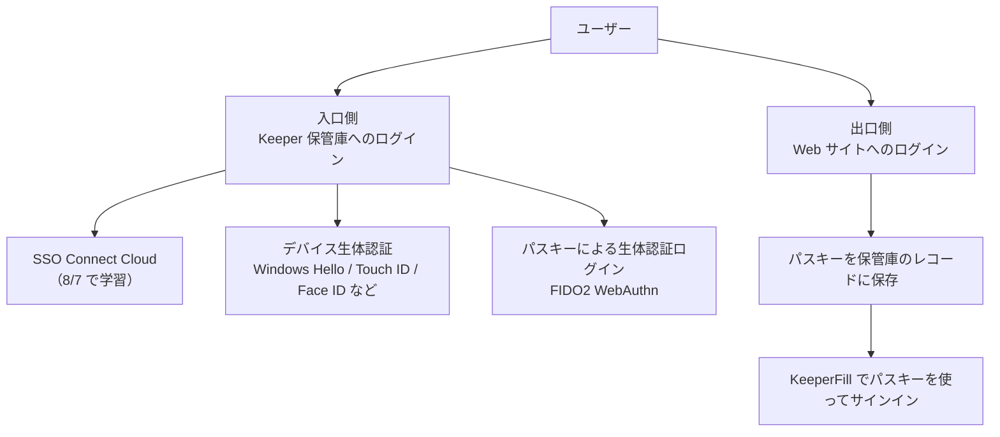
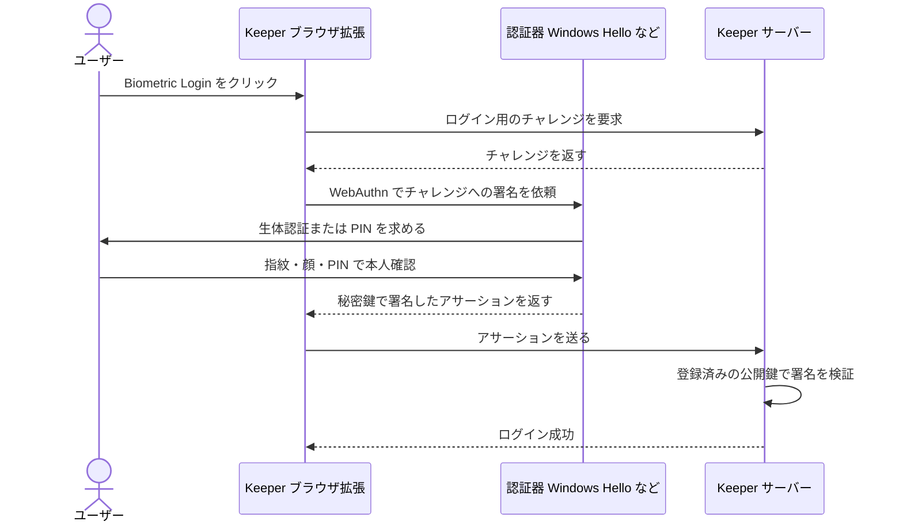

# 【勉強】Keeper — パスワードレス（パスキーによる生体認証ログイン・デバイス生体認証・パスキーの保管）（2026-11-19）

## 今日のテーマ

Keeper における「パスワードレス」を学びます。Keeper の場合、パスワードレスには 2 つの意味があります。1 つは **Keeper 自体にマスターパスワードなしでログインすること**、もう 1 つは **Keeper が Web サイト用のパスキーを保管・入力すること** です。今日はこの 2 つを分けて整理します。

> 前提：11/13 の Entra ID 編、11/15 の Okta 編、11/16 の Ping Identity 編、11/17 の Auth0 編、11/18 の IGA 編と同じ「パスワードレス」テーマの Keeper 版です。8/7 の SSO Connect Cloud 編で見た「SSO ならマスターパスワードが不要」という話も、広い意味でのパスワードレスです。今日はそれ以外の方法、つまり生体認証とパスキーを中心に扱います。9/4 のエンフォースメントポリシー編で一行だけ触れた「パスキーによるログイン」を掘り下げます。

## 概要 — Keeper にとってのパスワードレスは 2 方向ある

ほかの 4 製品（Entra ID、Okta、PingOne、Auth0）は IdP（ユーザーを認証してアプリにログインさせるサービス）でした。そのため「IdP にどうやってパスワードなしでサインインするか」が中心でした。

Keeper はパスワード管理製品です。そこで、次の 2 つの方向があります。

- **入口側**：Keeper の保管庫（Vault）を、マスターパスワードを打たずに開く。方法は SSO、デバイスの生体認証、パスキーによる生体認証ログインの 3 系統です。
- **出口側**：ユーザーが使う Web サイトのパスキーを、Keeper の保管庫に保存して、ログイン時に Keeper から使う。

次の図は、この 2 方向の全体像です。



> 用語メモ：**パスキー**は、FIDO2／WebAuthn という標準に基づく「公開鍵ペアを使ったログイン方法」です。秘密鍵は端末側に残り、サーバーには公開鍵だけを登録します。ログイン時はサーバーが出した「チャレンジ」（使い捨ての乱数）に秘密鍵で署名して返します。インフラの方には「SSH の公開鍵認証を、ブラウザと生体認証でやるもの」とたとえると近いです。

## 押さえる要点

### 1. デバイス生体認証（Device Biometrics）

- Keeper のデスクトップアプリやモバイルアプリで、Windows Hello、Touch ID、Face ID、Android の生体認証を使って保管庫を開く機能です。
- 暗号化モデルのドキュメントによると、生体認証を有効にすると、端末上でランダムな鍵が生成され、OS の安全な保管領域（キーチェーンやキーストア）に保存されます。ユーザーの **データキー**（保管庫を復号するための鍵）はこの鍵で暗号化されます。生体認証に成功すると、この鍵を取り出してデータキーを復号します。
- Keeper は生体情報そのものを保存も処理もせず、OS の生体認証機能を利用するだけです。
- 有効化は、ログイン済みの保管庫から行います。たとえば Windows Hello の場合は、デスクトップアプリのアカウントメニュー → Settings → Security で「Windows Hello Login」をオンにします。SSO ユーザーも、デスクトップアプリに SSO でログインした後、同じ画面から Windows Hello や Touch ID を有効にできます。
- 管理者側では、エンフォースメントポリシーの Login Settings にある **Device Biometrics** で許可・不許可を制御します。このポリシーの説明には「2FA はデバイス生体認証に加えて強制される」と書かれています。つまり、**デバイス生体認証はマスターパスワード（または SSO）の代わりにはなるが、2FA の代わりにはならない** という位置づけです。

### 2. パスキーによる生体認証ログイン（Biometric Login with Passkeys）

- 2025 年 7 月のブラウザ拡張機能 17.2 で追加された機能です。FIDO2／WebAuthn のパスキーで Keeper にログインします。
- リリースノートでは「従来のすべてのログイン方法を置き換える、デバイスに紐づいたパスキー」と説明されています。**一次要素（マスターパスワードや SSO）と二次要素（TOTP、SMS、Duo などの 2FA）の両方を満たす** とされている点が、デバイス生体認証との大きな違いです。
- 対応ブラウザは Chrome、Edge などの Chromium 系です。17.2 のリリースノートでは、Firefox は Firefox 147 または 148 で対応予定、Safari は Apple のネイティブなパスキー対応待ちとされていました。2025 年 11 月の 17.4.0 でも「Chromium 系ブラウザに限定」と書かれており、現在の Firefox／Safari の対応状況は **要確認** です。
- パスキー自体は OS や端末側に保存されます。リリースノートでは、Windows Hello なら TPM（PC に載っている暗号処理用チップ）、Apple の iCloud キーチェーンなら Secure Enclave に保存されると説明されています。
- 次回以降は、ログイン画面の「Biometric Login」をクリックしてログインします。マスターパスワードや SSO のログインも引き続き使えます。
- 2025 年 10 月の 17.3 では、パスキーでログインすると生体認証ログインが自動で有効になること、生体認証ログインをオフにすると関連するパスキーが Keeper アカウントからすべて削除されることが追記されました。
- 2026 年 5 月の 17.10.0 では、YubiKey などの **外部セキュリティキー** も使えるようになりました。一次要素としてのパスキー要求では、ユーザー検証（生体認証や PIN）が必須です。
- コマンドラインツールの Commander（PowerShell 版）でも、Windows Hello による生体認証ログインに対応しています（Windows 11 以上が必要）。

次の図は、パスキーによるログインの流れです。WebAuthn の一般的なチャレンジ・レスポンスの形で描いています。



> 注意：署名の検証後に、保管庫のデータキーがどのように端末へ届けられ復号されるかは、暗号化モデルのドキュメントに明記されていませんでした（**要確認**）。図はログインの認証部分だけを表しています。

### 3. 管理者のエンフォースメントポリシー

- 場所は **Roles → Enforcement Policies → Login Settings** です。
- リリースノート 17.2 によると、パスキーによる生体認証ログインは **既定ですべてのユーザーに有効** です。使わせたくない組織は、管理者がポリシーで無効にする必要があります。
- エンフォースメントポリシーのドキュメントには **Passkey Authentication** の項目があり、次の選択肢が説明されています。
  - パスキーログインの許可・無効化
  - パスキーとしてセキュリティキーを必須にする
  - デバイス上の認証器のみを必須にする
- リリースノート 17.10.0 では、管理コンソール 17.9.1 で「パスキー認証の新しい強制コントロール」が入ると書かれています。上の選択肢はこれに対応すると考えられますが、ポリシー名の表記（Biometric Login with a Passkey と Passkey Authentication）がドキュメント間で揺れています。管理コンソール上の実際の表示名は **要確認** です。
- 17.10.0 のリリースノートには、Commander から設定するためのポリシーキーとして `RESTRICT_PLATFORM_PASSKEY_LOGIN`（セキュリティキーのみに限定）と `RESTRICT_CROSS_PLATFORM_PASSKEY_LOGIN`（端末内蔵の認証器のみに限定）が載っています。どちらも設定しなければ、両方の方式が使えます。
- **Device Biometrics** と **Passkey Authentication** は別の項目です。前者は 2FA と組み合わせて使い、後者は 2FA の代わりにもなります。

### 4. Web サイト用のパスキーを保管する（出口側）

- Keeper は、Web サイトのパスキーを保管庫の **レコードの Passkey フィールド** として保存します。フィールドには作成日、ユーザー名、リライングパーティ（パスキーを使うサイト）が表示されます。
- 作成：サイトの「パスキーを作成」ボタンを押すと、Keeper が割り込んで保管庫への保存を提案します。
- 利用：サイトで「パスキーでサインイン」を選び、KeeperFill のウィンドウで「Use Passkey」を押します。
- パスキーを保存したレコードは、ほかのレコードと同様にフォルダに入れたり、**ほかのユーザーと共有したり** できます。
- モバイルでは Android 14 以上、iOS 17 以上が必要です。Android は「パスワード、パスキー、アカウント」の設定で Keeper を優先する自動入力サービスにします。iOS は「設定 → パスワード → パスワードオプション」で「パスワードとパスキーを自動入力」をオンにして Keeper を選び、ドキュメントの推奨に従って iCloud パスワードとキーチェーンを外します。
- パスキーに対応したサイトでしか使えない点は、ほかのパスキー管理と同じです。

## 手順や設定のイメージ

管理者として最初に確認したいのは、「既定で有効」になっているパスキーログインを組織として使わせるかどうかです。

1. 管理コンソールで **Roles** から対象ロールを開き、**Enforcement Policies → Login Settings** を表示します。
2. **Device Biometrics**（デバイス生体認証）と、パスキーログインの項目（Passkey Authentication）の設定を確認します。
3. パスキーログインを許可する場合は、セキュリティキーのみに限定するか、端末内蔵の認証器のみに限定するかを決めます。
4. ユーザー側では、ブラウザ拡張機能（Chromium 系）のログイン画面から生体認証ログインを設定し、次回から「Biometric Login」でログインします。

Commander（PowerShell 版）を使う場合、ログイン済みの状態で次のコマンドを実行すると、Windows Hello のパスキーを登録できます。

```powershell
# ログイン済みのユーザーに対して Windows Hello のパスキーを登録する
Register-KeeperBiometricCredential

# 登録済みの生体認証用パスキーを一覧表示する
Show-KeeperBiometricCredentials
```

## つまずきやすいところ・注意点

- **「既定で有効」に気づかない。** パスキーログインは 2FA の代わりにもなるため、組織の MFA 方針とずれる可能性があります。導入前にポリシーを確認しましょう。
- **デバイス生体認証とパスキーログインを混同する。** 前者は 2FA が別途かかり、後者は 2FA の要件も満たします。名前が似ているので、ポリシー画面ではどちらの項目かを必ず確認してください。
- **SSO ユーザーへの影響。** パスキーログインは SSO の一次要素も置き換えるとされています。そうだとすると、パスキーでログインするときは IdP 側の条件付きアクセスや MFA を通らずに Keeper を開けることになると考えられます（ドキュメントの記述からの推論で、明記はされていません）。SSO 中心の組織ほど方針を決めておく必要があります。
- **生体認証ログインをオフにするとパスキーが消える。** 17.3 以降、オフにすると関連するパスキーが Keeper アカウントから削除されます。再び使うには登録し直しが必要です。
- **ブラウザの対応範囲。** パスキーによる生体認証ログインは Chromium 系ブラウザが対象です。Firefox や Safari の利用者がいる場合は、対応状況を確認してください。
- **共有パスキーの扱い。** Web サイト用のパスキーは共有できますが、共有すれば「その人だけが持つ鍵」ではなくなります。共有アカウントのような限られた用途に絞るのが無難です。

## 今日のまとめ

Keeper のパスワードレスは「Keeper に入る側」と「Keeper から Web サイトへ出る側」の 2 方向です。入る側では、2FA と組み合わせるデバイス生体認証と、2FA の要件も満たすパスキーログインを区別することが大切です。

### ミニ辞書

| 用語 | 意味 |
|---|---|
| パスキー | FIDO2／WebAuthn に基づく公開鍵ペアのログイン資格情報。秘密鍵は端末に残る |
| 認証器（Authenticator） | パスキーの秘密鍵を持ち、署名する仕組み。Windows Hello、Touch ID、YubiKey など |
| ユーザー検証 | 認証器が生体認証や PIN で「本人が操作している」ことを確かめること |
| データキー | Keeper の保管庫を復号するためのユーザーごとの鍵 |
| Device Biometrics | 端末の生体認証で保管庫を開く機能とそのポリシー。2FA は別途かかる |
| Biometric Login with Passkeys | パスキーで Keeper にログインする機能。一次要素と二次要素の両方を満たす |
| リライングパーティ（RP） | パスキーでログインさせる側のサイトやサービス |

### 理解度チェック

1. デバイス生体認証とパスキーによる生体認証ログインでは、2FA の扱いがどう違いますか。
2. パスキーによる生体認証ログインを組織で使わせたくない場合、管理者はどこで何をすればよいですか。
3. Web サイト用のパスキーを Keeper に保存するとき、モバイル端末に必要な OS のバージョンは何ですか。

## 参考リンク

- [Passkeys | Keeper User Guides](https://docs.keeper.io/en/user-guides/passkeys)
- [Enforcement Policies | Keeper Enterprise Guide](https://docs.keeper.io/en/enterprise-guide/roles/enforcement-policies)
- [Keeper Encryption Model | Keeper Enterprise Guide](https://docs.keeper.io/en/enterprise-guide/keeper-encryption-model)
- [Browser Extension Version 17.2 | Keeper Release Notes](https://docs.keeper.io/en/release-notes/browser-extensions/browser-extension/browser-extension-version-17.2)
- [Browser Extension Version 17.3 | Keeper Release Notes](https://docs.keeper.io/release-notes/browser-extensions/browser-extension/browser-extension-version-17.3)
- [Browser Extension Version 17.4.0 | Keeper Release Notes](https://docs.keeper.io/release-notes/browser-extensions/browser-extension/browser-extension-version-17.4.0)
- [Browser Extension Version 17.10.0 | Keeper Release Notes](https://docs.keeper.io/release-notes/browser-extensions/browser-extension/browser-extension-version-17.10.0)
- [Login to Keeper with Windows Hello | Keeper User Guides](https://docs.keeper.io/user-guides/tips-and-tricks/login-to-keeper-with-windows-hello)
- [Using Windows Hello or Touch ID with SSO | Keeper User Guides](https://docs.keeper.io/user-guides/tips-and-tricks/using-windows-hello-or-touch-id-with-sso)
- [Biometric Login | Keeper Commander（PowerShell）](https://docs.keeper.io/keeperpam/commander-cli/commander-installation-setup/installation-on-powershell/biometric-login)
